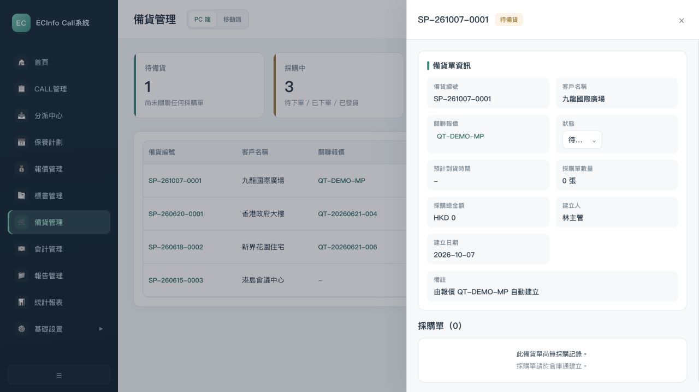
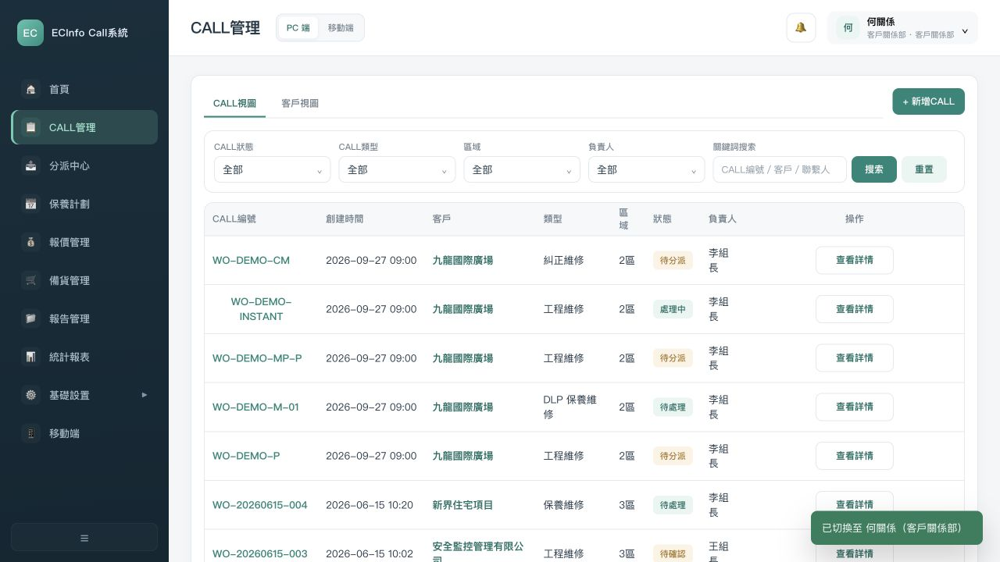
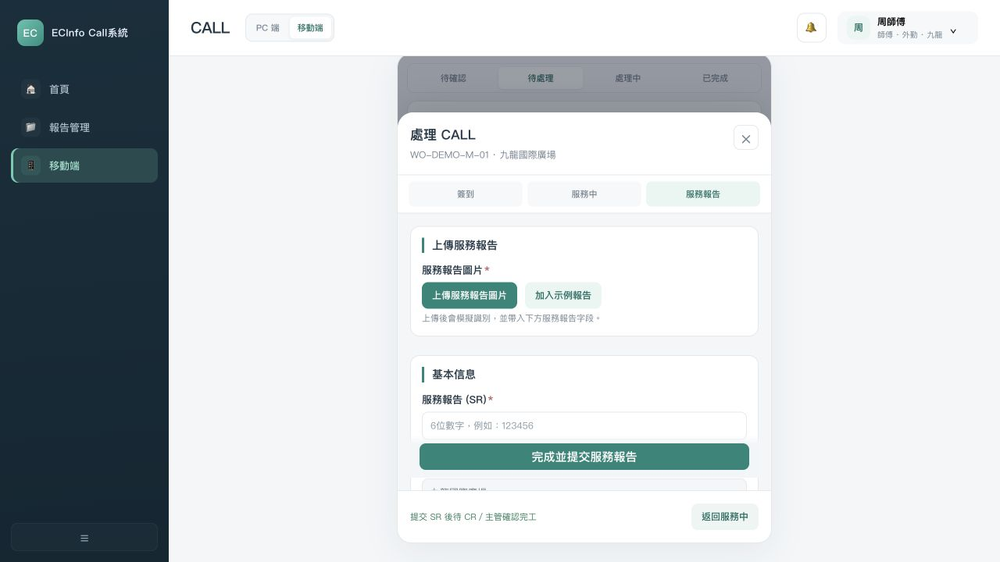

# EC 工单系统原型定版前全链路审计

审计日期：2026-10-07（Asia/Shanghai）。审计对象：当前 `prototype/`，以及项目中现存原始资料、历史版本、需求、流程、知识库、决策、交付工作簿与验收记录。**本轮只读，不修原型，不改需求，不补业务规则。**

本报告及其计算底稿、截图、提取文本、哈希清单都位于 `docs/audit/`。报告中的 AUD-R、ST、EX、P0/P1/P2 和审计用 FLOW 别名只用于审计定位，不创建正式需求或变更既有 FLOW。

## A. Executive Summary

**Prototype Finalization：NOT READY。**

不能定版的主要原因是：当前资料没有唯一且覆盖最新反馈的已批准范围；CS→CR/主管→报价和 MR→材料就绪→正式预约存在实际界面断点；区域权限、不可拍照豁免、多 SR 与财务特殊开票没有完整落实；9 月 28/30 日客户反馈未进入知识基线和全链 UAT。旧“7/7 PASS”仅证明当时七组模拟整改场景，不能证明当前原型或最新业务已被客户验收。

| 指标 | 结果 | 分子 / 分母 | 审计口径 |
| --- | ---: | ---: | --- |
| 需求完整度 | **32.6%** | 94 / 288 | 16 个业务域 × 18 类要求中，事实支持且能给出明确规则的 CONFIRMED 格；ASSUMPTION/CONFLICT/MISSING/PENDING 不计完整 |
| 原型业务覆盖度 | **0.0%** | 0 / 16 | 严格定版口径：真实职责从入口完成所需交接、出口及必要异常，且规则、权限一致才 Covered；16 组均有实质缺口，全部 Partial |
| 事实可追溯率 | **73.3%** | 44 / 60 | 60 项核心规则中能定位到直接客户资料 L1 或多个 L1 的 L2；只有项目文档/Decision/原型的 L3/L4 不计入 |
| 角色权限完整度 | **30.4%** | 34 / 112 | 14 个职责视角 × 8 项权限/责任检查中的 CONFIRMED 格；不是角色菜单出现比例 |
| 状态流完整度 | **8.3%** | 2 / 24 | 24 项关键迁移中，事实、角色、前置、动作、结果与记录对应完整；只有主干函数或模拟种子为 Partial |
| 异常流程完整度 | **0.0%** | 0 / 24 | 24 项异常中，须同时有入口、责任人、处理、结果、回流和记录；当前有部分异常按钮，但无一满足完整定版条件 |

这些百分比是**本轮明确检查集合下的定版完整度**，不是合同批准率、页面完成率、生产实现率或“系统什么都没做”。原型已存在大量页面、版本快照、角色菜单、现场记录和部分业务联动。0% 覆盖表示尚无一组完整满足本次严格定版条件；并不表示 0 个页面或动作可用。未执行的真实接口、外发、身份认证和客户 UAT 计入未证明部分，不冒充功能缺失。计算过程见 [审计明细台账](AUDIT-DETAIL-LEDGER.md) 与 `audit-model.json`。

**问题总量：P0 14 项、P1 22 项、P2 4 项；真正需要客户决定的事项 16 项。** P0 是定版阻塞，不自动等同需要客户决策，绝大部分是内部可以依据事实修复的缺口。

### A1. 当前可以保留并作为定版候选的内容

1. 电话、WhatsApp、现场、邮件的人工受理；客户中英文名称/别名搜索、来源可追溯。
2. 区域分派、师傅个人任务、现场签到、处理前后证据、客户签章、服务报告等业务骨架。不可拍照豁免已经明确，不能再把“是否豁免”当客户新问题。
3. 报价与服务执行是不同对象；报价可修订并保留历史。客户接受后进入材料和履约准备，完工与收款分开记录。
4. 周期保养与周期账单是不同业务节奏，不应直接互相替代。
5. 0928/0930明确提出的无报价手工 MR、仓管自主新增 MR、MR 三种状况、报价折扣/总价录入、SR 保固通知采购、Objective 筛选、CR 区域可见、人员双语搜索、正常/特殊开票规则，可作为明确的需求输入保留。

以上是**业务事实/明确诉求的保留判断**，不是整页、整模块获批。其字段细则、职责和验收仍按本报告缺口处理。9/27人工讨论中的自动MR、四报价入口、M整期计划、预排/正式时间、M+P并行可继续作为当前工作决策引用，但不能仅凭文件写“CONFIRMED”就宣称客户范围或全部细则已批准。

### A2. 四类范围

| 范围类别 | 本轮判断 |
| --- | --- |
| 当前交付范围 | 本轮仅交付审计报告；产品范围有明确工单/现场/商务诉求，尚缺唯一签署的 Prototype v1.0 范围，不能把全部80项都视为已批准 |
| 后续迭代范围 | 早期资料将报价、标书、深度仓储/财务接口及AI列为后续；后期已讨论其完整业务，但缺统一阶段批准，不能简单沿用旧二期标签 |
| 待确认范围 | 一期模块组合、岗位授权边界、CM冲突、现场收款、CP/SR适用、成交后变更、编号细则、续保比例、档案保留与通知渠道等，见E |
| 明确不做范围 | 宪法排除客户自助门户、实时定位监控、完整HR/薪酬绩效、未经确认的AI/OCR/WhatsApp自动抓取等；原始资料中的愿望/演示不撤销该边界。借用/升降机申请仅一句新诉求，暂不纳入既定范围 |

### A3. 定版门禁

Gate 1（需求冻结）不通过：当前范围不唯一、旧PRD与新业务模型矛盾、关键规则未决。Gate 2（原型冻结）不通过：MR交接、CS报价入口、权限、特殊开票等有实际阻塞。Gate 3（开发/交付启动）不通过：没有覆盖最新事实的可判定UAT及阻塞闭环记录。**这些结论不要求现在修改任何现有资料。**

## B. FLOW Coverage Matrix

### B1. FLOW 基线及版本关系

不能把任意一张“最新图”直接当批准流程。当前存在三套编号/粒度：历史 FLOW-001—012；9/26图册12组/16图；9/27 Project Hub 的 FLOW-MAIN、P、MAINT-ISSUE、INSTANT、M、CM、TENDER 七条。总流程是聚合视图，不与子流程重复计覆盖分母。本报告将独立交接/职责拆为16个审计域。

| 审计 FLOW | 业务基线 | 原编号 / 关系 | 入口→责任→动作→数据→正常出口 | 必要异常 / 下一职责 | 当前总判定 |
| --- | --- | --- | --- | --- | --- |
| FLOW-CALL | 来电/WhatsApp/直接需求 | FLOW-002 | CS记录来源/客户/地点→答疑/投诉/现场/报价分流→记录/CALL→CR/主管或结束 | 信息不全、投诉更新旧单、取消、重复；下一责任不能默认为建新单 | Partial：正常答疑和CS报价交接入口缺 |
| FLOW-DISPATCH | 首派、改派、团队申请 | FLOW-003 | CR/主管在授权范围选师傅→通知→收到/申请审核→任务历史 | 无人/请假/拒绝/跨区/申请撤回；交师傅或回主管 | Partial：角色范围、拒单及审批对象未冻 |
| FLOW-ONSITE | 到场、检查、处理 | FLOW-004 | 本人任务→到场签到→处理记录/证据→客户确认及SR | 不可拍照、客户不在、不能即时修、保固转采购 | Partial：豁免与保固分支缺 |
| FLOW-CLOSE | SR后内部完工确认 | FLOW-005、CONFIRMED-010 | 客户确认→师傅SR→CR/主管确认/退回→完工记录 | 缺签/退回/已完工重交；后续归档和财务独立 | Partial：权限、单据和重交状态不全 |
| FLOW-QUOTE | 商务报价生命周期 | FLOW-006 | 来源请求→报价组承接→版本沟通→客户接受→中单/丢单 | 未接受/修订/成交变更；交材料/保养/财务 | Partial：四入口不全、最新报价字段缺 |
| FLOW-MR | 材料申请与仓库交接 | FLOW-007A | 成交物料自动MR工作决策，另有无报价/仓管手工入口→库存/采购/备货 | 缺货/错货/取消/部分完成；交CR/Project/师傅 | Partial：MR实际入口和就绪信号断 |
| FLOW-P | 正式预约与施工 | FLOW-007B、FLOW-P | 材料完成→CR/主管确认客户正式时间→师傅施工→SR/确认 | 未就绪、改期、二次上门、新单/原单；交报告和财务 | Partial：材料Gate断、无CALL来源出口缺 |
| FLOW-M | 周期保养 | FLOW-M | M成交→整期计划→逐期CALL/排期→师傅保养→SR→本期确认→下一期 | 不到场/改期/续保/保养发现问题；交CR/报价 | Partial：种子计划可看，新建/续保及周期细则不足 |
| FLOW-MP | M+P | MAIN+M+P | 同一商业来源→M计划与P材料施工分开推进→各支单据及进度 | 一支缺料不能自动终止/推进另一支；取消/商务合流待定 | Partial：P支断、旧串行图仍存 |
| FLOW-MAINT-ISSUE | 保养发现二次维修 | FLOW-MAINT-ISSUE | 本期保养→SR发现问题→报价需求→中单→材料→二次上门SR/确认 | 多次报告/报价拒绝/缺货；保留原M合同来源 | Partial：第二份SR触发及多SR存档不足 |
| FLOW-INSTANT | 现场即时维修 | FLOW-INSTANT | 现场判断→客户接受/维修→SR/确认；现场款独立交接 | 价格授权、收费证明、交款/对账待定；报价/财务 | Partial：不能把现场收款自动入账作为既定规则 |
| FLOW-SR | SR/CP、报告与附件 | FLOW-008 | 报告录入/上传→业务对象关联→查询/补交→客户/会计资料包→归档 | 多SR、编辑、补签、不可拍照、外发失败和保留 | Partial：单SR覆盖/隐藏正本/无独立目的筛选 |
| FLOW-CM | CM直派及冲突 | FLOW-009、FLOW-CM | CR/主管指定→现场→SR→确认 | 与PM/其他任务冲突不自动决策；下一职责待明确 | Partial：主干保留、冲突规则未决 |
| FLOW-TENDER | 取得、回标、结果与履约 | FLOW-010、FLOW-TENDER | Tender取得/记录→报价/正式回标→结果→按M/P/M+P或无报价MR | 不投标/取消/未中标/延期/无报价；交对应业务负责人 | Partial：回标导出不可达、无报价分支缺 |
| FLOW-FINANCE | 开票、收款及会计 | FLOW-011 | 商务/服务证明→正常或特殊开票→发票/收据→独立收款跟踪 | 欠文件、低额原因、部分/超额/冲销、现场交款 | Partial：资料判据错误、特殊出口缺、M合约来源分裂 |
| FLOW-MASTER | 账号、角色、主档、合约 | FLOW-012 | 部门提供资料→授权维护→按本人/团队/区域显示数据→业务执行 | 重复客户、多合同、停用/交接、导入失败、访问拒绝 | Partial：记录级权限和核心对象模型不完整 |

### B2. 业务节点→需求→角色→UI→动作→状态→下一步

| FLOW ID | 业务流程 | 业务节点 | Requirement | 角色 | 需求状态 | 事实等级 | 原型页面 | UI Component → Action → State Change → Next Step | 原型覆盖 | 问题 | 定版阻塞 Y/N |
| --- | --- | --- | --- | --- | --- | --- | --- | --- | --- | --- | --- |
| FLOW-CALL | 客户受理与来电/CALL | C01 记录客户来电/WhatsApp | F006/008/009 | CS | CONFIRMED | L1 S04 | 首页/来电旧表单/客户视图 | 当前入口→新增CALL；电话内容→来源记录本应保留→CS处理 | PARTIAL | P0-02 旧来电字段/正常入口不统一 | Y |
| FLOW-CALL | 客户受理与来电/CALL | C02 答疑结束/投诉旧单更新 | F006/011/012 | CS/CR | MISSING | L1渠道、L3 SOP细则 | CALL详情/客户历史 | 仅编辑按钮；直接完成/催单/投诉回旧单不完整→CR | MISSING | P0-02 抽屉提前return | Y |
| FLOW-CALL | 客户受理与来电/CALL | C03 创建现场CALL | F007/009/073/079 | CS/CR | CONFLICT | L1 S05 | 新增CALL弹窗 | 提交CALL→待分派→CR/TL；JNO/合同仍错误绑定 | PARTIAL | P1-07/P0-13 | Y |
| FLOW-CALL | 客户受理与来电/CALL | C04 转交报价请求 | AUD-R029/F043 | CS→CR/TL→QUO | ASSUMPTION | L3 S07 | CALL/报价需求队列 | 请求对象待转交→无接收组件→不能进入QUO | BLOCKED | P0-02 | Y |
| FLOW-DISPATCH | 分派/改派/团队申请 | D01 区域候选/预排/首派 | F014/016/017/019/020 | CR/TL | CONFLICT | L1区域；L4推荐阈值 | 分派中心/派工抽屉 | 选师傅→待确认→通知师傅；实际用户区域/夜班例外缺 | PARTIAL | P0-05/P1-04 | Y |
| FLOW-DISPATCH | 分派/改派/团队申请 | D02 本人任务收到 | F022/026 | MASTER | CONFLICT | L1执行、L4不得拒绝 | 移动CALL待确认 | 收到→到场时间→待处理→现场；只收到/无拒绝细则 | PARTIAL | C-03/05；ST-05基本迁移可对应 | Y |
| FLOW-DISPATCH | 分派/改派/团队申请 | D03 团队申请/通过/不通过 | F023/076 | MASTER/CR/TL | ASSUMPTION | L1申请需求、L3对象建议 | 团队池/分派审批 | 申请→工单待审批→通过待确认或不通过待分派 | PARTIAL | P0-13 独立申请对象未冻 | Y |
| FLOW-DISPATCH | 分派/改派/团队申请 | D04 改派/无候选/请假/撤回 | F018/019/022 | CR/TL/MASTER | PENDING_CUSTOMER | L1业务+L4参数 | 分派中心/移动 | 改派历史有；空候选/跨区/撤回出口未完整→主管协调 | PARTIAL | C-03/05/P0-13 | Y |
| FLOW-ONSITE | 现场签到/检查/处理 | O01 到场签到 | F026/AUD-R015 | MASTER | CONFIRMED | L1/L2 S02/S13 | 移动现场处理 | 点击打卡→处理中+到场时间→服务中 | PARTIAL | 主迁移可用；正式施工条件P0-12 | Y |
| FLOW-ONSITE | 现场签到/检查/处理 | O02 处理记录/照片/无照片豁免 | F029/074 | MASTER | CONFIRMED | L1 S03 | 移动服务中/SR | 可传示例或照片；noPhoto仍强制Before/After→提交失败 | BLOCKED | P0-06 | Y |
| FLOW-ONSITE | 现场签到/检查/处理 | O03 保固交采购 | AUD-R023 | MASTER/PUR | CONFIRMED | L1 S06 P23 | SR/采购通知 | 缺保固选择→无采购接收→不能按真实责任交接 | MISSING | P0-09 | Y |
| FLOW-ONSITE | 现场签到/检查/处理 | O04 不能即时处理/缺签/跟进 | F030/031 | MASTER/客户/CR | PENDING_CUSTOMER | L1现场、L3例外细则 | 现场SR | 需要报价/后补报价双必填，缺签checkbox→缺后续补签/授权 | PARTIAL | C-08/P0-07 | Y |
| FLOW-CLOSE | 客户确认/SR/正式完工 | CL01 客户确认/签名/单据 | F031/032/AUD-R021 | 客户/MASTER | CONFLICT | L1纸样、L3适用决定 | SR/CP | 签名或缺席→SR；CP映射未冻→CR | PARTIAL | P0-10/C-08 | Y |
| FLOW-CLOSE | 客户确认/SR/正式完工 | CL02 师傅提交SR | F033 | MASTER | CONFLICT | L3 S07工作规则 | 移动SR | 完成提交→待完工确认；noPhoto/多SR不完整→CR/TL | PARTIAL | P0-06/07/13 | Y |
| FLOW-CLOSE | 客户确认/SR/正式完工 | CL03 CR/主管确认或退回 | AUD-R021/F033 | CR/TL | ASSUMPTION | L3 S07；早期L1主管审核 | CALL履约卡 | 确认SR并完工→已完成；退回→处理中→MASTER | PARTIAL | P0-05/10/13 逐记录/原因不足 | Y |
| FLOW-CLOSE | 客户确认/SR/正式完工 | CL04 完工归档与独立财务 | F035/080/AUD-R042 | CR/TL/FIN | CONFIRMED | L2 S01/S07 | 报告/会计 | 业务终态≠收款；证据包/报价CP不回写→欠文件 | BLOCKED | P0-10 | Y |
| FLOW-QUOTE | 报价/修订/客户接受/中单 | Q01 四入口→报价组承接 | F040/043/AUD-R029 | CS/CR/Tender/MASTER/QUO | ASSUMPTION | L3 S07；L1直接来源背景 | CALL/报价/Tender/SR | CS队列死链；Tender主要中标后才生成→QUO | PARTIAL | P0-02/08 | Y |
| FLOW-QUOTE | 报价/修订/客户接受/中单 | Q02 编制明细/总价/折扣/条款 | F041/045/AUD-R046-049 | QUO | CONFIRMED | L1/L2 S05/S06/S13 | 报价新增/编辑 | 保存报价→报价中；总价/折扣/保固/交期缺→客户 | PARTIAL | P1-01—04 | N |
| FLOW-QUOTE | 报价/修订/客户接受/中单 | Q03 修订/历史/发出/接受 | F044/AUD-R027 | QUO/客户 | CONFIRMED | L2 S02/S13 | 报价修订/历史/打印 | R历史→沟通；非价格改原版/发送日志为Mock→客户接受 | PARTIAL | P1-03/05/19/C-13 | N |
| FLOW-QUOTE | 报价/修订/客户接受/中单 | Q04 QUO中单→材料/M计划 | AUD-R028/030/037 | QUO/系统 | ASSUMPTION | L3 S07 | 中单弹窗 | 日期+依据/分类→已中单+成交材料/周期快照→仓务/CR | PARTIAL | P0-01/03/12；真实同步未执行 | Y |
| FLOW-MR | MR/库存/采购/备货 | MR01 成交自动MR | AUD-R030/F051 | 系统/QUO | ASSUMPTION | L3 S07 | 中单/报价同步卡 | 只物料行→MR，可能真实POST；本轮不执行→仓库通 | PARTIAL | P0-03/04；外部写未验证 | Y |
| FLOW-MR | MR/库存/采购/备货 | MR02 无报价/仓管手工MR | AUD-R031/032 | PUR/WAREHOUSE | CONFIRMED | L1 S05/S06 | 备货/手工MR缺页 | 无表单、无独立角色→无法申请材料 | MISSING | P0-04 | Y |
| FLOW-MR | MR/库存/采购/备货 | MR03 库存/采购/准备/缺量 | F052/053/054 | WAREHOUSE/PUR | CONFLICT | L1/L2 S02、L3 S11 | SP/PO详情 | SP可任意改；仓库执行/部分数量/错误回流未闭环 | PARTIAL | P0-03/C-04 | Y |
| FLOW-MR | MR/库存/采购/备货 | MR04 完成/取消/就绪交接 | AUD-R033/F055 | WAREHOUSE→CR/Project | CONFIRMED | L1 MR状况；L2备货交接 | SP/CALL履约 | SP已验收≠MR就绪→正式预约禁用 | BLOCKED | P0-03/04/13 | Y |
| FLOW-P | 正式预约/后续施工 | P01 商业/材料来源与预排 | F054/055/AUD-R036 | QUO/CR/Project | ASSUMPTION | L3 S07、L1收货施工 | 报价/排程/CALL | 无CALL成交仅MR；预排对象来源不足→主管 | PARTIAL | P0-12/C-07 | Y |
| FLOW-P | 正式预约/后续施工 | P02 材料后正式预约 | AUD-R035/036 | CR/主管 | ASSUMPTION | L2收货施工、L3正式时间 | CALL正式时间按钮 | MR待备货持续禁用；SP验收不能解锁→师傅 | BLOCKED | P0-03/12 | Y |
| FLOW-P | 正式预约/后续施工 | P03 领料/施工/二次现场 | F026/032/055/056 | WAREHOUSE/MASTER | PENDING_CUSTOMER | L1施工、L3后缀设计 | PO验收/派工/移动 | 旧PO建(2)CALL；材料/正式时间未统一约束现场→SR | PARTIAL | P0-12/C-07 | Y |
| FLOW-P | 正式预约/后续施工 | P04 客户证明/完工/财务 | F033/057/080 | 客户/MASTER/CR/FIN | CONFLICT | L1单据、L3适用/确认 | SR/CP/CALL/会计 | 现场SR→待完工确认→完工；证据不连财务→欠件 | PARTIAL | P0-10/11 | Y |
| FLOW-M | 整期计划/周期保养 | M01 M报价维护服务周期 | AUD-R037/F041 | QUO | ASSUMPTION | L3 S07 | 报价新增/编辑 | 新增缺完整周期，后续编辑才注入月份/合同→中单 | PARTIAL | P1-13/P0-12 | Y |
| FLOW-M | 整期计划/周期保养 | M02 成交整期计划 | AUD-R037 | 系统/CR | ASSUMPTION | L3 S07 | 保养计划 | 月份步进/120上限/首日→MP期次；种子可看→CR | PARTIAL | C-10/P1-13 | Y |
| FLOW-M | 整期计划/周期保养 | M03 每期排期/服务/确认 | F019/027/033 | CR/TL/MASTER | ASSUMPTION | L1服务、L3期次机制 | MP建立本期CALL/移动 | 独立CALL→签到/SR→本期已完成；新CALL联系地址空 | PARTIAL | P0-05/06/10/P1-14 | Y |
| FLOW-M | 整期计划/周期保养 | M04 下一期/续保/账单 | AUD-R050/058 | CR/主管/QUO/FIN | CONFIRMED | L1 S05/S01 | 计划/报价/会计合约 | 下一期可以建立；续保提醒缺；与真实账单主档不连 | PARTIAL | C-10/P1-12/13 | N |
| FLOW-MP | M+P 独立履约 | MP01 同一成交M+P分对象 | AUD-R038 | QUO/系统 | CONFLICT | L3 S07，旧SOP串行冲突 | 报价/MP/MR | 同成交生成M计划及物料MR→两支职责 | PARTIAL | P0-01/C-01 | Y |
| FLOW-MP | M+P 独立履约 | MP02 M支独立本期服务 | F019/033/AUD-R037 | CR/TL/MASTER | ASSUMPTION | L3 S07 | MP期次/CALL | P缺料仍可建M期次→SR/CR确认 | PARTIAL | P0-06/07/10 | Y |
| FLOW-MP | M+P 独立履约 | MP03 P支材料/施工 | AUD-R035/036 | WAREHOUSE/CR/Project/MASTER | ASSUMPTION | L2收货施工、L3独立方案 | MR/SP/CALL | MR就绪无UI→P正式预约不能完成 | BLOCKED | P0-03/12 | Y |
| FLOW-MP | M+P 独立履约 | MP04 商务取消/分摊/合约账单 | AUD-R038/056/058 | QUO/FIN/CR | PENDING_CUSTOMER | L3工作主干、细则无L1 | 报价/会计 | 两支终止/金额/回流未定义→客户/财务待决定 | MISSING | C-13/14/P1-12 | Y |
| FLOW-MAINT-ISSUE | 保养发现问题后二次维修 | MI01 保养发现不能即时修问题 | F027/030 | MASTER | CONFIRMED | L1现场资料、L3 S07场景 | SR | 写问题/需要报价→客户签章→请求 | PARTIAL | P0-06/09 | Y |
| FLOW-MAINT-ISSUE | 保养发现问题后二次维修 | MI02 SR生成再次报价 | F043/AUD-R022 | MASTER/QUO | ASSUMPTION | L3 S07/S08 | SR提交/报价任务 | 首份可生成；已有needQuotation第二份不生成→QUO断 | BLOCKED | P0-07 | Y |
| FLOW-MAINT-ISSUE | 保养发现问题后二次维修 | MI03 客户接受/MR/正式预约 | AUD-R030/035/036 | QUO/WAREHOUSE/CR | ASSUMPTION | L1采购、L3自动链 | 报价/备货/CALL | 原M来源保留意图有；MR就绪入口缺→二次服务 | PARTIAL | P0-03/12 | Y |
| FLOW-MAINT-ISSUE | 保养发现问题后二次维修 | MI04 二次报告/原保养关系 | AUD-R019/020/F080 | MASTER/CR/FIN | CONFIRMED | L1多报告与可编辑 | 报告/CALL/MP | 新的报价可保原来源；结构化旧SR被覆盖→归档不完整 | BLOCKED | P0-07/10 | Y |
| FLOW-INSTANT | 现场即时维修及收款 | IR01 现场报价/客户接受 | F030/AUD-R041 | MASTER/QUO/客户 | PENDING_CUSTOMER | L3部分场景，细则未冻 | SR后补/备注 | 只有是否后补字段；价格授权/客户接受完整动作未定义 | PARTIAL | C-06/14 | Y |
| FLOW-INSTANT | 现场即时维修及收款 | IR02 当场维修/签章/SR | F026/027/031/033 | MASTER/客户 | CONFIRMED | L1/L2现场纸样 | 移动现场/SR | 签到→处理→客户签名/缺席→待确认；豁免仍挡 | PARTIAL | P0-06/10 | Y |
| FLOW-INSTANT | 现场即时维修及收款 | IR03 现场收款/交款/对账 | AUD-R041 | MASTER/FIN | PENDING_CUSTOMER | L3 S07 PENDING-001 | 财务收款/现场缺页 | 无交款对象/款证/会计确认→不能算已入账 | MISSING | C-06 | Y |
| FLOW-INSTANT | 现场即时维修及收款 | IR04 后补商务/独立完工 | F043/AUD-R042 | QUO/CR/FIN | PENDING_CUSTOMER | L2完工款分离、细则未定 | 报价/报告/会计 | 后补任务可生，但金额阈值/资料/现场款关联不足 | PARTIAL | C-06/08/P0-07/10 | Y |
| FLOW-SR | SR/CP/附件/归档/发送 | SR01 报告编号/系统/目的/中文 | F027/035/036/AUD-R025/026 | MASTER/CR/CS | CONFLICT | L1 S01/S06/S13 | SR表单/报告列表 | 六位SR与客户七位示例冲突、英文选项、Objective仅关键词→查询 | PARTIAL | P0-07/P1-15/C-09 | Y |
| FLOW-SR | SR/CP/附件/归档/发送 | SR02 多报告/独立新增/更正 | AUD-R019/020/024 | MASTER/QUO | PENDING_CUSTOMER | L1多来源；独立新增原话疑问 | 已完成任务/报告 | 旧单编辑覆盖SR→无多份档案；独立新增没有 | BLOCKED | P0-07/C-11 | Y |
| FLOW-SR | SR/CP/附件/归档/发送 | SR03 正本/附件/CP/签名 | F029/031/032/080 | MASTER/客户/CR | CONFLICT | L1样例，适用细则未定 | SR隐藏正本/报价CP | 电子签名有、正本隐藏、CP据物料旧判断已改全部SR | PARTIAL | P0-10/C-08 | Y |
| FLOW-SR | SR/CP/附件/归档/发送 | SR04 外发/归档/查历史 | F037/038/039/071/080 | CS/CR/FIN/ADMIN | PENDING_CUSTOMER | L1归档诉求，L3渠道/保留设计 | 报告详情/发送/服务器 | 模拟日志/参数不能证明原件/投递/恢复→客户/财务 | PARTIAL | C-12/15/P1-19 | Y |
| FLOW-CM | CM 直派/冲突与重排 | CM01 真实任务/CR主管直派 | AUD-R039/F078 | CS/CR/TL | CONFIRMED | L2 S03/S07 | 新增CALL/分派 | 类型纠正维修→待分派→选师傅；类型映射未冻 | PARTIAL | P0-05/13/C-02 | Y |
| FLOW-CM | CM 直派/冲突与重排 | CM02 与PM冲突/重排 | AUD-R040 | CR/TL/MASTER | PENDING_CUSTOMER | L3 S07待决，旧SOP选择分支 | 排程/移动任务 | 无自动抢占是正确，但人工协调/改期出口未定义 | MISSING | C-05 | Y |
| FLOW-CM | CM 直派/冲突与重排 | CM03 收到/现场执行 | F026/027 | MASTER | CONFLICT | L1现场、L4不得拒绝 | 移动任务/签到 | 收到→处理/SR；与任务冲突/豁免不全 | PARTIAL | P0-06/C-05 | Y |
| FLOW-CM | CM 直派/冲突与重排 | CM04 SR及简单确认 | AUD-R021/F033 | MASTER/CR/TL | ASSUMPTION | L3 S07工作规则 | SR/CALL履约 | SR→待完工确认→已完成；数据/证据/回退缺口 | PARTIAL | P0-05/07/10/13 | Y |
| FLOW-TENDER | 标书/回标/中标/履约 | T01 导入/新建/截止/附件 | F046/047/049/AUD-R044 | Tender | CONFIRMED | L1 S05、L3扫描 | Tender新建/导入 | 负责人可非必填、17:00部分已修；OCR模拟→记录 | PARTIAL | P1-09/C-01/15 | N |
| FLOW-TENDER | 标书/回标/中标/履约 | T02 应标报价/导出/回标 | F040/046/AUD-R045 | Tender/QUO | CONFLICT | L3 SOP回标骨架、L1邀请业务 | Tender/报价 | 回标/导出无可达按钮；报价多中标后建→等待结果不完整 | BLOCKED | P0-08 | Y |
| FLOW-TENDER | 标书/回标/中标/履约 | T03 六态更新/结果查询 | F048/AUD-R043 | Tender/管理层 | CONFIRMED | L1 S05 P7 | Tender三Tab/六态下拉 | 更新可选六态→Tab交集导致已投标/取消/不投标不见 | PARTIAL | P1-09/P0-13 | Y |
| FLOW-TENDER | 标书/回标/中标/履约 | T04 中标有报价/无报价分流 | AUD-R031/038 | Tender/QUO/PUR/Project/CR | CONFIRMED | L1无报价，L3三业务工作分流 | Tender中标/报价/MR/MP | 一律新报价；无报价MR和Project负责人缺→履约不能闭环 | BLOCKED | P0-04/08/12 | Y |
| FLOW-FINANCE | 资料交会计/开票/收款 | F01 普通成交/服务证明交会计/欠文件 | F057/AUD-R051 | QUO/CR/PUR/FIN | CONFIRMED | L1/L2 S05/S02/S13 | 待开票/报告/报价 | 普通成交status/bidStatus错配漏入队列；CP字符串+任意附件/PO→判据不可靠 | BLOCKED | P0-10 | Y |
| FLOW-FINANCE | 资料交会计/开票/收款 | F02 正常/特殊/低额开票 | F057/058/AUD-R052/057 | FIN/批准人 | CONFIRMED | L1 S05 | 单笔/批量/欠文件行 | 正常可演示；欠件只能禁用，无特殊原因→合法例外不能完成 | BLOCKED | P0-11/P1-11 | Y |
| FLOW-FINANCE | 资料交会计/开票/收款 | F03 发票日期/编号/合同期间输出 | AUD-R054/055/056 | FIN | CONFIRMED | L1 S05及纸样 | 开票/批量/打印 | 到期+30/空、日counter、缺合同/PO/period→客户发票不符 | PARTIAL | P1-10/11/C-09 | N |
| FLOW-FINANCE | 资料交会计/开票/收款 | F04 周期账单/收款/收据/现场款 | F059/061/AUD-R041/058 | FIN/MASTER/客户 | PENDING_CUSTOMER | L1周期；L3收款细则 | 会计合约/收款 | 独立Mock合约、部分/冲销/交款未冻→财务闭环未完成 | PARTIAL | C-06/08/14/P1-12 | Y |
| FLOW-MASTER | 账号/权限/客户/合约/主数据 | B01 人员/客户/合约/地点 | F066/067/AUD-R004/005/006 | ADMIN/CS/CR/Sales/Tender/QUO | CONFIRMED | L1 S05/S06 | 用户/客户/报价/主档 | 客户双语已支持、人员英文缺；单客户合同/JNO→业务来源串档 | PARTIAL | P1-07/08/C-03/09 | Y |
| FLOW-MASTER | 账号/权限/客户/合约/主数据 | B02 权限范围/记录动作 | F020/072/AUD-R009/010 | 14职责视角 | CONFIRMED | L1 S06、L3其他授权 | 菜单/列表/详情/设置 | 页面白名单≠记录授权；CR全区、夜班未配置→不能冻结权限 | BLOCKED | P0-05 | Y |
| FLOW-MASTER | 账号/权限/客户/合约/主数据 | B03 字典/导入/停用/代理/历史 | F068/070/080/AUD-R059 | ADMIN/业务负责人 | PENDING_CUSTOMER | L1主档；L4代理阈值 | 字典/Excel/用户/服务器 | Mock配置/可改字典、代理文案、状态type映射未一致→需核对 | PARTIAL | P0-13/P1-17/21/22 | Y |
| FLOW-MASTER | 账号/权限/客户/合约/主数据 | B04 查询/统计/审计/UAT | F063/064/065/080 | BOSS/TL/CR/ADMIN | CONFLICT | L1留痕诉求、L3指标 | 首页/报表/工作簿 | 动态状态有、类型合计不对、测试refs全空→无法客户签收 | PARTIAL | P1-18/P0-14 | Y |

完整18维需求判断见 [审计明细台账](AUDIT-DETAIL-LEDGER.md)，包括每FLOW的业务规则、角色、状态、字段、必填、操作权限、数据权限、按钮、通知、附件、异常、退回、取消、修改、重开、历史、审计、关联对象，已逐项使用要求的六种状态。Core Rule和历史80项功能的编号不互相替代。

### B3. 已辨认的版本冲突和历史漂移

| 对象 | 旧模型 | 较新证据/工作决策 | 当前原型 | 审计处理 |
| --- | --- | --- | --- | --- |
| 范围 | 6/12 PRD、宪法：4角色/3类型/7状态，只工单核心闭环；报价采购等后续 | 0702全商务讨论；9/27新业务；0928/0930细节 | 10角色+保养计划+报价/Tender/备货/财务 | 业务真实存在≠本期全部批准；建立唯一范围映射，C-01 |
| 完工 | 早期TL关闭；0702部分讨论直接完成；F033待确认/待审批 | 9/27内部确认SR→CR/主管简单确认 | 新状态待完工确认，确认后已完成 | 工作决策优先解释现原型；不能重用旧P0“仍直接完工”，也不能假定已客户签署 |
| M+P | SOP03/9/26图010C固定P后M | 9/27 REJECTED-001明确推翻固定顺序 | 两支对象已存在 | 旧图保留历史，当前工作方案并行；追溯批准出处，不重新默认串行 |
| MR | SOP由CR/Project手填；9/27成交后自动MR | 0928无报价由采购手填；0930仓管自主新增 | 只有报价自动MR存储，手工入口没有 | 是多种入口，不能全局二选一；自动方案客户依据需归档，手工诉求不能丢失 |
| 仓库通 | 旧审计指出“只读同步+EC手改PO”冲突 | 9/26用户记载仓库备货回传；docs09记录9/30 PO在仓库通建 | PO新建入口移除，SP仍手动状态；仅EC→MR创建代理 | 不再报“EC仍新建PO”旧问题；材料回传/字段可写仍未闭环 |
| 状态 | PRD待受理/待接单/待确认/已关闭；9/19另一套7态 | 原型新增待完工确认，合计8态 | 待确认仍指师傅“收到”；待审批指申请 | 合同/界面/报表字典不一致；不是六态/七态字面选择题，须按对象语义冻 |
| 报价金额 | 旧需求F041税率/含税金额、明细价格汇总 | 0928不需要税率；0930折扣与只列材料手填总价 | 新编辑去税，旧Mock税10%；无折扣/总价模式 | 去税要求已明确；历史数据不能静默当正常业务样例；总价模式是缺失 |
| 原型说明 | docs05自称7页/4角色，历史路径ui-prototype/abc/materials/raw | README指定当前prototype/为2.0 | 当前代码实际已更广 | 文档、KB主题映射及旧验收均需标版本；不恢复旧目录 |
| 人工确认强度 | 原工作簿80项全部待确认 | DEC文本写人工确认，未提供客户确认人/原文 | README称“已确认流程整改” | 不是同一批准层次。资料真实性、业务原则和本期功能批准分别判断 |
| 新反馈 | KB/Hub均生成于9/27 | 0928/0930沟通笔记存在 | 已修部分0928，如Tender字典/去税；多数0930未修 | 新反馈要逐条追踪，不能因部分字段已修就推定全量对齐 |

## C. Fact Traceability Matrix

### C1. 来源等级和证据限制

等级按**具体片段**判定，不按目录、文件扩展名或文件名“确认书”判定。原始客户纸张能证明字段/文档存在，不能证明操作权限和系统必填。听记PDF中的演示建议、AI洞察、项目规划和自动生成数字不自动成为客户确认。能定位到客户原话的原文/明确反馈才按L1；多个独立L1共同支持稳定规则才按L2。项目团队PRD、生成表、内部Decision没有原始客户批准证明的规则按L3。原型自行参数/无来源按L4。

9/27 Decision记录是有效**当前项目工作决策**，应尊重其变更历史；但正文只有“人工确认”，缺确认人、客户身份和逐条原始记录。本轮不会把17条全部直接升级成客户L1。它与L1原始资料一致的规则可据原始资料确认，其余保持L3和中置信度。0928/0930是未署名沟通笔记；明确句式的客户反馈按L1工作副本、中置信度，“能否”保留PENDING。没有资料证明客户签署全部80项范围。

| Source | Source File（当前实际路径） | Source Section / 原始位置 | 等级/身份 | 用途及限制 |
| --- | --- | --- | --- | --- |
| S01 | `materials/听记纪要/0702_original_text.txt` | 第一份起L3、第二份起L729、第三份起L2599；第二份00:32:05—34:23 L1792—1846；第三份00:14:47—15:44 L2972—3005 | L1客户原话 / L3供应方演示片段 | 保留说话人及三份文件边界；`0702_extracted.txt`不是第二个独立证据；不是原PDF/录音独立验证 |
| S02 | `materials/听记纪要/纪要_ECInfo-dingtalk項目溝通和demo演示20260130.pdf` | p6采购/订单说明；p7 00:05:00、11:07、28:42、38:40、55:53 | L1会议工作副本，建议片段L3 | 无报价walk-in、资料交会计、区域/主档、报价版本、简化审批；需区分“介绍现状”和“建议” |
| S03 | `materials/听记纪要/纪要_ECInfo-dingtalk報價方案和POC反饋溝通20260326（2）.pdf` | p3—5工单/账号/不拍照/团队申请；p7 00:43:15、46:09；p2无文本页本轮渲染 | L1明确会议共识 / 自动分析L3 | 不可拍照豁免、账号留痕、申请审核；AI演示不等于本期生产功能 |
| S04 | `materials/听记纪要/纪要_ECInfo-dingtalk報價方案和POC反饋溝通20260326.pdf` | p6—9相应章节；p2本轮渲染 | L1会议工作副本，供应方路线L3 | 客服渠道、区域、照片、实时定位排除、工单关联报销；不能与另一PDF当同一规则的两个独立客户批准 |
| S05 | `materials/溝通筆記/ec+cs+報價組+會計0928.docx` | `word/document.xml` P1—P42，见本轮提取文本 | L1明确反馈工作副本，中 | Tender状态/日期、无报价MR、合约/JNO、续保、开票条件与例外。未见会议日期元信息与客户签字，不以文件修改时间代替确认日期 |
| S06 | `materials/溝通筆記/ec原型+倉庫+cr0930.docx` | `word/document.xml` P1—P41 | L1明确反馈工作副本，中 | 折扣/总价/交期/版本签名、SR中文/保固、MR三状态/自主新增、Objective、人员双语、CR及夜班可见范围 |
| S07 | `knowledge/decisions/DEC-20260927-真实业务流程讨论.md` | CONFIRMED-001—017、PENDING-001/002、REJECTED-001 | L3内部人工确认记录；与L1相互印证部分可成为L2 | 当前工作方案与推翻旧结论的重要依据；不独立证明客户功能/合同范围批准 |
| S08 | `.codex/sop-alignment/sop-graph.json`、`sop-components.md`；`outputs/019fb6ef-a630-7810-adc9-c8fd4cb24432/02-SOP流程图/纯SOP版/` | SOP01/02/03，节点32:1371、2010:2216、2010:3009、2011:8151、32:1527等 | L3现存结构化/重绘副本 | 指向项目外Downloads/SOP.jam；原始jam未在项目内发现，本轮不宣称重新解析；两套近似总流程及?责任人不能抹平 |
| S09 | `docs/01-requirements-spec.md`、`docs/02-ticket-flow-analysis.md`、`docs/07-complete-workflow.md` | 早期MVP/状态/权限/报价/通知章节 | L3团队整理 | 版本漂移比较，不能“PRD写了所以确认” |
| S10 | `outputs/2026-09-27-customer-requirements-review-v2/EC工单系统客户需求确认表（客户评审版-结构化）.xlsx` | 需求对齐主表A-001—080；流程/字段/权限/待决各Sheet | L3评审工作簿 | 客户确认仍待确认、字段列未定稿；验收列泛化句不是已执行UAT |
| S11 | `docs/09-warehouse-tong-sync-demo.md` | §2记录9/30用户说明；§5/6单向MR验收和旧回归限制 | L3项目记录 | PO在仓库通建是当前工作边界，去掉EC新建按钮是合理；不能据此认定回传/权限已完成或客户生产集成已验收 |
| S12 | `materials/参考文档/EC工单系统-功能字段一览表.docx` | `word/document.xml` P1—98 | L3参考字段表 | 明显含早期7态/4角色/税率，不是客户签字事实源 |
| S13 | `materials/纸质材料图片/IMG_20260608_*.jpg`，31张 | SR：185943；CP：185808；发票：185755；报价：190209/190228/190235/190243/190256/190316；PO：190409；流程/清单/WhatsApp示例其余图片 | L1纸样/原始图片，仅证明样例 | 本轮四张联系表已查看；报价discount、物料价格N/A及条款可追；小字/手写不清处不猜规则，客户隐私/联系方式不在报告复抄 |
| S14 | `knowledge/03-business/EC-REAL-BUSINESS-BASELINE.md`、`project-hub/data/flows.json`、`knowledge-base/data/knowledge-base.json` | 七新FLOW、十二旧FLOW、80REQ/28RULE/17PAGE/22Q | L3机器索引/整理层 | 主流可导航，但不含0928/0930；topic关联不是逐字段事实支持；部分旧路径不存在 |
| S15 | `materials/听记纪要/纪要_ECInfotech2.pdf`、`纪要_ECInfoTech-Dingtalk溝通.pdf`、`纪要_ECinfo-dingtalk整體方案講解20251204.pdf`、`纪要_20260504 EC方案报价沟通.pdf` | 各PDF页码与章节在本轮提取文件中 | L1会议客户诉求片段 / L3自动总结及提案 | 极简移动、存储/归档、账号、商业方案背景；自动生成预算/成功指标/路线不用于推导EC产品业务规则 |
| S16 | `store/temp.docx`、`materials/ecinfo_dingtalk_20_effect_final_v2_png.zip`、历史原型/旧完整规格HTML | 仓库通功能字段表；20页系统方案演示；旧页面与需求 | L3参考/历史演示 | 与EC不同系统不能拼成一期需求；ZIP内容21图与历史参考资产对应，不是客户批准 |

全盘盘点见 `source-inventory.json`：3,971个现存文件，包括缓存、工具、历史副本和图片；不是3,971个独立事实源。63个Word/PDF/Excel/SVG文件完成提取，按SHA复用重复文本，提取失败0。31张当前纸质资料本轮看图；2张无文本PDF页已渲染核对。锁文件仅登记，不作批准证据。工具/缓存没有业务身份，剔除事实评级。

### C2. 核心60项逐规则追溯

Confidence为证据质量判断，高/中/低不代表客户批准概率。Status针对该行具体规则；L1也可能CONFLICT/PENDING（例如原话“能否自主新建SR”）。

| Requirement | Business Rule | Fact Source / Section | Source Level | Confidence | Prototype Mapping | Status |
| --- | --- | --- | --- | --- | --- | --- |
| AUD-R001 | 电话/WhatsApp/现场/邮件人工受理 | S04 p6-8;S02 p7 | L1 | 中 | FLOW-CALL / 来电记录 | CONFIRMED |
| AUD-R002 | CS 答疑解决或转交现场工单 | S08 SOP01 A1/A2/A3 | L3 | 中 | FLOW-CALL / 当前CALL抽屉缺正常答疑出口 | ASSUMPTION |
| AUD-R003 | 客户资料可中英文检索 | S02 p7 00:11:07;S06 P37 | L1 | 高 | FLOW-MASTER / 客户列表已支持，人员缺英文 | CONFIRMED |
| AUD-R004 | 客户可有多份合约、客户记录可重复 | S05 P14/P17 | L1 | 中 | FLOW-MASTER / 客户单合约字段 | CONFIRMED |
| AUD-R005 | JNO 与客户无关、CALL 输入 JNO | S05 P14 | L1 | 中 | FLOW-CALL / JNO仍从客户带出且政府才显示 | CONFIRMED |
| AUD-R006 | CS/Sales/报价/Tender 可新建客户 | S05 P16 | L1 | 中 | FLOW-MASTER / Sales缺角色，Tender缺主档入口 | CONFIRMED |
| AUD-R007 | 客户来电可追溯历史及区域 | S04 p6-8;S01 第二份编号讨论 | L1 | 中 | FLOW-CALL / 客户历史CALL可见 | CONFIRMED |
| AUD-R008 | 人员独立账号及动作留痕 | S03 p4-5 | L1 | 高 | FLOW-MASTER / 快速切角色仅演示 | CONFIRMED |
| AUD-R009 | CR 只看对应区域数据 | S06 P40 | L1 | 中 | FLOW-MASTER / CR实测见1/2/3区 | CONFIRMED |
| AUD-R010 | 指定夜班组长可看全区CALL | S06 P41 | L1 | 中 | FLOW-MASTER / 无夜班范围配置 | CONFIRMED |
| AUD-R011 | 区域人工分派与团队申请审核 | S02 p7 00:28:42;S03 p4 | L2 | 高 | FLOW-DISPATCH / 主干存在 | CONFIRMED |
| AUD-R012 | 同区最低负载推荐、负载3为忙碌 | 原型 getMasters 与旧F016/F018 | L4 | 低 | FLOW-DISPATCH / 阈值和推荐无客户依据 | ASSUMPTION |
| AUD-R013 | 师傅收到指派后一律不得拒绝 | 原型 actionButtons 注释;S08存在选择分支 | L4 | 低 | FLOW-DISPATCH / 缺拒单但未见客户确认 | CONFLICT |
| AUD-R014 | 接单申请审批用独立对象 | S08衍生建议;旧Q005 | L3 | 低 | FLOW-DISPATCH / 待审批仍主状态 | ASSUMPTION |
| AUD-R015 | 现场签到/Before/After/客户签章 | S02 p6-7;S13 SR/照片/CP | L2 | 高 | FLOW-ONSITE / 主干可见 | CONFIRMED |
| AUD-R016 | 不可拍照客户不强制照片 | S03 p4/7 00:46:09 | L1 | 高 | FLOW-ONSITE / 提交无条件Before/After | CONFIRMED |
| AUD-R017 | Before/After 上限各10张 | S02有关照片段;旧流程每类9张 | L1 | 中 | FLOW-ONSITE / 上限口径冲突 | CONFLICT |
| AUD-R018 | SR 编号来自预印纸、师傅录入 | S01 第一份00:10左右及第三份00:14:25;S13 IMG_185943 | L1 | 高 | FLOW-SR / 六位字段与客户七位示例0486580冲突 | CONFIRMED |
| AUD-R019 | 已交SR可编辑及重交 | S01 第二份00:32:05-00:34:23 L1792-1846 | L1 | 高 | FLOW-SR / 已完成编辑入口但会重开状态 | CONFIRMED |
| AUD-R020 | 报价来源可关联2-3个SR或电话/email | S01 第三份00:14:47-00:15:44 L2972-3005 | L1 | 高 | FLOW-SR/QUOTE / 只有单个srNo/sourceSrNo | CONFIRMED |
| AUD-R021 | SR 提交后 CR/主管简单确认才完工 | S07 CONFIRMED-010;S02 p7主管审核；S01早期语义不同 | L3 | 中 | FLOW-CLOSE / 当前工作基线采用，需保留确认出处 | CONFLICT |
| AUD-R022 | SR“需要报价”自动产生任务 | S07 CONFIRMED-009;S08 SOP02 N1-N4 | L3 | 中 | FLOW-MAINT-ISSUE / 第二次提交被旧needQuotation门槛抑制 | ASSUMPTION |
| AUD-R023 | SR 增加保固选项并直接通知采购 | S06 P23 | L1 | 中 | FLOW-ONSITE/MR / 缺选项和通知 | CONFIRMED |
| AUD-R024 | 师傅可脱离CALL自主新建SR | S06 P25“能否” | L1 | 中 | FLOW-SR / 这是请求讨论，不是已批准独立业务 | PENDING_CUSTOMER |
| AUD-R025 | SR 文案需要中文 | S06 P21;S13双语纸样 | L1 | 中 | FLOW-SR / System/Objective仍英语选项 | CONFIRMED |
| AUD-R026 | 报告管理增加Objective筛选 | S06 P34 | L1 | 中 | FLOW-SR / 只有关键词覆盖目的 | CONFIRMED |
| AUD-R027 | 报价版本历史及确认后不改原版 | S02 p7 00:38:40;S13多版报价 | L2 | 高 | FLOW-QUOTE / R快照有；纯文字不升版为额外规则 | CONFIRMED |
| AUD-R028 | 报价组负责完整生命周期及中单 | S07 CONFIRMED-008 | L3 | 中 | FLOW-QUOTE / owner选项仍TL/ADMIN | ASSUMPTION |
| AUD-R029 | 四个报价入口（CS经CR/TL/CR/Tender/SR） | S07 CONFIRMED-009 | L3 | 中 | FLOW-QUOTE / CS队列已无渲染、Tender仅中标后建任务 | ASSUMPTION |
| AUD-R030 | 成交报价自动生成MR | S07 CONFIRMED-006/007 | L3 | 中 | FLOW-MR / 自动函数有，无材料不会产生MR | ASSUMPTION |
| AUD-R031 | 无报价中标时采购手填MR | S05 P10;S02 p6 00:05:00 walk-in | L1 | 中 | FLOW-TENDER/MR / 全部强制新报价 | CONFIRMED |
| AUD-R032 | 仓管能自主新增MR | S06 P31 | L1 | 中 | FLOW-MR / 仓管角色和表单缺失 | CONFIRMED |
| AUD-R033 | MR状况已完成/已取消/处理中 | S06 P28/P29 | L1 | 中 | FLOW-MR / 实际内部待备货/备货中/材料就绪 | CONFIRMED |
| AUD-R034 | 采购单在仓库通创建 | S11 §2所记2026-09-30用户说明 | L3 | 中 | FLOW-MR / EC新建PO已移除，读写其他字段仍需核对 | ASSUMPTION |
| AUD-R035 | 收货/备货后再交现场施工 | S02 p6 00:02:00;S13 CP与照片 | L2 | 高 | FLOW-P / MR到正式时间断点 | CONFIRMED |
| AUD-R036 | 预排不是正式时间、材料好再由CR确认 | S07 CONFIRMED-004/005 | L3 | 中 | FLOW-P / 分日期但门槛只控制预约，不控制开工 | ASSUMPTION |
| AUD-R037 | M报价约定周期、中单生成整期计划 | S07 CONFIRMED-011/012 | L3 | 中 | FLOW-M / 月步进与首期日期规则未获L1支持 | ASSUMPTION |
| AUD-R038 | M+P 两支可独立推进 | S07 CONFIRMED-013/REJECTED-001 | L3 | 中 | FLOW-MP / 与旧SOP P后M冲突，按当前工作决策留并行 | CONFLICT |
| AUD-R039 | CM 存在且通常由CR/主管直派 | S03 p3-4;S07 CONFIRMED-014/015 | L2 | 高 | FLOW-CM / 无固定自动重排 | CONFIRMED |
| AUD-R040 | CM 与 PM 冲突如何重排/拒绝 | S07 PENDING-002;S08 SOP01 C1/C2 | L3 | 低 | FLOW-CM / 仍待客户规则 | PENDING_CUSTOMER |
| AUD-R041 | 现场收款后登记/交款/对账 | S07 PENDING-001 | L3 | 低 | FLOW-INSTANT/FINANCE / 没有交接规则 | PENDING_CUSTOMER |
| AUD-R042 | 完工与收款独立 | S07 CONFIRMED-017;S01报价/财务分离讨论 | L2 | 高 | FLOW-CLOSE/FINANCE / 数据对象分开 | CONFIRMED |
| AUD-R043 | Tender 六状态字典 | S05 P7 | L1 | 中 | FLOW-TENDER / 字典已补齐，Tab筛选不完整 | CONFIRMED |
| AUD-R044 | Tender负责人不必填/截止默认17:00 | S05 P4 | L1 | 中 | FLOW-TENDER / 新建部分已修，旧日期文案不一致 | CONFIRMED |
| AUD-R045 | 邀请报价无需邀请结果且可关联标书中标 | S05 P21/P23/P24 | L1 | 中 | FLOW-TENDER/QUOTE / 旧编辑仍有inviteResult | CONFIRMED |
| AUD-R046 | 报价保修默认1年、有效60/90天 | S05 P22 | L1 | 中 | FLOW-QUOTE / 保修1年已带出、有效仍30天 | CONFIRMED |
| AUD-R047 | 折扣和只列材料不列价格、手填总价 | S06 P2/P3;S13 IMG_190316含discount | L2 | 高 | FLOW-QUOTE / 无discount、总价为明细合计 | CONFIRMED |
| AUD-R048 | Delivery 默认30天/天周/范围可手填 | S06 P5-P8;S13报价条款 | L2 | 高 | FLOW-QUOTE / 新建无完整交期控件 | CONFIRMED |
| AUD-R049 | 保修改保固/签名历史/盖章/OurRef版本001 | S06 P12/P14/P15 | L1 | 中 | FLOW-QUOTE / 仍保修/R编号，未见签名主档 | CONFIRMED |
| AUD-R050 | 私人续保按时长比例提醒CR/主管 | S05 P27/P28 | L1 | 中 | FLOW-M / 续保触发和政府差别未完整定义 | CONFIRMED |
| AUD-R051 | 开票需CP/照片/客户确认PO，缺则欠文件 | S05 P33;S02 p6 00:03:00 | L2 | 高 | FLOW-FINANCE / 普通成交漏入队列；仅字符串/任意附件判据且豁免取任意地址 | CONFIRMED |
| AUD-R052 | 特殊开票须写原因 | S05 P34 | L1 | 中 | FLOW-FINANCE / 欠文件只有禁用按钮 | CONFIRMED |
| AUD-R053 | 财务不需要税率 | S05 P35 | L1 | 中 | FLOW-FINANCE/QUOTE / 新合计去税，旧Mock10%仍保留 | CONFIRMED |
| AUD-R054 | 开票/到期日都默认当前日 | S05 P36 | L1 | 中 | FLOW-FINANCE / 单笔+30天、批量到期空 | CONFIRMED |
| AUD-R055 | 发票编号每月清零 | S05 P37“年日+递增（每月清零）” | L1 | 中 | FLOW-FINANCE / 实现按日计数；正式前缀仍需澄清 | CONFIRMED |
| AUD-R056 | 发票描述合同/PO/PM period | S05 P38;S13发票样张 | L2 | 高 | FLOW-FINANCE / 合约链分开且描述仅标题 | CONFIRMED |
| AUD-R057 | 低于报价总额须填原因 | S05 P39 | L1 | 中 | FLOW-FINANCE / 单/批部分实现但修改金额可绕过 | CONFIRMED |
| AUD-R058 | M合约按月/按期多次开票 | S01 第三份财务账单/保养讨论 | L1 | 中 | FLOW-FINANCE / 独立Mock合约，不接成交M | CONFIRMED |
| AUD-R059 | 2027-01-01生效/一月并行/一周代理 | 原型用户管理交接说明；未找到原始出处 | L4 | 低 | FLOW-MASTER / 不能视为客户承诺 | ASSUMPTION |
| AUD-R060 | 借用系统/升降机申请 | S05 P42 | L1 | 低 | FLOW-MASTER / 仅一句诉求，不擅自纳入工单一期 | PENDING_CUSTOMER |

历史 F001—F080 / REQ-001—080 全部逐项对照见 [历史80条需求审计](LEGACY-80-REQUIREMENT-AUDIT.md)，每项保留原批准状态、实际差异、FLOW/PAGE以及UAT缺口。未把新增60项核心规则与80项历史功能简单相加当“140项已确认需求”。

## D. Prototype Gap List

分级以当前全业务定版目标判断。若客户通过C-01明确缩小本期范围，排除项可以离开对应定版门禁，但必须明确范围，不得靠隐藏页面或忽略流程“降级”。本轮发现的问题按根因合并，避免一处断点在五个流程重复计P0。

### P0 14项 定版阻塞

#### P0-01 唯一范围与事实批准链缺失，最新反馈未进入基线

- 问题：PRD的四角色核心MVP、历史80项清单、七新FLOW和当前广模块原型并存。KB/Hub均9/27生成，未索引0928/0930。DEC“人工确认”缺客户身份/原始批准记录，不能替代合同范围确认。
- 事实依据：S01—S07、S09—S14；S10需求确认列全部待确认；仓库Demo只确认受限单向创建。
- 影响FLOW：全部。影响角色：全部业务部门、客户与项目负责人。
- 当前原型：实际2.0，README称已确认整改，docs05仍7页/4角色；客户范围未对应最新页面。
- 正确预期：每条需求有当前来源、批准身份和本期边界；业务原则、原型演示与客户功能批准分开记录。
- 建议动作：内部先编制差异和来源批准索引，追回已存在的确认记录；C-01仅让客户冻结真正未决范围。不得重新泛问已明确的去税/豁免/手工MR诉求。

#### P0-02 来电答疑与CS报价移交有代码但当前正常入口断裂

- 问题：客户视图只呈现新建CALL；新CALL弹窗直接提交，没有来电答疑判断/草稿。CALL抽屉`actionButtons(...,'drawer')`提前返回，只给编辑和CR报价，CS直接完成/取消/催单等主链动作不呈现。CS报价需求对象和CR/TL转交监听存在，但没有生成`data-rem-forward-quote`组件。
- 事实依据：S04客服人工入口、S08 SOP01及S07 CONFIRMED-009当前工作决策；当前截图02/03/15、`index.html:9238`、`remediation.js:307/481`。
- 影响FLOW：CALL、QUOTE、CM、INSTANT。影响角色：CS、CR、TL、报价组。
- 当前原型：当前CALL客户视图/详情/新增CALL；原型中旧来电表单不是现有用户可达的主路径。
- 正确预期：能从当前入口登记仅答疑/需现场/报价来源，责任交接有可见接收队列；旧函数存在不算Covered。
- 建议动作：据已确认入口恢复对应业务动作与返回路径，合并新旧入口规则。CS分派/关闭的最终范围只按C-03，不擅自扩大。

#### P0-03 MR就绪界面消失，SP与MR材料状态互不交接

- 问题：当前`renderProcurement()`只显示SP，没有MR列表/物料行/就绪按钮。`remediation.js`保留MR保存/就绪监听但无对应UI。实测把SP从待备货改为已验收后，CALL仍显示MR待备货，CR确认正式时间仍禁用。
- 事实依据：S02采购/收货/安装；S07 CONFIRMED-004—007工作规则；本轮08-sp-detail、08-mr-sp-state-mismatch、13 CR；`index.html:17649`、`remediation.js:391/508`。
- 影响FLOW：MR、P、MP、MAINT-ISSUE、TENDER。影响角色：仓管、采购、CR、Project/主管、师傅。
- 当前原型：备货列表、SP抽屉、CALL履约卡，MR仅在数据和报价同步卡存在。
- 正确预期：材料需求、准备明细、就绪证明和下一责任人可见；正式时间读到同一被授权材料就绪事实。
- 建议动作：统一MR/SP/PO/回传语义，恢复本期所需的就绪交接表现。真实仓库通回传未定义部分等C-04，不能用随意改SP伪装仓储完成。

#### P0-04 无报价及仓管自主MR入口、MR三状况与仓务职责缺失

- 问题：只提供报价成交自动MR；没有采购无报价手填、仓管新增或三状况维护。WAREHOUSE没有角色，现有监听以PUR/ADMIN代仓管。
- 事实依据：S05 P10、S06 P28/P29/P31；S02 p6无报价walk-in；S08仓务节点。
- 影响FLOW：MR、TENDER、P、INSTANT。影响角色：采购、仓务、Project/CR。
- 当前原型：备货管理仅SP；角色登录无仓务。
- 正确预期：自动与手工入口并存、各有来源及责任；MR完成/取消/处理中不应混为库存就绪或工单完工。
- 建议动作：按C-03确定岗位编码/系统入口映射，按C-04确定写入系统；提供手工MR已明确诉求的评审路径，不再把它当“需求是否存在”询问客户。

#### P0-05 记录级数据/动作权限不完整且CR区域规则失效

- 问题：CR何关系（2区）在CALL列表实际看到1/3区；`filterCallTickets`只读筛选器，不强制身份范围。分派用`currentRole().area`，切换CR人员仍继承角色默认2区。BOSS全页且出现开票动作；师傅PC首页和报告也不是仅本人。Project、Sales、夜班例外未有明确映射。
- 事实依据：S06 P40/P41、S05 P16、S03独立账号责任；13-cr-area截图/DOM；`index.html:6117/6365/9865/11450`。
- 影响FLOW：全部。影响角色：CR、夜班组长、普通TL、师傅、财务、管理层、Sales、Project。
- 当前原型：菜单白名单、权限说明文本和记录列表三套口径不一致。
- 正确预期：角色本人/区域/团队/例外范围与每个创建/修改/确认/退回/关闭动作一致；可见菜单不是授权证明。
- 建议动作：先恢复已明确CR区域限制和实际用户区域读取，清楚表示尚未批准动作。C-03只补未定授权/例外人员，客户不需再次判断CR是否区域可见。

#### P0-06 不可拍照客户无法提交，财务豁免又使用错误地点判据

- 问题：SR及现场流程无条件要求Before/After至少各一张；客户noPhoto资料没有进入提交校验。会计又用客户任意地址存在noPhoto豁免整张报价，而不是本次服务地点。
- 事实依据：S03 p4、p7 00:46:09明确不强制照片；F074；18-mobile-sr与17-mobile-start；`index.html:8967/19110`。
- 影响FLOW：ONSITE、CLOSE、M、P、CM、FINANCE。影响角色：师傅、CS/CR、客户、财务。
- 当前原型：noPhoto主档存在，现场校验不读；会计读取任意地址。
- 正确预期：已标记不可拍照的本次客户/地点可在合法豁免下完成；不能迫使上传假照片，也不能误豁免可拍地点。
- 建议动作：将事实源已有豁免贯穿任务和财务校验；替代证明/豁免审批未定部分由C-08确认，技术不应阻断已明确例外。

#### P0-07 SR编号校验冲突，多SR和重交覆盖原报告

- 问题：SR输入`maxlength=6`且提交仅接受六位数字；0702第三份客户00:14:25明确举出`0486580`这一七位、含前导0编号，与供应方早期“六位”演示/衍生分析冲突，真实编号会被截断/拒绝。报告列表从ticket单个`serviceReportNo/cpNo`生成；提交覆盖当前字段，旧报告结构/附件没有独立档案。报价仅`srNo/sourceSrNo`，无法表达客户说明的多SR来源。已有`needQuotation`为true时，后续新SR“需要报价”被`!t.needQuotation`拦住。已完成SR重交会再进入待完工确认，既有财务证明可能失效但没有规则。
- 事实依据：S01第三份00:14:25、第二份00:32—34已交报告可编辑、第三份00:14—15多份报告关联一张商务单；S13服务报告原件No栏；S06 P25独立新增仍是疑问；`index.html:8931/8980/9016/21936/23604`。不能把供应方介绍原型当客户编号规则批准。
- 影响FLOW：SR、QUOTE、M、MAINT-ISSUE、CLOSE、FINANCE。影响角色：师傅、报价、CR、财务。
- 当前原型：报告管理一工单一行，历史工单编辑进入原SR。
- 正确预期：既有SR编号含前导0完整保留，至少保留报告身份、来源和内容历史，不覆盖旧证明；每份实际报告的报价需求可独立追踪。CALL与多SR具体关系不从“多报告账单”原话过度推断。
- 建议动作：依据C-09冻正式编号格式，在此之前不截断真实例子；按C-08/C-11定义报告对象关系、独立SR及修订规则。已明确多报告来源和已交可编辑先纳入需求，不把索引中的“一单多SR”未经核对当成全部数据模型已确认。

#### P0-08 Tender正常回标/报价顺序和无报价履约不完整

- 问题：详情只有编辑、中标和更新状态，回标/导出无可达动作；导出用`false`关闭。当前Tender→报价主要在中标后才建立，正常报价/回标前入口不清；所有中标都走新增报价，无法走0928无报价MR。
- 事实依据：S08 SOP03回标节点32:1527；S05 P10/P21/P24；本轮19-tender-detail；`index.html:20382/21750`、`remediation.js:284`。
- 影响FLOW：TENDER、QUOTE、MR、M/P/MP。影响角色：Tender、报价、采购、仓务、Project/CR。
- 当前原型：政府Tender详情及中标关联报价。
- 正确预期：区分应标报价、客户接受/商业成交与中标履约；支持真实无报价分支，不能强造报价当资料前置。
- 建议动作：按已有SOP骨架和最新反馈补当前评审所需入口；正式回标方式/责任和本期范围等C-01/C-15，不直接模拟真实回标送出。

#### P0-09 已明确SR保固→采购通知分支缺失

- 问题：SR没有保固期选项，只能选需要报价/后补报价；没有对应直接通知采购事件。它改变现场发现问题的下一责任，不能算只是字段美化。
- 事实依据：S06 P23明确要求选项及直接通知采购；本轮18-mobile-sr；全源检索无保固分支。
- 影响FLOW：ONSITE、SR、MR、MAINT-ISSUE、INSTANT。影响角色：师傅、采购、报价、CR。
- 当前原型：现场服务报告表单及通知。
- 正确预期：已有明确保固诉求可被选中并交采购；保固判定依据、是否仍报价/领料/客户收费不得擅自决定。
- 建议动作：补诉求对应评审交互和接收责任；日期/对象判定归C-08，而不是再问要不要通知采购。

#### P0-10 普通成交到财务入口及SR/CP/照片/客户PO证据链断裂

- 问题：普通报价`confirmWon`只更新`status=已中单`，只有Tender来源才更新`bidStatus=已中标`；财务入口却仅按`bidStatus`筛选。实测普通QT-DEMO-P确认中单后，财务收到1条通知，但按该编号查找“暂无待开票项目”，连欠文件行也没有。另有`getQuotationMissingDocs`以CP状态字符串、非空客户PO和任意ticket附件当齐备的问题。SR新完工不自动形成报价CP状态/单据包；无报价/多SR/二次CALL没有稳定关联。签名正本上传入口隐藏，但Outstanding持续要求正本。
- 事实依据：S05 P33/P38；S02 p6资料整理；S13真实CP/发票/照片/PO；`index.html:18529/19110/23745/19540`、`remediation.js:236`；本轮28-normal-won、29-normal-won-finance-missing截图/DOM。
- 影响FLOW：CLOSE、SR、FINANCE、P/M。影响角色：师傅、CR、采购、财务。
- 当前原型：待开票欠文件、报价完工纸管理、报告文件夹各读不同字段。
- 正确预期：普通报价成交与Tender中标分别记录；普通成交也进入财务处理对象，在资料不足时明确欠件。本次服务证明、照片/豁免、客户确认PO可从实际关联对象核对；不是凭文件名或状态标签声称存在原件。
- 建议动作：先修普通成交→财务队列的字段/条件错配，再统一当前工作对象的证据包与财务读口径。CP是否必需/何种服务只SR按C-08决定，但未定时不能一律伪装已齐备或永远欠CP。

#### P0-11 欠文件时的特殊开票出口缺失

- 问题：资料不足只能禁用开票，已明确“特殊开票写原因”没有按钮、原因、责任或结果；合法例外不能走到业务出口。
- 事实依据：S05 P34；本轮09-finance/role-FIN，`index.html:19220/22547`。
- 影响FLOW：FINANCE、CLOSE、QUOTE。影响角色：财务、客户、商务负责人。
- 当前原型：待开票欠文件行。
- 正确预期：正常开票资料门槛和特殊开票说明是不同出口；未明确审批授权不能自行给ADMIN/BOSS兜底。
- 建议动作：按C-03授权补例外原因/保留欠缺证明/审批状态与记录。客户无需再次回答“是否需要特殊开票”。

#### P0-12 材料/正式预约只约束一个按钮，实际开工与后续CALL交接未一致

- 问题：材料未齐只禁用CR正式时间，但分派/师傅现场签到没有同一履约门槛。自主报价和Tender报价可没有CALL；中单仅建MR/计划，无明确Project施工入口，旧PO验收逻辑又另建后缀CALL且不完整继承成交/预约来源。
- 事实依据：S02收货后安装；S07预排/正式时间工作规则；`remediation.js:201/391/497`、`index.html:25022/18235/22947`；本轮08/13正式时间禁用及17签到动作。
- 影响FLOW：P、MR、MP、TENDER、MAINT-ISSUE。影响角色：CR/Project、仓管、师傅、报价。
- 当前原型：分派中心、CALL履约卡、师傅现场处理、旧采购后建单逻辑。
- 正确预期：预排可以表达，正式施工交接应满足所采用业务工作规则；无CALL来源也有可达下游责任对象，不能靠测试脚本注入`ticketId`续链。
- 建议动作：先按C-07解决原单/新单；对每种入口验证材料、正式预约、师傅执行三者；不能新增自动派单或假客户预约。

#### P0-13 状态、退回、取消、重开及衍生对象影响未形成一致规则

- 问题：旧PRD7态、旧原型7态和现原型8态并存；CALL抽屉状态动作缩减；SP可任意跳状态。CALL取消/报价丢单/已完工SR修改对MR、计划、报价、通知、财务没有统一规则，历史终态没有一致锁定或重开权限。
- 事实依据：S03四阶段原始说明、S01与S07不同完工语义、S09旧状态、S06MR三状况；本轮SP待备货直跳已验收；ST/EX台账。
- 影响FLOW：全部。影响角色：CS、CR、主管、师傅、采购、报价、财务。
- 当前原型：STATUSES、各对象下拉/处理函数和报表。
- 正确预期：按业务对象定义状态意义、合法转换、前置、角色、记录和关联影响。业务完工和已收款仍分开。
- 建议动作：内部按已有事实梳理合法迁移候选，C-02/C-13仅冻结未定业务策略；阻止没有来源的默认取消/重开副作用。

#### P0-14 当前全链验收覆盖和客户定版签收缺失

- 问题：80项REQ的`testRefs`全空。工作簿验收语句泛化，无实际结果/人员/日期。旧7场景依赖种子、脚本注入角色/关联字段；docs09明确指出后续修改后旧定位器已经失效。没有0928/0930增量、区域越权、多SR、无报价MR和特殊开票的客户UAT结果。
- 事实依据：S10验收列、S14机器索引、`review/prototype-remediation/regression.playwright.cjs`与RESULT/TRACE、S11 §6。
- 影响FLOW：全部。影响角色：客户业务代表、项目负责人和下一轮执行者。
- 当前原型：页面/状态功能有演示，未提供本轮完整人工验收。
- 正确预期：来源→需求→角色→入口→UI动作→状态→下一步→可判定UAT，覆盖正常和必要异常；自动回归不能替代客户业务批准。
- 建议动作：按H定义具体场景和输入，修复正常UI入口后再测；本轮不运行会真实写MR的历史脚本、不声称当前7/7通过。

### P1 22项 定版前应解决

| ID / 问题 | 事实依据 | 影响FLOW | 影响角色 | 当前原型 | 正确预期 | 建议动作 |
| --- | --- | --- | --- | --- | --- | --- |
| P1-01 折扣/仅材料+总价模式缺失 | S06 P2/P3；报价纸样190316 | QUOTE/MR/FINANCE | QUO/财务/采购 | 总额只取qty×unitPrice汇总，无discount | 支持明确诉求，不强迫每行单价；MR材料数量仍可追 | 增加报价模式与折扣表达，折扣计算细则依C-14，不臆造税 |
| P1-02 报价有效期与保固文案/交期不符 | S05 P22；S06 P5—8/P14 | QUOTE | QUO/客户 | 默认有效30天；保修；新建无完整Delivery天/周范围 | 保固称谓、60/90天可表达、默认30天交期及手填天/周 | 统一新建/编辑/历史/输出，不把保固时长当报价有效期 |
| P1-03 签名历史/公司盖章/OurRef001缺 | S06 P12/P15；S13报价底栏 | QUOTE | QUO/客户 | R0/R1/PreparedBy文字，不见签名主档和001输出 | 负责人签名、历史与公司盖章有来源，版本输出满足请求 | 建输出样例，不对真实报价文件代签；确认版本格式C-09 |
| P1-04 报价负责人候选主要TL/ADMIN | S07报价组工作决策；S05报价组反馈 | QUOTE/TENDER | QUO/CR/TL |新建仅加当前QUO，编辑排除全部QUO | 与报价工作责任一致的人员选择，不把TL默认为报价人 | 统一新建/编辑/自动任务承接人员来源 |
| P1-05 纯文字/材料变更不自动升版，周期快照不全 | S02 p7确认后不可改原版；S06签名历史 | QUOTE/M/MR | QUO/CR | 只总价格变化触发R；周期copy在快照函数之后 | 变更历史能追真实发出的版本及成交服务周期 | 对C-13冻结前保留编辑历史、不误称已锁定所有成交字段 |
| P1-06 邀请结果字段仍残留/参考报价带料不足 | S05 P23/P24/P29 | QUOTE/TENDER | QUO/Tender | 旧编辑有inviteResult；缺参考报价选取带物料主路径 | 邀请报价关联真实标书/参考报价，不用独立“邀请结果” | 清理旧表单分岔并验证来源/中标连回标书 |
| P1-07 多合同与JNO对象绑定错误 | S05 P1/P14/P17 | CALL/MASTER/FINANCE | CS/CR/FIN/Tender | 客户单contractNumber/jNumber，政府才显示JNO | 客户可重复/多合同、任务独立JNO；合同可明确选择 | 梳理身份/合同/场地对象及业务页字段，不仅加一个文本框 |
| P1-08 人员姓名缺英文搜索 | S06 P37 | MASTER/DISPATCH | 各操作人员/管理员 | 用户name，没有英文姓名和英文检索 | 人员双语字段与搜索；客户nameEn已实现不要重复报缺失 | 补人员主档字段和搜索/派工选择一致性 |
| P1-09 Tender六态筛选与三Tab交集丢记录 | S05 P7 | TENDER | Tender/管理层 | 只有待投标/中标/未中标Tab；其他状态过滤与Tab同时限制 | 已投标/取消/不投标可回看，不是字典有值就算覆盖 | 统一状态入口，测试更新后仍可找回同一Tender |
| P1-10 正常/批量开票日期、月流水口径不符 | S05 P36/P37 | FINANCE | FIN | 单笔到期+30天、批量空；按日prefix计算序号 | 两日期当前日；每月清零意图正确，正式编号前缀C-09 | 单/批使用相同日期/编号业务口径并防重复 |
| P1-11 发票描述/低价原因/修改金额不统一 | S05 P38/P39；S13发票 | FINANCE | FIN/客户 | remark仅标题；有单/批低额原因，改金额未同门槛 | 合同/PO/PM period可追；每种低额路径保留原因 | 统一财务预览和金额变更留痕；不要伪造空PO/合同 |
| P1-12 成交M与会计保养合约主档分裂 | S01周期开票；S07服务周期不等账期 | M/MP/FINANCE | QUO/CR/FIN | MP计划与ecinfo_maintenance_contracts无来源关联；M报价显示“工程一次性” | 两周期独立但关联同一真实合同/成交，不重复计价 | 合约身份/期次映射，账期确认C-08，不把服务频率直接复制为开票频率 |
| P1-13 月份周期/首期/上限120是原型规则 | S07只定义按周期合同期，未定义月步长/首期/120 | M | QUO/CR/TL | 只每n月、contractStart第一期、最多120 | 原型参数不能冒充完整客户保养计划 | 以真实合同样例验证周期/边界；未定用C-10或保养样例决定 |
| P1-14 待完工确认在移动任务缺入口 | S07完工工作规则；当前STATUSES | CLOSE/SR | MASTER/CR/TL | 师傅任务仅待确认/待处理/处理中/已完成 | 提交后用户能找回等待确认报告/退回结果 | 加可达只读/补充入口及明确下一责任，不让提交后任务消失 |
| P1-15 Objective无独立筛选、中文未落实 | S06 P21/P34 | SR | CS/CR/TL/MASTER | Purpose列有数据，但仅关键词；选项仍英语 | 目的可独立选，中文/双语与纸样对应 | 补筛选与字典文案，不扩展无依据枚举 |
| P1-16 通知目标和页面权限不相容 | S07报价组承接；S03动作留痕 | QUOTE/SR/CALL | QUO/CS/CR/TL | 报价需求通知targetPage=workorder，QUO无该页 | 接收人能进入自己允许的真实处理对象 | 统一通知落地页/对象；外部渠道C-15、保固采购P0-09 |
| P1-17 无新数据迁移/历史样例的缺证据标识 | S11历史说明；原型Seed规则 | 全部 | 全部 | 旧已中单无接受版本/类别、旧type不在新字典，沿用localStorage | 演示种子和历史不足证据数据有显式定位 | 清楚标旧数据和缺值；不静默修成客户事实，不自动覆盖缓存 |
| P1-18 统计口径与状态/类型不对齐 | S09统计、S10F063；实际11报表 | MASTER/M/CALL | 管理层/TL/CR | 17总单但TYPES只合9；Outstanding查type=PM漏DLP；趋势固定6月/+12% | 可计算指标来源和口径一致、假趋势明确标示 | 统一合法type映射C-02后重算；不要用固定数字当当前结果 |
| P1-19 正本上传隐藏及外发/归档仅模拟 | S01签名正本与softcopy；S15归档诉求 | SR/FINANCE | MASTER/CR/CS/FIN | 正本section sr-hidden；邮件/WhatsApp日志模拟，附件多为名称 | 原型能展示完整资料及限制，发送/回执不能假称真实 | 恢复已确认的评审资料路径；C-12/C-15决定保留和外发责任 |
| P1-20 离线SR恢复字段丢失 | F034仅P1/POC；原型syncOfflineData | ONSITE/SR/CLOSE | MASTER/CR | Outbox含完整updates；回放只SR号/系统/目的/状态等 | 若保留离线演示，不丢签名/工作/客户缺席/确认相关字段 | 先明确范围，模拟对照字段及冲突/重复，不许声称真实离线已验收 |
| P1-21 基础设置子页和管理层全操作边界未定义 | S03责任账号；S05/S06主档授权 | MASTER/FINANCE | CS/CR/TL/BOSS/ADMIN | 多角色有settings且渲染全部子菜单，BOSS可开票；ROLE_PERMISSIONS说明不匹配ROLE_PAGES | 主档维护和业务执行按批准动作可见/可操作 | 以C-03矩阵区分配置与操作、显示无权限状态；不是生产后端安全审计 |
| P1-22 上线日期/并行试运转/代理阈值无原始出处 | 用户管理“2027-01-01/至少1月/一周以上代理”全源未找到出处 | MASTER | 管理员/项目负责人 | 在日常用户管理显示确定项目承诺 | 有批准来源才显示为计划；代理不能只是一段说明 | 内部追来源，未证实撤出定版承诺候选；交接授权规则C-03/C-13 |

### P2 4项 后续优化

| ID / 问题 | 事实依据 | 影响FLOW / 角色 | 当前原型 | 正确预期 | 建议动作 |
| --- | --- | --- | --- | --- | --- |
| P2-01 列表和抽屉窄宽度关键列被截断 | 本轮06/07/10截图 | QUOTE/TENDER/SR；办公室人员 | 1280宽视口表格多个列需横滚，部分标号截断 | 用户能识别当前业务对象和动作 | 主链修复后做列优先级/横滚提示；不改变事实字段 |
| P2-02 英文缩写及中文术语未一致 | 宪法中文规范；S06 SR中文 | 各FLOW；一线角色 | CALL/SR/CP/OurRef及简繁混用、保修/保固 | 减少理解偏差且保留客户纸样缩写 | 按客户既定术语做词典，别用翻译改业务定义 |
| P2-03 页面日期/演示提示位置不一致 | 首页固定2026-06-15、09财务/11统计 | 管理、统计；业务代表 | 当前10月走查仍旧日期，真仓库创建提示只局部 | 对演示时态和真实副作用有明确辨识 | 统一原型演示日期说明，不把示例视为真实绩效 |
| P2-04 表单键盘/焦点和真实手机未验证 | 本轮截图/DOM能确认部分结构，未用真实手机 | ONSITE/QUOTE/MASTER；一线用户 | 桌面内移动工作区可滚动，不等于真实手机适配 | 下一轮在目标设备检查弹层/键盘/触控和返回 | 作为原型QA补测；不宣称WCAG或实机验收通过 |

## E. Customer Pending Decisions

只有客户业务政策、授权或合同范围才能确定的内容列在这里。表中可选方案是**评审选项**，不是建议默认规则。内部能根据S05/S06完成的字段/按钮/豁免修复不转嫁给客户。原有Q-004“要不要主管确认”、Q-016“报价谁负责”、MR自动时点和M+P顺序优先追回9/27现存确认出处；不因为文档落后就全部重问。

| ID | 问题 | 为什么无法内部确定 | 现有证据 | 可选方案 | 影响范围 | 是否阻塞定版 |
| --- | --- | --- | --- | --- | --- | --- |
| C-01 | Prototype v1.0实际冻结哪些模块/阶段？ | 早期宪法/PRD与后期商务讨论不同；没有统一客户范围批准 | S09核心MVP；S10全部待确认；S05/S06新增商务反馈 | 核心闭环先冻结；核心+选定商务；完整当前业务分批冻，逐项标后续 | 全项目及验收 | Y |
| C-02 | PM/CM、5类CALL、各对象状态的最终语义与字典？ | 原始四阶段、旧7态、现8态不能直接合并为最终产品 | S03状态/S01讨论/S07工作决策、TYPES旧数据 | 主状态+业务阶段；统一状态表配独立申请；保留客户术语并定义映射 | CALL/派工/报告/统计 | Y |
| C-03 | 岗位与授权怎样映射，哪些夜班人员可看全区、谁可特殊开票/跨区操作？ | Project/仓务/Sales是否独立账号与动作授权必须业务负责人决定 | S05 P16；S06 P31/P40/P41；S08角色；已确定CR区域可见不重问 | 独立角色；既有角色附授权岗位；明确白名单范围例外 | 所有角色数据/按钮/交接 | Y |
| C-04 | 仓库通与EC的MR/SP/PO/就绪字段谁写，哪些回传？ | PO在仓库通创建已是当前说明，但不能推导MR自主入口和就绪确认全权 | S05无报价采购手填；S06仓管新增；S11只单向MR创建 | MR全部仓库通；EC申请且仓库通执行；明确定义允许的双向字段 | MR/采购/正式施工 | Y |
| C-05 | CM与原PM/其他任务冲突时谁协调、是否可拒绝、如何改期？ | 人员资源/客户约定是业务政策，现Decision明示待定 | S07 PENDING-002；S08接受/拒绝两分支 | 人工协调重排；审批抢占；按指定条件可拒绝/保留原任务 | CM/排程/师傅 | Y |
| C-06 | 现场款如何登记、交款、对账，及现场报价授权？ | 金额收取与交款责任不能靠工程完工自动推断 | S07 PENDING-001/017；S02/S08即时维修背景 | 师傅登记后会计确认；CS/报价登记；指定负责人核对款证 | INSTANT/FINANCE | Y |
| C-07 | 后续施工恢复原CALL还是建新CALL，关联/编号如何体现？ | 一次现场与二次服务关系影响历史和计价，(2)后缀未获确认 | S08再次分派；历史Q017；当前后缀逻辑 | 同CALL新增服务任务；子CALL带明确父对象；独立施工对象关联原来源 | P/二次维修/Tender | Y |
| C-08 | SR/CP适用、缺签/不拍照替代证明、保固判定与M开票凭证怎样规定？ | “有这些单据”和“每种情况必须哪些”不同；保固需对应合同/设备日期；会计例外授权未定义 | S13纸样；S05 P33/P34；S06 P23；S03不拍照已明确 | 按服务类型配置资料清单；明确可用替代证明；保固人工标记或按客户确认合同判断 | SR/CLOSE/M/FINANCE | Y |
| C-09 | CALL/任务/Project/JNO/报价OurRef/SR/发票编号最终关联和格式？ | 原话“年日+递增每月清零”、OurRef001与旧R展示等粒度不足 | S01编号原话；S05 P14/P37；S06 P15 | 分开编号字段及明确关联；按客户既有样张格式；月流水需明确前缀 | 全单据与财务 | Y |
| C-10 | 具体保养合同周期、首期/尾期/改期与私人续保提醒比例，政府怎么提醒？ | 1/2、1/3没有明确哪个合同用哪个，政府仅说不同；月步长/起始首期也未确认 | S05 P27/P28；S07整期M；原样合同待提供 | 合同逐项周期；私人按指定比例/日期；政府按指定规则/人工续保 | M/排程/QUOTE | Y（纳入该业务时） |
| C-11 | 师傅能否独立新建无CALL的SR，怎样关联后补来源和补签/修订？ | S06用“能否”，不能自行扩展新业务入口；多SR来源存在但CALL关系未定 | S06 P25；S01多报告及已交编辑原话 | 只对已有任务新增报告；允许独立SR并人工关联；授权特定人员独立建 | SR/QUOTE/MASTER | Y（报告对象关系）；独立无CALL入口可后置 |
| C-12 | 照片9/10张上限、原件/电子件保留期、归档调阅权限？ | 客户资料容量/保密/长期凭证要求需要业务责任确认；压缩实现由团队选择 | S02照片限制；S15月容量/归档；旧9张规则无一致批准 | 客户纸样上限；按类型区分；确认业务保留/访问，技术方案另评估 | SR/附件/管理员/会计 | Y（必需资料和上限）；存储实现POC后置 |
| C-13 | 取消/退回/已完工重交/重开/成交变更对MR、合同计划与发票有什么授权和影响？ | 会改变合同履约和账务，团队不能默认撤销或重开 | S01已交SR可编辑；S02确认后不改原版；S09重开待决 | 更正历史保留不改终态；重新审核明确版本；授权重开/撤回并定义关联处理 | 各FLOW状态/历史/审计 | Y |
| C-14 | 总价模式/折扣具体口径、M+P金额分配、部分收款/冲销/异常金额怎样处理？ | 明确需要折扣/总价但未明确百分比或金额、分支成本/付款核销政策 | S06 P2/P3；S05低额原因；S01财务讨论 | 总额折扣或行折扣；仅总价；客户指定分摊；按发票核销或指定款项分配 | QUOTE/MR/FINANCE | Y（相关出口） |
| C-15 | 报告/报价/回标/业务通知用什么渠道，哪些需要真实发出/回执，Tender本期回标责任？ | 模拟发送不证明客户接受电子版或正式应标渠道，接收范围含外部对象 | S01softcopy讨论；S08回标；S10/S11原型界限 | 本期只内部提醒且外部人工；授权Email/WhatsApp；明确应标方式与回执 | QUOTE/TENDER/SR/通知 | Y（关键交接责任）；真实接口可后置 |
| C-16 | 0928“借用系统、升降机申请”是否独立后续需求？ | 只有一行，缺场景、责任、范围，不允许团队顺手做 | S05 P42 | 后续另立需求；明确不纳入本期；客户提供用途后再评审 | 独立新增模块 | N，保持本期待确认范围外 |

**内部应处理且不列客户新决策的问题**：去税；默认日期已明确；保固名称；Objective筛选；人员双语字段；不可拍照不强制照片；CS交接组件缺失；MR就绪死链；旧路径/旧文档版本；过期测试定位器；任意附件冒充照片；三Tab过滤丢记录。需要确认的是细则和授权，不能把已明确诉求再次变为可选“不做”。

## F. Unsupported Prototype Design

这些项存在于原型，却没有足够业务依据或明确本期批准，不能默认进入最终版本。L4指未找出规则来源，不表示断言客户永远不需要。

| 类型 | 原型内容 | 当前来源等级 | 风险 / 不能推定内容 | 处理及相关问题 |
| --- | --- | --- | --- | --- |
| 页面 | 组件库、服务器空间高级配置、Peachtree完整模拟同步 | L3/L4 | 工具/演示能力不能当一期业务页面；接口版本/方向未定 | C-01/C-04/C-15；P1-19/21 |
| 页面/流程 | 自主新增报价立即默认P、默认30天有效期 | P类默认L4、有效期与L1冲突 | 不是每个请求都工程；60/90天需求不能退成30天默认 | P1-02，QUOTE |
| 字段 | VIP/重要客户等级、满意度必须选、需跟进事项必填、后补报价和需要报价双必填 | 基础字段表L3、必填细则L4 | 纸样有字段不证明必须有值；维修不需跟进时被迫造文本 | ONSITE/MASTER；C-08/C-13 |
| 字段/来源 | JNO来自政府客户主档；客户只有一个合同 | 与S05 L1冲突 | JNO不依客户；不能把多合同简化为单客户属性 | P1-07 |
| 字段 | 担任报价负责人TL/ADMIN、AUTO PJ编号 | L3/L4 | 岗位归属/Project Job格式不是HTML函数可决定 | P1-04、C-03/C-09 |
| 字段/参数 | 负载>=3忙碌、1/1/2分钟超时、采购5天停滞、照片默认9张 | L4或与L1冲突 | 演示阈值不等真实调度/SLA与附件限制 | C-12/P1-20；保留演示身份，不默认冻 |
| 字段/校验 | SR仅六位数字并maxlength=6 | 供应方介绍及衍生文档L3，与客户七位例子L1冲突 | 不能把客户实际SR号截断后伪称同一原件 | P0-07/C-09；含前导0按标识保留 |
| 字段/流程 | M只允许整数月步长、起始日第一期、120次上限 | L3工作规则进一步设计L4 | 保养按每周/季度等实际合同不能由代码选择 | P1-13/C-10 |
| 按钮 | BOSS全页开票、各角色共用settings子页、CR任意工单编辑 | L3/L4 | 菜单/全局角色不是每个业务动作授权 | P0-05/P1-21/C-03 |
| 按钮/流程 | SP状态下拉可直跳已验收，无采购/缺量证明 | L4 | 手工字符串变化不等仓管就绪/收货 | P0-03/P0-13/C-04 |
| 按钮 | 指派师傅“收到”且普遍无拒绝 | L4注释“会议决策”未找到对应客户记录 | SOP部分有拒绝；CM冲突不能当通用规则 | C-05/C-03，DISPATCH |
| 状态 | 待审批承载团队申请，待确认承载师傅收到，旧“待确认”含完工 | L3多版本 | 不能等同客户已批准主状态字典 | P0-13/C-02 |
| 状态/流程 | MR只待备货/备货中/材料就绪，无0930状况 | L3/L4设计且违背新增诉求 | 材料准备状态≠MR业务关闭状态 | P0-04 |
| 流程 | 采购验收新单自动加(2)、Tender强制中标后再新报价 | L3/L4且新L1例外不支持 | 不能丢失无报价采购入口或原商业来源 | P0-08/P0-12/C-07 |
| 流程 | 已完工SR编辑自动重走待完工确认 | L4 | “报告可编辑”不能推导“已完工业务重开” | P0-07/C-13 |
| 流程 | 现场收款自动计入财务、单次付款自动整票已付的隐含行为 | L4/待定 | 现场交款/核销未定，不能用原型默认代替财务政策 | C-06/C-14 |
| 流程/输出 | 上传图片后固定示例带入、模拟Email/WhatsApp日志、离线回放“上传成功” | L3演示 | 不证明实际OCR、外发、后端幂等或离线恢复完成 | P1-19/20，标Mock边界 |
| 计划/权限 | 2027-01-01上线、至少一月Parallel Run、一周以上自动/临时代理交接 | L4未定位原文 | 日常用户管理不应成为无批准的合同承诺或流程授权 | P1-22，内部追回来源 |

**明确OUT_OF_SCOPE**：实时位置持续监控、客户公开自助门户、完整HR/薪酬绩效、未经确认的WhatsApp自动抓取/AI自动审批不由本轮扩展需求。示例/OCR建议不能自行升级为已确认一期。

## G. Missing Prototype Coverage

本节仅列能定位到客户明确资料的缺口；9/27尚缺客户确认出处的内部规则在D和C矩阵中标L3，不混成“已经明确客户批准”。

| 已明确需求 | 原始依据 | 未覆盖的真实动作/出口 | 当前页面 | 关联问题 |
| --- | --- | --- | --- | --- |
| 不可拍照不强制照片 | S03 p4/7；F074 | 无照片提交SR/完工并保留本次地点豁免 | 客户主档、现场SR、会计 | P0-06 |
| 已提交SR编辑/重新上传 | S01 第二份00:32—34 | 历史报告保留、修改结果与业务完工状态不误混 | 报告管理/师傅已完成CALL | P0-07 |
| 多SR作为报价/商务来源 | S01 第三份00:14—15 | 一张商务记录关联多份报告、分别查原件，不覆写最后一份 | 报告/报价详情 | P0-07 |
| 实际预印SR号应完整保留 | S01第三份00:14:25客户七位例子；S13 No栏 | 六位输入限制会截断/拒绝实际编号，前导0不能丢 | SR录入/报告检索/报价来源 | P0-07/C-09 |
| 无报价采购手填MR | S05 P10；S02 p6 walk-in | 中标/直接订单不用造报价也能申请材料 | Tender/备货 | P0-04/P0-08 |
| 仓管自主新增MR及MR三状况 | S06 P28—31 | 自主新增、处理中/完成/取消与业务关联 | MR/角色入口 | P0-04 |
| SR保固选项通知采购 | S06 P23 | 师傅选择保固、采购有明确接收待办 | SR/采购 | P0-09 |
| 报告中文/Objective筛选 | S06 P21/P34 | 中文服务选项、独立按目的筛选/返回全部 | 现场SR/报告管理 | P1-15 |
| CR区域及指定夜班全区 | S06 P40/P41 | 实际账号区域过滤及例外可见范围 | CALL/报告/派工/用户 | P0-05 |
| 人员中英文姓名和搜索 | S06 P37 | 英文人员主档及派工/人员搜索 | 用户/派工 | P1-08 |
| 客户多合同/独立JNO | S05 P1/P14/P17 | 选客户后选适用合同、任务JNO独立维护 | 客户/CALL/发票 | P1-07 |
| Sales/Tender/报价/CS新增客户 | S05 P16 | 各真实职责可从业务入口录客户；Sales身份缺 | 主档/报价/Tender | P0-05/P1-21 |
| 折扣/仅材料不列单价、手填总价 | S06 P2/P3；S13报价 | 两种金额表达可完成报价并输出、保留物料 | 新增/编辑/打印报价 | P1-01 |
| 报价保固/交期/历史签名盖章/版本001 | S06 P5—15 | day/week范围手填、对应签名历史和输出版本 | 报价新建/编辑/版本/输出 | P1-02/03 |
| 有效期60/90天、无需邀请结果、参考报价带料 | S05 P22/P23/P29 | 适用有效期选择、引用原报价及物料、减少无用字段 | 邀请报价 | P1-02/06 |
| 私人续保主动报价/提醒CR与主管 | S05 P27/P28 | 到指定阈值有可达续保任务/报价；政府保持未定边界 | 保养/报价/通知 | P1-12/13、C-10 |
| 完工纸/照片/客户PO欠件清单 | S05 P33；S13真实文件 | 从实际单据逐件核验、补件后合法开票 | 资料包/待开票 | P0-10 |
| 特殊开票写原因 | S05 P34 | 欠件例外可走审批/授权结果并保留原因 | 待开票 | P0-11 |
| 两日期默认当前、月流水、描述合同/PO/PM period、低价原因 | S05 P36—39 | 单笔/批量/改金额一致，实际发票可追来源 | 开票/批量/打印/改金额 | P1-10/11 |
| 周期开票 | S01 第三份财务讨论 | 真实成交保养合同连到会计期次，不另造独立Mock合同 | M计划/会计合约 | P1-12 |

不能在Missing中直接把“能否自主SR”“借用/升降机系统”“正式客户门户”标成已批准，分别按C-11/C-16和范围排除处理。

## H. Prototype Finalization Plan

这是下一轮可执行的**整改计划**，本轮没有授权执行。先闭环事实和真正的客户决策，再改本期确定内容。按FLOW分批，不允许下一轮将当前Assumption实现成默认规则。

| Batch | FLOW | 需要修改页面 | 需要补充交互 | 需要补状态 | 需要补权限 | 依赖 | 优先级 |
| --- | --- | --- | --- | --- | --- | --- | --- |
| B00 事实与范围基线 | 全部 | 不改原型；先对需求/来源/版本提出差异稿 | 为S05/S06、9/27确认身份和C-01逐项做可复核范围记录 | 每项明确CONFIRMED/待决/排除；80项不批量改批准 | 确认业务负责人/岗位授权记录 | 客户范围C-01；内部追回已确认出处，其他已明确问题不重问 | P0-01/P0-14 |
| B01 账号/主档/合同/字典 | MASTER、CALL | 用户/客户/合同/权限/字典/CALL选择 | 客户多合同、JNO任务独立、双语人员、区域/夜班授权、Sales/Tender新增客户入口 | 按对象冻结状态语义；旧type/旧状态显式历史标记 | 实际用户区域、具体记录读写、岗位身份及BOSS边界 | C-02/03/09；S05 P14/P16/P17、S06 P37/P40/P41 | P0-05/P0-13；P1-07/08/18/21 |
| B02 受理与报价交接 | CALL、QUOTE | CALL队列/客户详情/来电录入/需求转交队列/通知 | 从现入口答疑/投诉/现场/报价分流；CS→CR/TL接收→QUO；已转来源可回查 | 来电结果、交接待处理/已转交与CALL状态分开 | CS只能已批准动作；CR/TL接收区域；QUO进入真实任务 | B01；CONFIRMED-009工作方案须有批准记录 | P0-02/P1-16 |
| B03 报价完整生命周期 | QUOTE | 新建/编辑/详情/修订/历史/打印/客户接受 | 折扣/总价模式、参考报价带料、保固/有效/交期、正确负责人、001/签名历史；新旧编辑合一 | 发出版本、客户接受、成交锁定、丢单；保持来源和每次内容历史 | QUO完整职责与CR发起区别；不让未授权角色中单 | B00/B01；C-09/13/14；S05/S06明确字段；成交变更不得默认更新MR | P0-01/13；P1-01—06 |
| B04 MR与仓库交接 | MR、P、TENDER、MP | MR列表/详情/手工申请/备货SP/PO只读或授权字段/同步状态 | 自动材料和无报价/仓管手工三入口；库存不足/错货/数量/完成/取消；真实或明确Mock的材料就绪交接 | MR业务状况与备货/库存状态分开，回传→就绪→正式预约 | 仓管/PUR/CR/Project写入权按C-04；不让ADMIN/BOSS任意改状态 | C-03/04/07；B01/B03；保持PO在仓库通创建当前边界 | P0-03/04/12/13 |
| B05 分派与现场/完工 | DISPATCH、ONSITE、CLOSE、CM | 派工/改派/移动任务/签到/现场抽屉/CR确认 | 预排与正式预约、无照片合法豁免、缺签说明、保固直交采购、拒绝/协调、退回理由、等待确认可找回 | 申请/收到/现场/SR待确认/正式完成及退回对象分开 | 本人师傅、实际区域CR、主管与夜班例外；逐记录动作 | B01/B04；C-03/05/08/13；不可拍照豁免已明确先修 | P0-05/06/09/12/13；P1-14 |
| B06 服务单据与证据包 | SR、MAINT-ISSUE、CLOSE、FINANCE | SR新建/提交/历史/报告管理/资料包/发送 | 多SR来源、SR修订不覆原件、再次报价独立触发、CP适用/正本/照片/PO关联、Objective筛选、中文 | 报告版本/提交/待补签/更正与CALL终态关系按客户决策 | 师傅编辑边界、CR/财务查证明、外发授权 | C-08/11/12/13/15；B03/B05；禁止让报告编辑默默重开商务 | P0-07/10；P1-15/19/20 |
| B07 周期保养与M+P | M、MP、MAINT-ISSUE | 新建/编辑M报价、整期计划、期次CALL、续保/维修报价 | 报价阶段周期输入、新成交建计划、首尾期/改期、到期排期/续保、二次维修报价来源；M/P分别可达 | 每期/合同/维修子业务独立；P缺料不推动M；服务与账单周期独立 | CR/TL排期、师傅执行、QUO续保、财务账期权限 | B03/04/06；C-07/08/10/13；M+P不恢复旧串行默认 | P0-12；P1-12/13 |
| B08 Tender生命周期 | TENDER、QUOTE、MR、M/P/MP | 标书新建/列表/详情/引用报价/回标记录/中标分流 | 六状态可检索、截止17:00、负责人非必填、应标报价→回标→结果；无报价中标直接手工MR；来源可回查 | 已投标与日期/凭证、中/未中标/取消/不投标合法迁移 | Tender、QUO、采购、Project/CR按职责 | C-01/03/04/15；B03/04/07；不把中标=再次报价成交强绑 | P0-08；P1-06/09 |
| B09 财务正常与例外出口 | FINANCE、INSTANT、M | 待开票/资料包/特殊开票/单批开票/发票预览/收款/合约 | 实际CP/SR/照片/PO证明、特殊原因、低额原因、两日期当前、月序号、合同/PO/PM period、M合同关联、现场款交接 | 欠文件/授权例外、发票/独立收款、核销/撤销；不得用工单终态代替款状态 | 财务、例外批准人和现场交款责任明确；BOSS不默认全操作 | B03/06/07；C-03/06/08/09/13/14 | P0-10/11；P1-10/11/12 |
| B10 全链回归与客户定版 | 全部 | 以上本期页面、通知落地、移动入口、统计 | 从真实UI入口逐职责交接、异常/返回/无权限；禁止脚本注入业务关联绕过断点 | 逐对象核对输入→输出→历史/审计→关联业务 | 14视角含未单独角色的岗位映射；正/反授权用例 | 所有本期P0关闭；未决范围明确排除；客户UAT负责人与签收记录 | P0-14；剩余P1；P2最后 |

### H1. 下一轮验收场景（要求，不是本轮已通过）

| UAT编号 | 从真实入口开始的业务场景 | 必须验证的出口与断言 | 依据 / 阻塞 |
| --- | --- | --- | --- |
| UAT-01 | CS电话答疑，无现场/报价 | 仅来电记录、记录内容可查、正确结束，不产生伪施工 | S04/S08，P0-02 |
| UAT-02 | CS电话/WhatsApp需报价，经对应CR/TL | CR/TL能收到/转交，QUO能从自己入口接任务，来源不丢 | S07工作方案，P0-02/P1-16 |
| UAT-03 | CR独立需求→P报价→客户接受→MR→材料就绪→正式预约→师傅SR→确认 | 成交版物料唯一MR、完整当前UI交接、无MR死链、无注入ticketId、完工款分离 | S02/S07，P0-03/12 |
| UAT-04 | M报价首次新建→周期→成交→整期计划→两期分别服务 | 新建不是只种子；首/尾期正确；第二期独立，账期不覆盖服务期 | S07、C-10，P1-12/13 |
| UAT-05 | M+P来源→P缺料→M一期完成→P后续施工 | M/P互不自动推进；两支各有数据、责任、客户资料和报告 | S07 REJECTED-001工作方案，P0-03/12 |
| UAT-06 | 保养现场第一次/第二次SR分别发现问题 | 两份报告保留、各报价来源可查、旧M合同不被覆盖 | S01/S07，P0-07 |
| UAT-07 | 可拍照与不可拍照两客户/两地点 | 可拍场景证据齐；不可拍可合法提交、会计不误免别的地点 | S03，P0-06 |
| UAT-08 | 师傅选保固期、采购收到任务 | 采购有可进入的来源/原因；不能误自动收费或创建报价 | S06 P23、C-08，P0-09 |
| UAT-09 | 无报价中标/直接订单→采购手填MR→仓管完成/取消 | 不强造报价，三MR状况及来源/取消后续影响明确 | S05/S06/S02，P0-04/08 |
| UAT-10 | Tender应标报价→正式回标记录→已投标→结果及六态查询 | 已投标/取消/不投标能找回；结果分流真实负责人 | S05/S08、C-15，P0-08/P1-09 |
| UAT-11 | CR 1/2/3区、普通TL、夜班例外、本人师傅、财务/管理层 | 可看可改可确认/退回/关闭/导出均与批准范围一致；跨区禁止或明确例外 | S06、C-03，P0-05 |
| UAT-12 | SR完成、退回补充、已完成报告更正、多SR来源 | 不丢原件、不误重开已收费商务、不虚构确认人 | S01、C-08/11/13，P0-07/10/13 |
| UAT-13 | 正常开票、欠文件补齐、特殊开票原因、低额开票、单笔/批量 | 实际证据齐备/例外授权；日期/编号/合同PO期间一致；原因留痕 | S05、C-03/08/09/14，P0-10/11 |
| UAT-14 | 周期性账单及部分/异常/现场收款 | 合同来源唯一、服务期与账期分离、核销/交款由真实角色完成 | S01、C-06/08/14，P1-12 |
| UAT-15 | CM撞PM及原任务改期 | 只执行客户选定策略，拒绝/协调/重派不丢原预约，正常SR确认 | S07 PENDING-002、C-05 |
| UAT-16 | 客户重复/多合同/JNO、双语人员、停用、导入失败/历史资料 | 不串合同/地点、英文能搜、离职历史保留、失败行明确、无数据越权 | S03/S05/S06、C-03/09/12/13 |

每个UAT必须记录：事实规则/AUD-R→F/REQ或新批准需求→FLOW节点→测试角色与数据范围→页面/组件→操作→前置/后置状态→下一职责→正常/异常结果→实际执行人/日期/证据→客户接受结论。未决问题先明确“未纳入本期”或“等待决策”，不能填默认答案后记PASS。

## I. 本轮实际走查证据、UAT现状与只读验证

### I1. 本轮截图和编号步骤

| 步骤 | 实际页面/操作 | 健康状态 | 本轮证据 |
| --- | --- | --- | --- |
| 01 | 管理员首页及菜单 | 页面可达，样例日期/全局指标不能证明授权范围 | `screenshots/01-admin-home.png` |
| 02 | CALL客户视图/切CALL视图 | 列表可达；客户/合约、来电判断、角色数据范围有缺口 | 02-call-customers.png、02-call-dom.txt |
| 03 | 成交M+P CALL详情 | 履约卡存在、缺正式时间，当前编辑与CR报价以外动作不足 | 03-call-detail.png/DOM |
| 04 | 分派中心 | 主入口存在；权限/申请状态/材料Gate未整体闭环 | 04-dispatch.png/DOM |
| 05 | 整期保养计划 | 种子计划可见、每期对象独立；新建报价到计划规则不完整 | 05-page.png/DOM |
| 06 | 报价列表 | 可达且含历史/新种子，旧类别/税样例须分开 | 06-page.png/DOM |
| 07 | Tender列表 | 六态字典存在、三Tab查询不完整 | 07-page.png/DOM |
| 08 | SP详情→改已验收→返回CALL | **阻塞**：SP已验收而MR待备货、CR正式时间禁用 | 08-sp-detail.png、08-mr-sp-state-mismatch-dom.txt、13-cr区域详情DOM |
| 09 | 财务待开票/欠文件 | 正常门槛可见；M显示工程一次性、特殊出口缺 | 09-finance.png/DOM |
| 10 | 报告管理 | 有列表/详情入口；无独立Objective、多SR不足 | 10-page.png/DOM |
| 11 | 统计 | 可达；类型总数不对、趋势日期固定、Outstanding旧类型 | 11-page.png/DOM |
| 12 | 早期尝试子页用户管理 | 当时菜单折叠而未到用户管理，旧12-page截图为统计，**不作为用户页证据** | 12-page仅保留拒收记录；正式用户页见16 |
| 13 | CR何关系2区查看CALL | **权限不符**：实际看到1/3区；正式时间材料门槛仍禁用 | 13-cr-area.png/DOM |
| 14 | QUO新增报价表单 | 明细价汇总可见；没有折扣/手填总价、周期完整新建字段 | 14-quote-create.png/DOM |
| 15 | CS新增CALL表单 | 可打开/返回；独立合同/JNO和来电/报价交接仍不足 | 15-call-create-dom.txt |
| 16 | 展开设置后用户管理 | 正式页面已验证；无双语人员/仓务/夜班/Sales，项目承诺出处缺 | 16-users.png/DOM |
| 17 | 周师傅移动任务→保养开始→点击签到 | 主处理可走：签到直接进入处理中；无照片豁免分支 | 17-mobile-start.png |
| 18 | 移动SR下一步/返回 | 中文框架、英文选项；保固缺、单报告/必填规则有问题 | 18-mobile-sr.png/DOM |
| 19 | Tender详情 | 详情可达/可关闭；仅编辑/中标/状态，没有回标导出 | 19-tender-detail.png/DOM |
| 20 | 10现有角色切换、主页/菜单 | 身份/菜单切换成功；不代表记录/动作权限确认；切角色会保留可见旧移动页状态 | role-各角色-dom.txt与截图；CS/CR/QUO另有专题DOM |
| 21—25 | 字典、客户、服务器空间、Excel导入、组件库子页 | 全部可达；模拟配置/硬编码/字段表不等客户批准，部分页顶标题仍显示字典管理 | 21—25-settings截图/DOM |
| 26—27 | TL/CR移动首页 | 专属工作台可达，CR移动首页确有2区过滤，与PC漏过滤形成端间差异；角色切换须重新进移动工作区才切对应首页 | 26-tl-mobile、27-cr-mobile截图/DOM |
| 28—29 | 普通报价中单→切财务查该编号 | **阻塞**：报价已中单、财务有通知，但没有该成交待处理/欠件记录；普通成交和Tender中标的字段错配 | 28-normal-won、29-normal-won-finance-missing截图/DOM |

关键当前截图（均本轮保存并目视检查，非旧缓存截图）：

### I1a. 角色默认登录入口与切换差异

依据当前 `login()` 默认路由（index.html:8218）及本轮角色切换观察：CS/CR登录默认CALL管理；TL默认分派中心；QUO默认报价管理；Tender默认标书管理；PUR默认备货管理；FIN默认会计管理；ADMIN/BOSS默认首页。MASTER代码尝试默认dispatch，但页面白名单不含dispatch，回退首页；移动工作区需再进入。角色切换会在当前页面仍有权限时保留该页/移动子页，所以本轮role快照是切换视角，不冒充每个角色重新登录截图。仓务/Project/Sales/夜班例外没有独立可登录配置，需要按C-03映射。独立账号原则已明确，快速选角色只是原型演示，未验证生产认证。

### I2. 静态代码与动态证据如何区分

本轮读取当前27,426行HTML、613行remediation.js、237行server.py以及历史归档/备份的角色、状态、模板、函数和事件。代码说明用于解释动态断点；函数有定义但未被页面渲染不算可执行覆盖。没有通过浏览器evaluate直接修改业务状态、调用隐藏函数或补对象绕过入口。浏览器只用当前可见UI进行角色切换、页导航/表单打开、SP状态演示、现场签到和普通报价隔离中单。

本轮独立端口18767，标准静态HTTP服务，仅本地预览；未运行带warehouse-tong写入代理的server.py。普通报价中单会自动尝试同源MR请求，但本轮请求只到本地静态服务器，返回501，未转发宜搭。截图中的“宜搭接口返回501”来自原型通用提示，**这是本轮隔离环境限制，不是宜搭/真实同步服务故障证据**。没有执行真实MR同步/重试，没有创建外部仓库通记录、正式标书回标、发送邮件/WhatsApp、实际财务交易或签署客户文档。SP状态、签到和写明“隔离模拟，不是真实客户确认”的中单只改变审计端口的模拟对象，现有原型源码和用户原演示端口数据未改。

未验证范围明确：真实后端/身份授权、仓库通回传/库存/采购、生产并发与幂等、正式通知投递、设备弱网、真实手机键盘与性能、完整存储备份恢复、客户实际UAT和逐项签收。没有用这些未验证项宣称生产安全/性能不合格；但不能计为定版已证明。

### I3. 现有UAT/回归链审计

- `knowledge-base/data/knowledge-base.json` 的80个需求均无`testRefs`，测试不是遗漏一个页面，而是未形成需求→可判定用例关系。
- S10的验收列为“相关角色按确认规则完成功能、记录可查”等模板句，缺输入条件、具体状态/对象、异常和实际执行结果。客户确认列不是已签字验收。
- `docs/05-prototype-review.md` 是早期7页/4角色固化记录，与当前2.0商务范围不同。
- `review/prototype-remediation/REMEDIATION-TRACE.md`/RESULT记录9/27七场景PASS和R05/R12等Pending。本輪承认它们的历史贡献，不覆盖原文；不能把七场景100%等同本项目业务覆盖100%。
- 旧脚本使用`page.evaluate`切角色、开抽屉、设置业务关联/报价内容等，部分关键交接确实用UI；这更不能替代从真实业务入口的UAT。
- `docs/09-warehouse-tong-sync-demo.md` §6已明确后续回归停于旧CALL定位器，聚焦仓库Demo只覆盖单向创建/重复回查；本轮没有重跑含真实外写的脚本。
- 0928/0930的新增MR/报价/权限/财务规则没有对应完整客户UAT结果；“可演示”与客户接受的功能结论不同。

### I4. 审计范围完整性与只读自检

已完成事实源→FLOW→Requirement→Role→Prototype→State→UAT全链检查；对无法原文验证或没有可达入口的内容明确标记等级/未验证，而没有中途停止或推测补规则。阅读现存历史计划和宪法用于对比，不恢复已移动/已删除的历史路径。

按开始扫描时的 SHA-256 快照复核：**3971 / 3971 个既有文件内容未变**；删除0；`docs/audit/`外新增0。详情见 `readonly-verification.json`。原先未跟踪的backups、Excel锁文件和inspect.ndjson均保留，未提交Git、未修改源文件。

审计产物：本报告、`AUDIT-CHECKLIST.md`、`AUDIT-DETAIL-LEDGER.md`、`LEGACY-80-REQUIREMENT-AUDIT.md`、`audit-model.json`、`source-inventory.json`、本轮截图/DOM/提取文本及可复核生成脚本。所有新增产物均在允许的 `docs/audit/`。

下一步：先根据B00完成范围与来源批准记录，客户只处理E中真正未决事项；再授权下一轮按H分批整改。当前不能标Prototype v1.0 READY，也不建议用“条件通过”掩盖实际履约断点。
