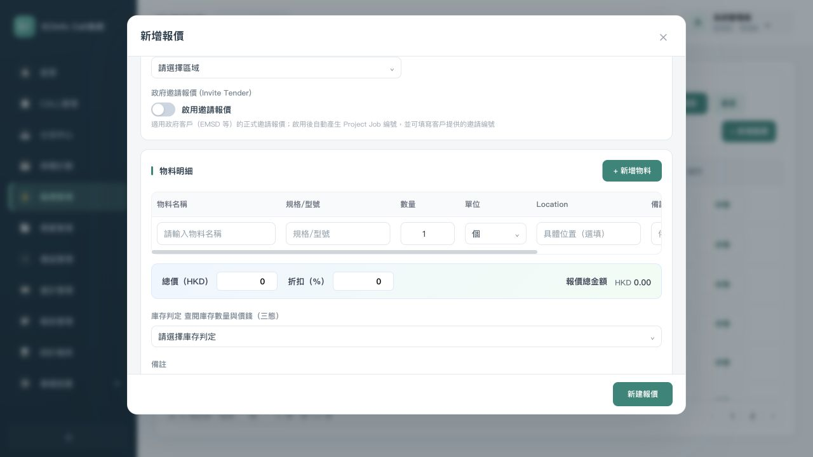
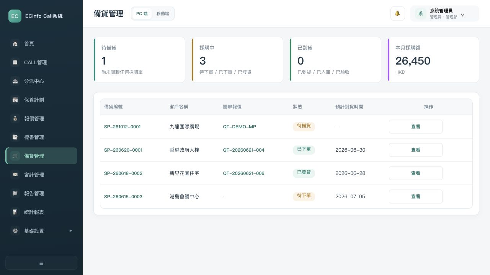
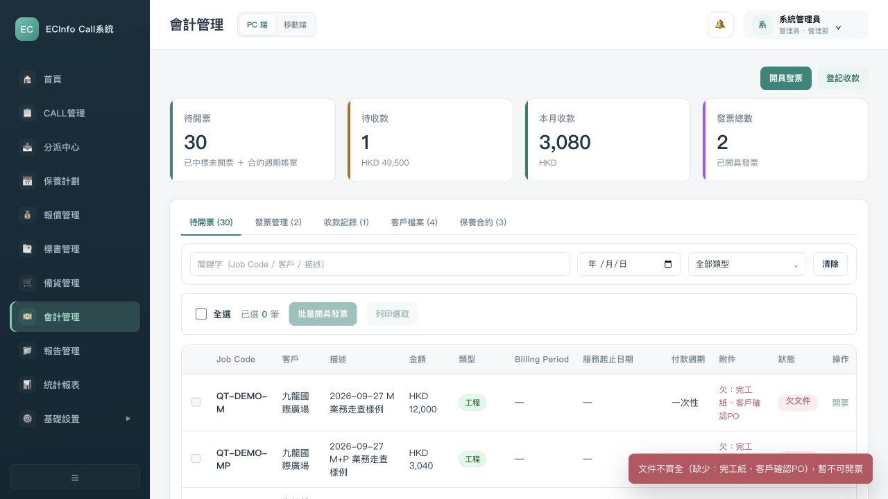
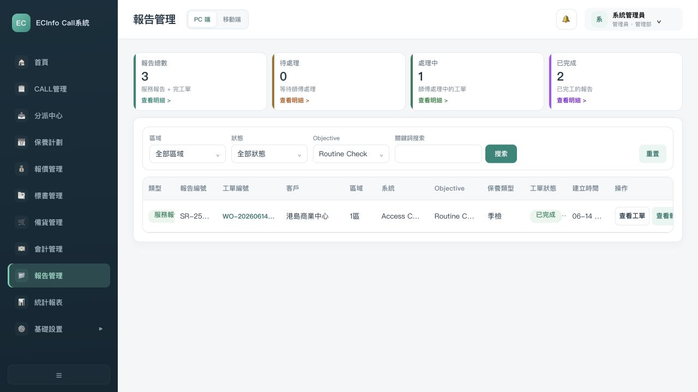

# 原型定稿准备复核

复核日期：2026-10-12。当前原型与10/07审计时HTML/JS哈希不同，旧结论不得整体沿用。
本轮没有修改原型；使用当前UI登录管理员、打开页面及表单，没有注入业务关联、真实仓库写入、外发或开票。
本轮只验证所列入口/字段/筛选，不构成全链角色验收。未动态复测的条目保留为待复测，不算解决。

## 本轮实际步骤

1. 登录及管理员菜单：入口可用；角色岗位授权仍待逐记录验收。
2. 报价列表及新建表单：总价、折扣、日周货期、保固字段可见；有效期和人员职责仍有错位。
3. 备货列表：SP可见；未见正常MR就绪处理入口，不能用新增桥接代码宣称闭环。
4. 财务队列及欠件下一步：普通资料门槛存在，欠件样例被拒绝，特殊原因出口仍需处理。
5. 报告Objective筛选和重置：实际3条缩至1条，再恢复3条；中文选项及角色范围未验收。

## 审计编号逐项复核状态

| 审计编号 | 问题 | 本轮状态 | 本轮依据与限制 | 证据 | 后续批次 |
| --- | --- | --- | --- | --- | --- |
| P0-01 | 唯一范围与事实批准链缺失，最新反馈未进入基线 | 资料已收口，客户批准未完成 | 最新记录已逐项整理，本期范围/确认身份仍待核对 | docs/audit/PROTOTYPE-FINALIZATION-AUDIT.md P0-01 | B02 |
| P0-02 | 来电答疑与CS报价移交有代码但当前正常入口断裂 | 待动态复测 | 本轮未执行对应完整场景；保留审计线索，整改前按当前代码和角色复测 | docs/audit/PROTOTYPE-FINALIZATION-AUDIT.md P0-02 | B02 |
| P0-03 | MR就绪界面消失，SP与MR材料状态互不交接 | 当前界面仍有缺口 | 备货列表仅SP，未见可达MR就绪处理；新MR桥接不等于完整就绪交接 | evidence/05-procurement.png | B02 |
| P0-04 | 无报价及仓管自主MR入口、MR三状况与仓务职责缺失 | 部分代码/职责待复测 | 仓务独立入口与无报价MR仍需从真实岗位走查，不能用桥接代码计完成 | evidence/00-login.png、05-procurement.png | B02 |
| P0-05 | 记录级数据/动作权限不完整且CR区域规则失效 | 待动态复测 | 本轮未执行对应完整场景；保留审计线索，整改前按当前代码和角色复测 | docs/audit/PROTOTYPE-FINALIZATION-AUDIT.md P0-05 | B01 |
| P0-06 | 不可拍照客户无法提交，财务豁免又使用错误地点判据 | 待动态复测 | 本轮未执行对应完整场景；保留审计线索，整改前按当前代码和角色复测 | docs/audit/PROTOTYPE-FINALIZATION-AUDIT.md P0-06 | B02 |
| P0-07 | SR编号校验冲突，多SR和重交覆盖原报告 | 待动态复测 | 本轮未执行对应完整场景；保留审计线索，整改前按当前代码和角色复测 | docs/audit/PROTOTYPE-FINALIZATION-AUDIT.md P0-07 | B02 |
| P0-08 | Tender正常回标/报价顺序和无报价履约不完整 | 待动态复测 | 本轮未执行对应完整场景；保留审计线索，整改前按当前代码和角色复测 | docs/audit/PROTOTYPE-FINALIZATION-AUDIT.md P0-08 | B04 |
| P0-09 | 已明确SR保固→采购通知分支缺失 | 待动态复测 | 本轮未执行对应完整场景；保留审计线索，整改前按当前代码和角色复测 | docs/audit/PROTOTYPE-FINALIZATION-AUDIT.md P0-09 | B02 |
| P0-10 | 普通成交到财务入口及SR/CP/照片/客户PO证据链断裂 | 仍需处理并复测 | 普通成交字段/财务筛选关系仍需复测，当前M样例显示工程一次性；证据包关联未验收 | evidence/06-finance.png；remediation.js confirmWon | B05 |
| P0-11 | 欠文件时的特殊开票出口缺失 | 当前界面仍有缺口 | 欠文件样例点击下一步直接拒绝，未提供已明确的特殊原因出口 | evidence/07-invoice-form.png、08-invoice-fields.png | B05 |
| P0-12 | 材料/正式预约只约束一个按钮，实际开工与后续CALL交接未一致 | 待动态复测 | 本轮未执行对应完整场景；保留审计线索，整改前按当前代码和角色复测 | docs/audit/PROTOTYPE-FINALIZATION-AUDIT.md P0-12 | B02 |
| P0-13 | 状态、退回、取消、重开及衍生对象影响未形成一致规则 | 待动态复测 | 本轮未执行对应完整场景；保留审计线索，整改前按当前代码和角色复测 | docs/audit/PROTOTYPE-FINALIZATION-AUDIT.md P0-13 | B01 |
| P0-14 | 当前全链验收覆盖和客户定版签收缺失 | 验收草案已准备，未全链执行 | 本轮入口复核不能算客户UAT；既有7场景历史结果不计当前通过 | docs/audit/PROTOTYPE-FINALIZATION-AUDIT.md P0-14 | B07 |
| P1-01 | 折扣/仅材料+总价模式缺失 | 部分已实现，需核对口径 | 当前新建报价已有总价与折扣%，无明细价格列；编辑/计算/打印一致性及折扣口径仍待确认 | evidence/03-quotation-create.png、04-quotation-amount.png | B02 |
| P1-02 | 报价有效期与保固文案/交期不符 | 部分已实现，仍有错位 | 已有保固术语/1年、货期日周范围；有效期仍默认30天，60/90天出现在保固选项 | evidence/03-quotation-create-dom.txt、04-quotation-amount.png | B02 |
| P1-03 | 签名历史/公司盖章/OurRef001缺 | 待动态复测 | 本轮未执行对应完整场景；保留审计线索，整改前按当前代码和角色复测 | docs/audit/PROTOTYPE-FINALIZATION-AUDIT.md P1-03 | B02 |
| P1-04 | 报价负责人候选主要TL/ADMIN | 待动态复测 | 本轮未执行对应完整场景；保留审计线索，整改前按当前代码和角色复测 | docs/audit/PROTOTYPE-FINALIZATION-AUDIT.md P1-04 | B02 |
| P1-05 | 纯文字/材料变更不自动升版，周期快照不全 | 待动态复测 | 本轮未执行对应完整场景；保留审计线索，整改前按当前代码和角色复测 | docs/audit/PROTOTYPE-FINALIZATION-AUDIT.md P1-05 | B02 |
| P1-06 | 邀请结果字段仍残留/参考报价带料不足 | 待动态复测 | 本轮未执行对应完整场景；保留审计线索，整改前按当前代码和角色复测 | docs/audit/PROTOTYPE-FINALIZATION-AUDIT.md P1-06 | B02 |
| P1-07 | 多合同与JNO对象绑定错误 | 待动态复测 | 本轮未执行对应完整场景；保留审计线索，整改前按当前代码和角色复测 | docs/audit/PROTOTYPE-FINALIZATION-AUDIT.md P1-07 | B01 |
| P1-08 | 人员姓名缺英文搜索 | 待动态复测 | 本轮未执行对应完整场景；保留审计线索，整改前按当前代码和角色复测 | docs/audit/PROTOTYPE-FINALIZATION-AUDIT.md P1-08 | B01 |
| P1-09 | Tender六态筛选与三Tab交集丢记录 | 待动态复测 | 本轮未执行对应完整场景；保留审计线索，整改前按当前代码和角色复测 | docs/audit/PROTOTYPE-FINALIZATION-AUDIT.md P1-09 | B04 |
| P1-10 | 正常/批量开票日期、月流水口径不符 | 待动态复测 | 本轮未执行对应完整场景；保留审计线索，整改前按当前代码和角色复测 | docs/audit/PROTOTYPE-FINALIZATION-AUDIT.md P1-10 | B05 |
| P1-11 | 发票描述/低价原因/修改金额不统一 | 待动态复测 | 本轮未执行对应完整场景；保留审计线索，整改前按当前代码和角色复测 | docs/audit/PROTOTYPE-FINALIZATION-AUDIT.md P1-11 | B05 |
| P1-12 | 成交M与会计保养合约主档分裂 | 待动态复测 | 本轮未执行对应完整场景；保留审计线索，整改前按当前代码和角色复测 | docs/audit/PROTOTYPE-FINALIZATION-AUDIT.md P1-12 | B03 |
| P1-13 | 月份周期/首期/上限120是原型规则 | 待动态复测 | 本轮未执行对应完整场景；保留审计线索，整改前按当前代码和角色复测 | docs/audit/PROTOTYPE-FINALIZATION-AUDIT.md P1-13 | B03 |
| P1-14 | 待完工确认在移动任务缺入口 | 待动态复测 | 本轮未执行对应完整场景；保留审计线索，整改前按当前代码和角色复测 | docs/audit/PROTOTYPE-FINALIZATION-AUDIT.md P1-14 | B02 |
| P1-15 | Objective无独立筛选、中文未落实 | 部分已解决 | Objective筛选与重置已实际验证3→1→3；服务报告中文选项仍待核对，不能整项关闭 | evidence/09-report.png、10-report-filter.png、11-report-reset-dom.txt | B02 |
| P1-16 | 通知目标和页面权限不相容 | 待动态复测 | 本轮未执行对应完整场景；保留审计线索，整改前按当前代码和角色复测 | docs/audit/PROTOTYPE-FINALIZATION-AUDIT.md P1-16 | B02 |
| P1-17 | 无新数据迁移/历史样例的缺证据标识 | 待动态复测 | 本轮未执行对应完整场景；保留审计线索，整改前按当前代码和角色复测 | docs/audit/PROTOTYPE-FINALIZATION-AUDIT.md P1-17 | B02 |
| P1-18 | 统计口径与状态/类型不对齐 | 待动态复测 | 本轮未执行对应完整场景；保留审计线索，整改前按当前代码和角色复测 | docs/audit/PROTOTYPE-FINALIZATION-AUDIT.md P1-18 | B02 |
| P1-19 | 正本上传隐藏及外发/归档仅模拟 | 待动态复测 | 本轮未执行对应完整场景；保留审计线索，整改前按当前代码和角色复测 | docs/audit/PROTOTYPE-FINALIZATION-AUDIT.md P1-19 | B02 |
| P1-20 | 离线SR恢复字段丢失 | 待动态复测 | 本轮未执行对应完整场景；保留审计线索，整改前按当前代码和角色复测 | docs/audit/PROTOTYPE-FINALIZATION-AUDIT.md P1-20 | B02 |
| P1-21 | 基础设置子页和管理层全操作边界未定义 | 待动态复测 | 本轮未执行对应完整场景；保留审计线索，整改前按当前代码和角色复测 | docs/audit/PROTOTYPE-FINALIZATION-AUDIT.md P1-21 | B01 |
| P1-22 | 上线日期/并行试运转/代理阈值无原始出处 | 待动态复测 | 本轮未执行对应完整场景；保留审计线索，整改前按当前代码和角色复测 | docs/audit/PROTOTYPE-FINALIZATION-AUDIT.md P1-22 | B02 |
| P2-01 | 列表和抽屉窄宽度关键列被截断 | 待动态复测 | 本轮未执行对应完整场景；保留审计线索，整改前按当前代码和角色复测 | docs/audit/PROTOTYPE-FINALIZATION-AUDIT.md P2-01 | B07 |
| P2-02 | 英文缩写及中文术语未一致 | 待动态复测 | 本轮未执行对应完整场景；保留审计线索，整改前按当前代码和角色复测 | docs/audit/PROTOTYPE-FINALIZATION-AUDIT.md P2-02 | B07 |
| P2-03 | 页面日期/演示提示位置不一致 | 待动态复测 | 本轮未执行对应完整场景；保留审计线索，整改前按当前代码和角色复测 | docs/audit/PROTOTYPE-FINALIZATION-AUDIT.md P2-03 | B07 |
| P2-04 | 表单键盘/焦点和真实手机未验证 | 待动态复测 | 本轮未执行对应完整场景；保留审计线索，整改前按当前代码和角色复测 | docs/audit/PROTOTYPE-FINALIZATION-AUDIT.md P2-04 | B07 |
