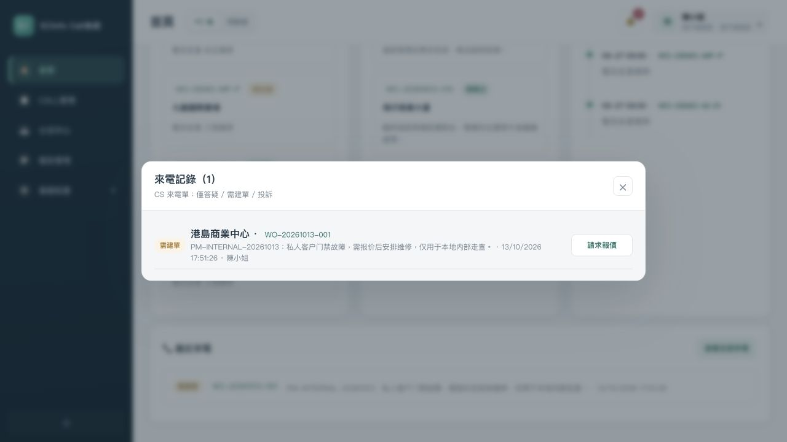
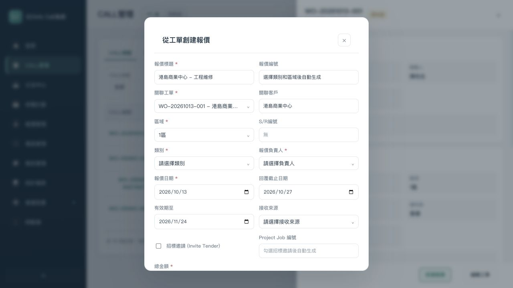
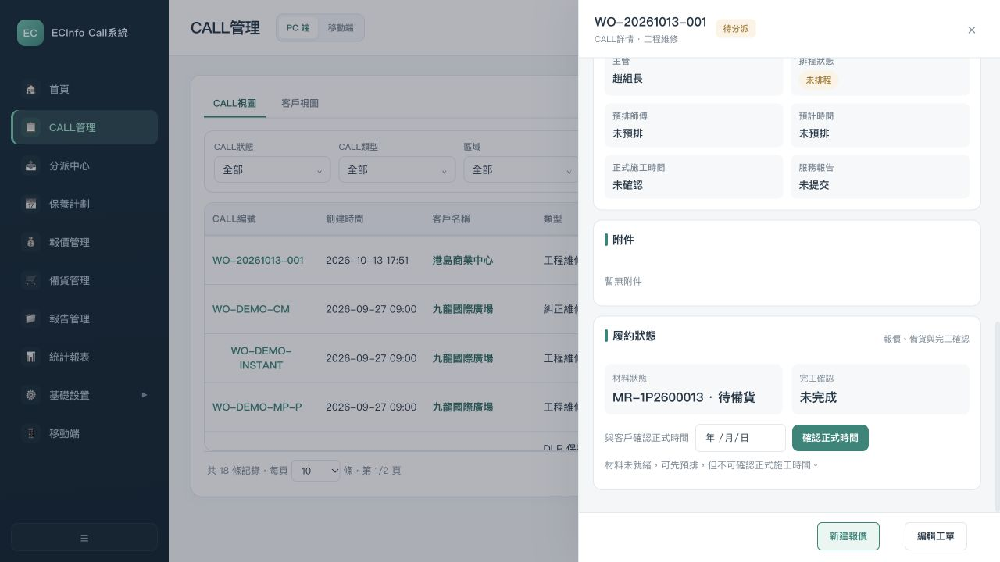
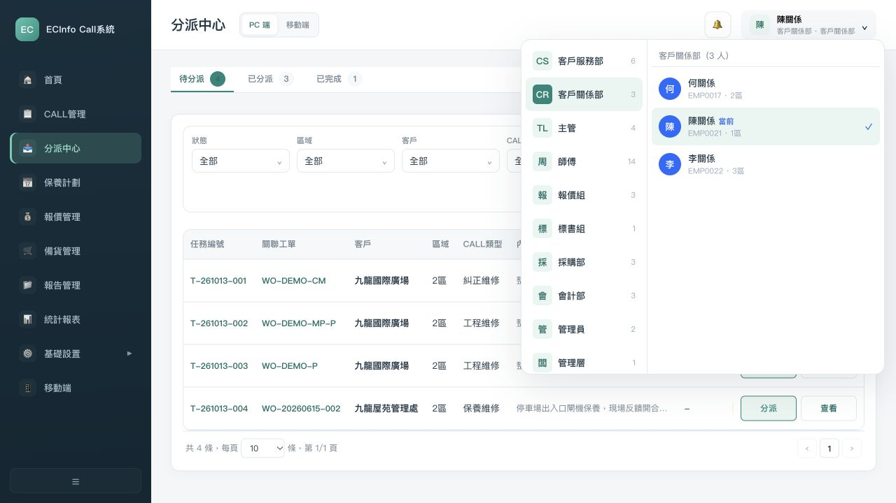
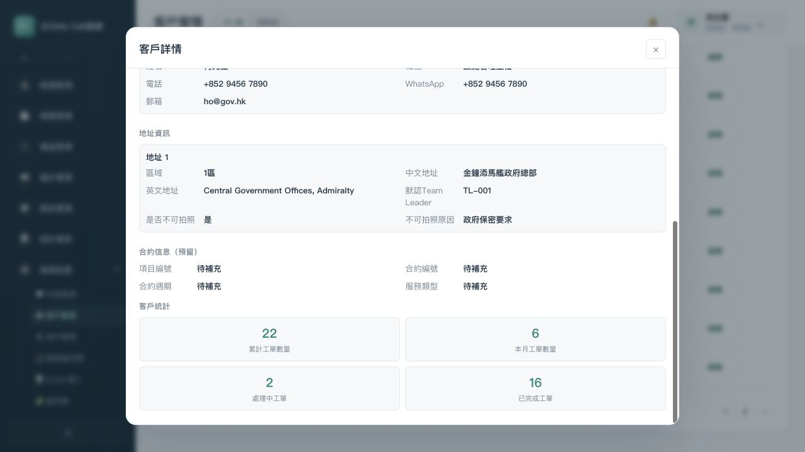
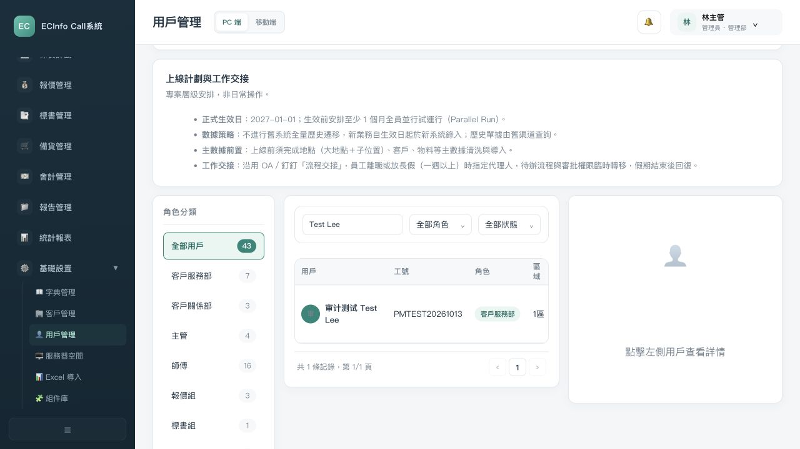

# 首批内部需求与原型走查

本文件保存10/13整改前的只读初查快照；下文“本轮/未整改”均指初查时点。随后按用户授权完成明确问题整改，当前结果见[整改复测](REMEDIATION-RESULT.md)，不将初查FAIL改写成历史PASS。

复核日期：2026-10-13。对应TASK-039、TASK-040、TASK-041。范围为公共基础和第一条P维修链。
结论：内部走查未通过，暂不组织客户定稿。Gate 1不通过，Gate 2不通过，0个批次冻结。
核对材料：[公共基础与维修链对照](../../knowledge/03-business/B01-B02-INTERNAL-BASELINE-20261013.md)。任务进度只回填README指定Excel，本报告保存结果和证据。

## 本轮环境与证据限制

- 当前prototype/代码只读，原件及历史不改。通过正常UI创建新CALL、报价、物料并模拟中单，没有注入ticketId、MR状态或其他业务对象。
- 使用独立本地端口18814的静态服务，未启用真实仓库代理。MR同步的HTTP501为环境限制，不认定宜搭接口故障，不声明已验证真实写入/回传。
- 模拟客户接受记录明确写“仅本地内部走查，不是真实客户确认”。新增中英文人员是本地合成样例，不是正式账号或客户人员资料。
- 本轮主链：WO-20261013-001 → 1P2600013 → MR-1P2600013 / SP-261013-0002。到材料与正式预约处受阻；现场、SR/CP、完工及财务没有走通。
- 只使用本轮截图/DOM作为当前行为证据。旧审计仅用于编号对照，不整体复用旧PASS/FAIL。
- PC视口实测，移动端、屏幕阅读器、完整键盘路径及全部角色权限未验，不宣称可访问性合规。

## 本轮实际步骤

| 步骤 | 操作及责任角色 | 实际结果/健康情况 | 本轮证据 |
| --- | --- | --- | --- |
| 1 | 登录CS陈小姐 | 角色入口可用，快速登录10类岗位；未出现独立仓务登录角色，具体系统分工仍待C-04 | 01-login.png |
| 2 | CS从CALL管理创建新私人客户工程维修CALL | 正常保存，产生需建单来电记录，CALL立即为待分派；仅答疑创建入口未验证到 | 02-cs-call.png、03-cs-new-call.png、04-cs-created-call.png及DOM |
| 3 | CS首页打开全部来电并请求报价 | 有真实可达按钮与“已交CR/主管”提示；不能沿用“CS报价入口完全不可达”的说法 | 05-cs-incoming-quote-entry.png及DOM |
| 4 | 1区CR陈关系进入首页、报价和分派 | 首页/报价显示跨区数据，分派页只显示2区；实际人员与默认角色区域不一致，未通过 | 06-cr-quotation.png、14-cr-dispatch.png、15-cr-selected-region.png及DOM |
| 5 | CR从来源CALL新建报价 | 可继续创建关联来源报价；未验证CS待转交请求转为已转交的正常入口。负责人候选仅TL/ADMIN | 07-cr-source-call.png、08-source-quotation-form.png及DOM |
| 6 | QUO邹组长看到并编辑新报价 | 可保存物料和总价，源CALL关联保留；负责人列表仍无QUO。来源简表、编辑、详情条款不一致 | 08-source-quotation-form.png、09-quo-quotation-detail.png及DOM |
| 7 | QUO模拟接受最终报价并分类物料后中单 | 本地中单成功，自动生成MR及SP。真实仓库同步未验证，不算业务通过 | 10-won-mr.png及DOM |
| 8 | PUR张采购打开新SP并改为已验收 | SP状态可操作且更新；无可达MR就绪记录，采购记录提示到仓库通建立 | 11-procurement-detail.png、12-sp-accepted.png及DOM |
| 9 | CR返回同一CALL确认正式时间 | MR仍待备货，输入/按钮禁用。必要材料门槛存在，但业务缺少推进出口，主链未通过 | 13-material-gate-blocked.png及DOM |
| 10 | 检查合同与JNO | 客户详情单合同、合同信息为预留，客户仍保存J Number；政府新CALL可编辑JNO，不能笼统判定没有JNO字段 | 16-government-jno.png、18-customer-contract.png、19-contract-placeholder.png及DOM |
| 11 | 管理员新建混合中英文姓名，再检索 | “审计测试 Test Lee”由真实UI保存，中文/英文各命中同一记录，不匹配词返回0。单姓名字段可支持混合姓名，其他选择器和真实数据仍未验证 | 17-user-form.png、20-english-name-search.png、21-chinese-name-search-dom.txt、22-name-no-match-dom.txt |
| 12 | 后续现场、SR/CP、完工和财务 | 同一新来源链未到达，明确未执行。不能换种子单或改状态冒充整链走通 | 第9步断点；本报告未执行边界 |

JNO截图为管理员对同一表单的复核，16号DOM保留此前CR打开表单的记录，两个角色不混称。

## 核心截图

### CS实际报价入口

### 报价负责人和来源表单

### SP已验收后，MR仍阻塞正式时间

### 1区CR与2区分派范围不一致

### 合同信息存在预留，完整多合同流程待验证

### 中英文姓名检索子项已验证

## 本轮问题（8项，未关闭）

| ID/优先级 | 问题及实际影响 | 依据/关联旧编号 | 正确预期和边界 | 下一步 |
| --- | --- | --- | --- | --- |
| INT-20261013-01 / P0 | 1区CR首页/报价跨区，分派按默认2区。员工选择与业务范围不一致 | UPD-006；SOURCE-015 P40；P0-05；14/15号证据。代码currentRole只替换name/avatar，保留角色默认area | 普通CR按实际人员区域；读范围一致，不能只改下拉框。夜班全区名单/动作仍待C-03 | 首批明确问题整改候选，覆盖首页、CALL、关联报价和分派，再做1/2/3区正反复测 |
| INT-20261013-02 / P0 | SP已验收但MR待备货，CR正式时间禁用，没有正常MR就绪出口 | CONFIRMED-005～007；UPD-028/029；P0-03/12；11～13号证据 | 材料真正就绪后可推进；不能默认SP验收等于MR完成。谁/哪系统写材料状态须C-04 | 先整理MR可达入口与源单关联方案，保留未定职责，不在内部整改中擅自授权 |
| INT-20261013-03 / P1 | QUO可接手制作，但负责人列表不含QUO，只能选TL/ADMIN | CONFIRMED-008；REQ-045；P1-04；08/09号证据 | 报价责任按真实报价岗位维护；不能以当前候选批准其他角色负责报价 | 补齐已明示报价岗位的负责人候选，保持实际执行和历史人名不被替换 |
| INT-20261013-04 / P0 | CS请求已提示交审阅，但CR首页/来电/报价未见待转交接手动作。CR另从CALL建报价是旁路 | CONFIRMED-009；REQ-005/043；P0-02/P1-16；05～08号证据；原代码有待转交/已转交处理 | 正常CS→CR/TL→QUO交接可达、来源与转交记录对应。并非整段入口完全不存在 | 恢复既有请求/转交逻辑的可见入口，不新增审批策略，复测防重复及来源关联 |
| INT-20261013-05 / P1（待验证） | 当前看到单记录合同编号及预留合同信息，未实际创建同名不同合同再验证下游；客户主档保存J Number，政府CALL可改，私人入口未显示 | UPD-001～003；SOURCE-014 P1/P14/P17；P1-07；16/18/19号证据 | 合同可正确选择且不串单，JNO独立。原话允许客户重复，不强制独立合同对象；不能把预留区判断成全能力缺失 | 先执行同名不同合同的实际案例，再提出最小对象/关联方案；不静默迁移或覆盖历史，适用和编号样张留C-09 |
| INT-20261013-06 / P1 | 来源新建、编辑、详情为不同报价表单，保固/有效期/OurRef显示不一致。详情仍“保修期未设定”，OurRef没有001版本段 | UPD-013/023/024；SOURCE-014 P22、SOURCE-015 P14/P15；P1-02/03；08/09/10号证据 | 明确条款跨入口一致。60/90如何默认、OurRef前缀和R0/R1映射未确认，不擅自生成编号 | 梳理两套入口差异，先修明确文案/字段承接；精确编号和默认策略留候选 |
| INT-20261013-07 / P1 | 报价详情点击交付信息，一次点击后DOM和画面均未切换 | 本轮10号状态后的实际点击；详情tab已有但本次未生效 | 每个可见tab有可达内容或明确不可用说明 | 定位事件与渲染覆盖，复测该入口；不由此认定所有tab都失效 |
| INT-20261013-08 / P1 | 新CALL选择客户时抛TypeError；旧联动把area输入框当select读取options，地址及后续联动可能中断 | 本轮3次客户选择的浏览器错误；index.html:25945；新CALL地址未设定，源客户已维护地址 | 已有客户选择逻辑不能因控件类型变化抛异常，保留实际地点选择，不擅自改成强制首地址 | 和区域修复一起校正既有控件联动，验证私人/政府客户以及空数据，不新增业务默认规则 |

MR真实同步是本轮未验证项，不增加远端接口缺陷。中英文同姓名字段检索已实际通过，不重复创建“缺英文检索”整改任务。

## UAT回填边界

| 场景 | 当前结论 | 已执行/未执行 |
| --- | --- | --- |
| UAT-01 | 未执行完整场景 | 观察CS入口但未创建仅答疑记录 |
| UAT-02 | 部分执行，未通过完整交接 | CS请求、CR旁路建来源报价、QUO可见已执行；正常请求审阅/转交未走通 |
| UAT-03 | 未通过 | 新来源链到MR/SP与正式预约断点；现场至完工交财务未执行 |
| UAT-11 | 未通过（1区CR代表） | 首页/报价/分派范围不一致；其他岗位、夜班和全操作权限未全验 |
| UAT-16 | 部分执行，未通过整项 | 双语姓名关键词检索子项通过；多合同/JNO、停用/离职、导入失败和历史范围未全部验 |
| 其余UAT | 未执行 | 本轮没有用旧PASS或无关种子数据填写当前通过 |

## 初查提出的内部整改包 RP-20261013-01

建议下一轮先做两项，不需要用户拆技术任务：

1. 修复普通CR按实际员工区域读取，覆盖首页/CALL/关联报价/分派，并修复客户选择时把区域输入框误当下拉框的既有联动。暂不实现夜班例外、新的动作授权或地点默认策略。
2. 恢复CS请求到CR/TL再到QUO的既有转交入口，补齐QUO负责人候选，核对来源记录与重复请求。暂不重定审批政策、单号或保养/财务规则。

候选包由Codex整合和验证；用户已授权项目经理推进明确问题，随后成果供用户确认。用户确认不替代客户C-03/C-04/C-09决定。
MR材料确认人/系统分工、合同对象和精确编号先准备方案与影响，再集中澄清。明示报价条款/详情事件安排后续最小整改，不和首轮混改。
验收：普通CR 1/2/3区正反访问，CS真实发起一个请求、CR/TL转交、QUO接手并保留来源；无假客户接受、真实仓库写入或生产部署。

## 当前需要客户决定的首批内容

只沿用已登记问题，不新增一套客户问题编号：C-02对象状态含义，C-03夜班名单/未定动作授权，C-04仓库与EC写入边界/谁确认材料就绪，C-09编号实际样张及适用关系。先交带依据、方案和影响的材料，不让客户替团队定位事件覆盖或默认区域的技术问题。
客户表目前仍为草案，没有要求客户对尚未走通原型签字。

## 范围与自检

本轮新增内部知识对照和真实走查证据，不新增批准业务角色、字段、状态或一期范围。
原型HTML/CSS/JS、原DOCX、原听记及9/27Decision均保持内容一致。内部账号样例和模拟接受只在独立浏览器本地数据中，不导入正式资料。
页面可达、子项检索通过不等于全链通过。材料断点和CR范围问题未整改，Gate 1/Gate 2均不能放行客户定稿。
用户页出现2027-01-01上线、迁移和一周代理阈值，属于历史原型设计，未核定为当前批准计划，记录但不在本批顺手修改。
移动与可访问性仍未验证；禁用正式时间按钮的绿色外观也未证明可理解性合格。
