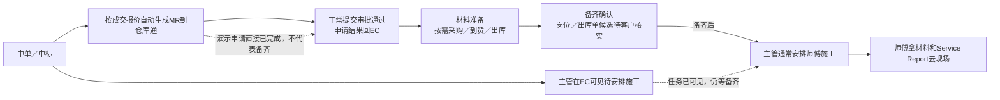

# C-04 材料就绪与系统分工内部候选

日期：2026-10-13；整理更新：2026-10-14。对应TASK-044、INT-20261013-02、客户问题C-04。状态：内部候选，用户业务说明已记录、尚未客户批准；本文件不是第二套任务表。

## 已核实的交接与下一步

已完成提问：MR含义和主管EC查看已获说明；用户对仓管职责/出库确认明确要求客户核实，不再重复向用户追问这一点。
用户本次只确认：“仓管应该仅负责出库，在出库环节确认备齐”为待核实倾向，已收录C-04客户待确认；不视为已经确定的职责或出库放行规则。
当前内部动作：用户说明师傅公司领Service Report再去现场；CR/主管交付是候选，C-08留待用户后续客户核实，不重复追问同项。C-04材料归口与C-09七位+1细则也待客户；原型本轮不改，继续准备/现场/回交三个环节的入口、权限与资料核对，打印/发号/OCR仍未实现。

上一步已获得用户说明：MR在仓库通、主管在EC查看待安排施工；仓管是否仅负责出库及在出库单确认备齐，当前待客户核实。此前口述和最新“应该/需客户确认”的原话均见[内部业务说明](../../knowledge/03-business/B01-B02-INTERNAL-BASELINE-20261013.md)。不以最新倾向替客户作出确定判断。

后续已获得用户说明：中单/中标后主管在EC工单系统看到待安排施工，备货完成后安排；师傅带材料和Service Report去现场，当前纸单、目标EC打印已说明。任务可见、可以施工、打印与现场完成分别记录；字段/跨系统映射及打印编号/岗位未定，不自动把SR标为完成。

MR含义补充（2026-10-14）：用户明确MR是材料申请，中单报价数据自动生成MR到仓库通，正常提交审批通过后结果回EC；演示直接新MR申请已完成，之后仍可能采购、到货、出库。MR完成不代表备齐，原话见SOURCE-022“MR申请审批与备齐”。本轮[申请/材料显示与派工门槛局部整改](../../review/2026-10-14-material-handoff/MATERIAL-HANDOFF-REVIEW.md)已完成限定子项复测，完整备齐回写和下游未走通。

解释例子（合成情景，不是真实客户业务）：报价已成交，一次维修需要3个电源。有人登记“已收货”，CR准备约施工。这时CR需要知道，这一单所需材料是否已经核对、备齐，以及是谁确认的。收到某批货与某张维修单可以施工之间的确认方式尚未统一；不能直接把采购/备货状态当作MR完成。

这里的C是要核实的业务交接含义，不表示已批准一个新审批、按钮或独立业务状态。系统分工、就绪标准、回传及异常规则同样先查依据，再逐项问用户；用户也无法回答的部分再登记给客户。完整候选保留在下方供团队使用。

图中MR提交审批来自本轮用户说明，真实审批人/权限与协议未给出；原型捷径只完成申请维度，不模拟仓管已备齐。此前未区分申请审批和材料回传的候选，以本段补充说明为准，历史记录保留。

提问方式更新依据：2026-10-13用户要求“先问我”，无法回答的再记录问客户，随后说明仓管/仓库通及施工顺序；2026-10-14确认主管查看系统为当前EC。剩字段映射、材料标准/异常和服务单形式先由Codex追溯，不将未回复记作“不清楚”。

## 本次向原件追溯的结果

| 资料与原始位置 | 核对到什么 | 证据边界及处理 |
| --- | --- | --- |
| SOURCE-004：01/30沟通纪要PDF，第3页“采购触发机制”、第4页“到货与安装跟踪” | 采购依material request订货；采购单记录预计/实际到货，指定师傅领取安装 | 历史沟通纪要原件；原件中的整理文字不等于当前一期正式批准。没有定义哪个岗位最终确认本单材料可施工 |
| SOURCE-005：03/26反馈纪要PDF，第5页“关键决策”、第6页“仓库系统定位” | 当时仅采购管理，库存盘点/扫码入库留二期，库存状态人工判断 | 保留历史范围边界。9/27材料门槛没有明示推翻这个边界，本轮不能扩成完整库存系统或默认实时库存联动 |
| SOURCE-014：0928 DOCX P10 | 没报价时MR手动填，记录岗位为采购部 | 与普通成交报价自动MR分开看；具体入口/系统仍待核实，不把不同来源强行视为矛盾 |
| SOURCE-015：0930 DOCX P28/P29/P31 | MR有完成/取消/处理中，仓管可自主增加MR | 工作副本L3；有新增和状态诉求，没有给出所有场景的就绪标准、最终确认人和系统写入边界 |
| SOURCE-001：CONFIRMED-005～007 | 成交报价生成MR，材料准备完成后CR/主管约正式时间 | 当前工作讨论基线；没有指定材料最终确认岗位，不以CR约时间倒推出CR确认齐料 |
| 旧SOP可读提取：quotation_flow_readable.md §阶段4及节点提取 | 收货、仓务入库/留货、业务负责人核对数量及准备完工纸分开描述 | 团队提取L3、有多套流程与待定责任，不能直接套用到当前原型。本次确认外部SOP.jam原件存在并记录哈希，但旧解析依赖已失效，未重新解析节点或认定版本已批准 |
| SOURCE-024：10/13复测步骤12 | SP验收后MR仍待备货，正式时间禁用 | 实际本地UI证据；不是远端仓库状态，也不证明外部接口故障 |

精确来源路径：

- SOURCE-004：[01/30沟通纪要](../../../materials/听记纪要/纪要_ECInfo-dingtalk項目溝通和demo演示20260130.pdf)。
- SOURCE-005：[03/26反馈纪要](../../../materials/听记纪要/纪要_ECInfo-dingtalk報價方案和POC反饋溝通20260326.pdf)。
- SOURCE-014：[0928沟通副本](../../../materials/溝通筆記/ec+cs+報價組+會計0928.docx)。
- SOURCE-015：[0930沟通副本](../../../materials/溝通筆記/ec原型+倉庫+cr0930.docx)。
- 旧SOP：[阶段4可读提取](../../analysis/flow-reference/quotation_flow_readable.md)。外部原件现址为`/Users/xiaoxiangruanjian/Downloads/SOP.jam`，SHA-256为`09aafc916f90dff353fa7439ea11bcf8713a4c18c9536fbea0588242cbfc08c2`；未搬移、未复制原件，不作为团队已共有文件。

现阶段内部结论：普通报价自动MR、无报价手动MR、仓管自主MR分开说明；主管EC可见待安排、备齐后施工及师傅带材料/Service Report保留。用户最新倾向为仓管仅出库、在出库环节确认备齐，并明确需客户核实；该职责/单据不再按已确定规则描述。字段/材料映射、齐料标准/异常及服务单形式仍待核，技术问题由团队处理。

材料核对阶段展示自检：推进表首页改为单个材料问句，TASK-041/044及C-04补引导/依据；该阶段任务和客户/UAT批准状态保持原值。Hub首页/项目状态显示同一问句及依据链接，检查期间无浏览器错误，证据见[引导截图](evidence/50-mr-guided-hub.png)及50号DOM。材料核对未修改原型或新增批准角色、库存功能和材料默认规则。同轮后续独立的报价代码整改见[报价局部复测](QUOTATION-REMEDIATION-RESULT.md)，不据此关闭材料断点。

## 保留给团队的完整候选

已有事实：9/27讨论CONFIRMED-005～007要求材料准备与正式预约衔接；SOURCE-015 P28/P29记MR处理中/已完成/已取消，P31记仓管自主MR；UPD-028/029保留这些要求与未定实现边界。当前UI实测SP已验收而MR待备货，正式时间禁用。静态环境不验证仓库通真实写入/回传。

可由内部确定：MR和SP是关联对象，SP验收不能凭名称自动当作材料可施工；要保留来源报价、CALL、材料行、确认记录及异常出口。当前已有MR入口受系统/岗位分工限制，不能擅自增加EC仓务角色和授权来跨过断点。

已有说明保留：MR申请完成不等于齐料；主管在EC查看任务、备齐后安排施工。仓管只出库/出库单确认备齐现在只是待客户候选，不据此更改岗位或流程。技术字段/回写继续追溯，业务边界待客户确认；出发前服务单可独立核对。

| 候选（未批准） | 责任和操作安排 | 影响/依赖 |
| --- | --- | --- |
| A 仓库通维护材料事实，EC读取/回传 | 仓务在仓库通处理MR与实际备料；EC显示经核验的就绪结果，CR/TL据此确认正式时间 | 需确认外部状态、回传字段/时机、失败与冲突处理；真实接口另批验证 |
| B EC登记就绪，仓库通执行备料 | 指定实际材料确认岗位在EC登记有依据的确认；仓库通保留出入库执行记录 | 需客户指定岗位、证据与权限，并明确两系统冲突谁负责；不能由AI默认授权 |
| C 拆开仓库备料和施工材料确认 | 仓库登记备料事实，施工责任岗位确认是否足以预约；两个结果分别显示 | 需证明业务确实有两次确认；增加交接与维护成本，不能当成现有要求 |

以上A/B/C保留最初候选身份供追溯，未选定任何完整方案。原A所写仓务备料职责也须按本次C-04客户回复核实；B/C额外登记/二次确认未批准，不继续把三个完整方案都丢给用户或客户选择。

当前不选择默认方案，不实现任一候选。先补齐证据，逐项向用户核实现行业务；用户也不清楚或仍存在无法解释的冲突，才把具体缺口登记在主台账C-04中供后续集中客户确认。用户回答保留身份/出处/范围，不能自动升级为客户正式批准。随后形成能解释“谁点哪里、产生什么记录、下一人如何继续”的方案。

本包完成条件：MR/SP/报价/CALL关联可解释；材料标准、负责岗位、维护系统、回传及异常出口都有依据或明确待决；候选经内部核对后提交。决定后原型复测同一来源链，现场与SR/完工/财务继续，不用种子单或改状态代替。

## C-04 客户待确认：备齐确认的岗位与单据（2026-10-14）

准备给客户的问句：请确认，哪一岗位、在哪张单据/哪个环节确认“本单材料已备齐，可以安排施工”？目前内部倾向是仓管仅负责出库，在出库环节核对备齐，请确认或纠正。

| 项目 | 当前记录 |
| --- | --- |
| 为什么需客户确认 | 用户明确用了“应该”并要求和客户确认，实际责任及操作记录未取得；团队不能把候选当事实 |
| 用户原话 | “仓管应该只负责出库，出库里确认材料是否备齐。这个要和客户确认下” |
| 现有证据 | SOURCE-022此前仓管备货/确认口述与本次补充；SOURCE-015 P31有仓管自主MR诉求；旧SOP提取有业务负责人核数量，岗位/入口适用范围需核实 |
| 可确认的安排 | 出库环节由仓管确认；或由其他岗位/既有单据确认。均只为讨论方向，不预选、不新增双重审批 |
| 客户需要给出的结果 | 实际确认岗位、单据/操作、何时可认为本单已备齐；提供实际例子或页面更便于团队核对 |
| 影响 | FLOW-MR/FLOW-P的材料就绪与派工、仓管职责/权限、EC状态承接；与UPD-029自主MR日常/例外边界联动核对 |
| 是否阻塞 | 阻塞材料备齐→施工这一段定稿/完整验收；不阻止独立的Service Report等内部准备 |
| 当前状态 | PENDING_CUSTOMER；客户确认人、日期和结论未取得；问题尚未对外发送，客户版v1本轮不改写 |

本轮只准备问句并回填主台账C-04，不创建第二份客户问题进度表；后续按同一编号/版本导出正式客户材料。MR已完成、出库完成、备齐确认不自动互相映射，已有三项明确内容（MR申请与材料分开、EC主管查看、备齐后派工）继续保留。

## 第一次职责/系统澄清回填快照（2026-10-14整理）

以下只保存当时三次用户说明阶段的检查，不覆盖后续原型整改或本次出库职责待客户的结论。

已在同一推进Excel更新TASK-040/041/044的依据和下一步、C-04剩余缺口及C-08出发前服务单要求，共24个单元格。TASK-041由待确认转进行中：三次用户说明已记，转内部核对；其余任务状态、客户批准/签收及UAT结果保持。6张表、原需求/任务编号、日期/数字格式和13个首页链接保留，未发现公式错误。本轮prototype/全部7个文件哈希无变化，未新增仓库确认按钮或改业务状态。

底层知识保存三次用户原话和边界，Hub已同步仓管/仓库通、主管EC待安排与备齐后施工、师傅材料/SR及下一步内部动作，实际展示见[当前材料交接说明](evidence/64-user-material-clarified.png)及64号DOM。62/63号截图分别是第一/二次业务回答后的阶段快照，旧问句不再是待用户任务。没有对外联系客户、提交、推送或发布。

## 出库职责待客户收口自检（2026-10-14）

本次同一推进主表23个单元格补充C-04客户问句/依据、TASK-040/041/044依赖与下一步及UPD-029职责边界；6张表、158条需求/参考编号、45个任务编号、日期/数字格式、表范围和13个首页链接保留，未发现公式错误。任务/客户批准/业务验收状态保持，客户结论未填写；175个受保护原件/决定/原型文件哈希保持，本次prototype/没有变化，客户版v1未改写。

知识保留新旧原话并把最新职责/出库确认判断标为ASSUMPTION/PENDING_CUSTOMER。Hub的C-04由OPEN收口为PENDING，主题仍为现有16个，不另增第二套问题台账；本次补齐生成脚本对SOURCE编号的识别，C-04可下钻SOURCE-022/025/015和原审计，未捕获页面error。展示见[客户待确认及出处](../2026-10-14-material-handoff/evidence/18-c04-customer-pending.png)及18号DOM。未发送客户、提交、推送或发布；Service Report形式问题另先问用户，未回复不视为用户也不清楚。
