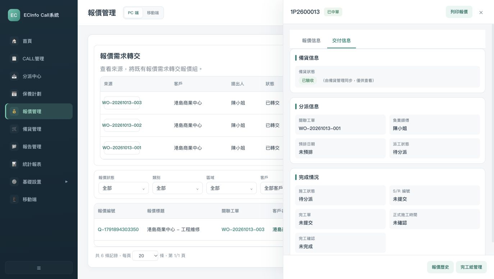

# 报价条款与交付入口局部整改复测

复核日期：2026-10-13
当前结论：交付分页面板重绘问题已修复；保固期与截止日期保存、清空、刷新及两个新增入口默认显示已局部复测。TASK-045继续进行中；材料断点、有效期细则和精确编号仍未解决，完整维修链未通过，暂不客户定稿。

关联：TASK-045、TASK-040；INT-20261013-06/07；UPD-013/023/024。本次仅修改当前prototype/index.html，不修改原件、既有业务决定或历史报价数据。代码修复和内部子项验证不代表客户批准、业务验收或冻结。

## 依据与边界

| 内容 | 依据位置 | 等级和判断 | 本次处理 |
| --- | --- | --- | --- |
| 新报价保固期默认1年，出现60天/90天有效期要求 | SOURCE-014：`materials/溝通筆記/ec+cs+報價組+會計0928.docx`，原文段落P22；UPD-013 | L3工作沟通整理有明确文字，客户身份及一期正式批准未补齐；不能由此选择60或90的默认、起算日及自动计算规则 | 沿用既有保固字段，新报价显示1年；取消未经确认的30/42天截止默认，保留截止日手填和原文提示 |
| 保修期改称保固期 | SOURCE-015：`materials/溝通筆記/ec原型+倉庫+cr0930.docx`，原文段落P14；UPD-023 | 明示名称，整理记录不等于全需求批准 | 修改对应报价详情、编辑、修订和打印模板名称 |
| 交付页可达 | TASK-045既有验收条件、INT-07初查及本次正常UI复现 | 内部交互缺陷，页面存在不批准其业务字段 | 修正列表重绘后分页面板事件绑定 |
| 精确OurRef、版本格式 | UPD-024、C-09、当前样例及初查INT-06 | 待核纸样/规则；已有编码不自动视为获批 | 未调整前缀、序列、001版本格式，历史报价不批量改写 |

P22/P14为项目提取的原文段落定位，非Word页码。截止日期测试值2026-12-12由内部手填，用于验证持久化，不是客户选择60天、自动计算结果或报价发送承诺。

## 实际修改

- 交付分页绑定抽为共用函数，详情直接打开和整页重绘均调用，同一面板避免重复绑定。
- 侧栏编辑补接既有warrantyPeriod字段；保固期和validUntil明确填写空值时可以清空，不再保留旧值。已有自定义保固值仍保留为可选项。
- 两个新增表单的有效期截止日期留空，停止自动给出30/42天；新来源请求报价及新表单按记录显示1年保固。历史对象不补写默认值。
- 打印模板缺截止日时显示“未設定”，移除“自报价日起30天”的无依据回退。打印/PDF本次仅代码核对，未完成输出和版式动态验证。

## 本地正常UI复测

独立静态服务18814，未启用仓库代理，未执行真实宜搭/仓库写入；没有从脚本注入业务状态。下列样例是已有本地测试数据，不是客户成交、签批或收货事实。

| 步骤 | 角色/操作 | 实际结果 | 证据：本目录evidence/ |
| --- | --- | --- | --- |
| 1 | QUO邹组长打开Q-1791894303350，修改列表每页20，再点击交付信息 | 修改前点击无效且aria-selected仍false，复现INT-07；修复后为true，未中单提示可见 | 51-delivery-refresh-before.png及DOM；52-delivery-refresh-after.png及DOM |
| 2 | QUO编辑同一报价，保固1年、截止2026-12-12并保存 | 详情显示新值，来源WO-20261013-003/CS请求、HKD1200和既有R1保留 | 53-quote-terms-saved-dom.txt |
| 3 | 刷新后打开编辑，再清空两字段、保存 | 刷新读回原值；清空后重新编辑读回空值；随后恢复内部测试值 | 54-quote-terms-cleared-dom.txt；55-final-quote-terms.png及DOM |
| 4 | 主列表新增报价，只检查表单后关闭 | validUntil为空，warrantyPeriod为1年；未保存或创建另一份报价 | 56-main-create-defaults-dom.txt |
| 5 | CR陈关系：CALL视图→WO-20261013-003→新建报价，随后取消 | 来源带入；截止日为空、保固1年可见；未创建重复报价 | 57-source-create-defaults.png及DOM |
| 6 | CR打开既有已中单1P2600013，列表每页20→交付信息→返回报价信息 | 分页双向可达，既有备货、分派和施工信息可见；没有据此认定数据或材料状态正确 | 58-won-delivery-refresh.png及DOM |
| 7 | 本次新检查页浏览器错误日志 | 未捕获error；不代替远端接口、全部入口及业务验收 | 59-quote-errors.json |

## 未解决事项与下轮动作

1. INT-07本次复现路径已修复，其他筛选、移动端及全部详情动作尚未全面回归。INT-06只关闭名称/字段承接和无依据有效期回退子项，不能整体关闭。
2. 有效期60/90如何选择、默认哪项、从哪日起算，须继续追溯已有确认或纸样；无证据再收敛为客户单项决定。既有保固候选仍含60/90天，未凭P22把它们认定为保固事实；与UPD-013的区分要求尚未完成，后续对照纸样整理选项。既有打印模板写“自完工日起计”的保固起算依据亦待追溯。打印/PDF和旧编辑入口完整保存未动态验证，新CS请求默认保固仅代码核对，不能记整项业务PASS。
3. 已中单样例仍有SP已验收/MR待备货断点。交付页把既有CALL负责人陈小姐显示为“负责师傅”，而无正式派工；这是内部数据映射待查，不把该显示认定为真实师傅或交给客户决定。TASK-040继续核对，不能绕过材料门槛去填现场/SR/完工/财务。
4. 多合同/JNO完整案例及完整岗位权限仍未验证。第一轮整改记录保留；本报告是下一组局部增量，不覆盖旧检查结论。
5. 推进表TASK-045记“进行中/已修改/未业务验收”；客户确认仍待确认。UAT-02只补对应报价子项证据，整体仍执行中；UAT-03仍未通过；冻结批次0。

技术复测由Codex负责。用户当前只需要判断材料核实问句是否清楚，见[一个材料例子](MR-DECISION-CANDIDATE.md)；不需要批准本报告的技术正确性或替客户指定材料岗位。

后续提问规则已由用户纠正：以上“只判断问句”是该次复测结束时的安排；当前先向用户核实现行业务，用户也无法回答的部分记录后再集中问客户。技术复测仍由Codex负责，本报告的代码和验收结果不因此变化。

## 三个入口同步核验

同一v2推进主台账共42个单元格更新，仍保留6张工作表、158条需求/参考行和45个任务编号；客户批准、客户签收和整体UAT结果未提高。日期/数字格式及任务表范围保留，13个首页原生链接目标有效，未发现公式错误。166个受保护原件/既有规则/原型配套文件哈希保持；只有本次允许的prototype/index.html变化。

Hub从本报告读取当前结论，首页与项目状态均显示单个材料问句和报价增量证据入口，未捕获浏览器error，见[当前展示](evidence/60-hub-quote-result.png)、60/61号DOM。SOURCE-026仅登记内部复测；39项沟通要求、80条历史REQ及原讨论决定身份/状态未改写。任务进度继续只在Excel维护。没有提交、推送、发布或对外发送客户问题。
