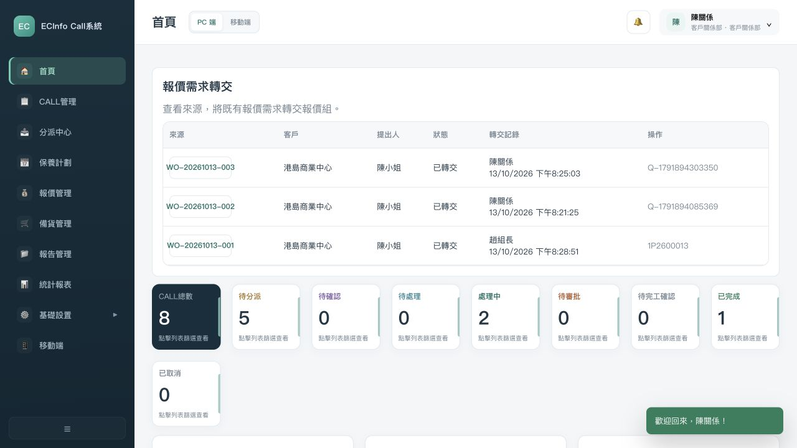
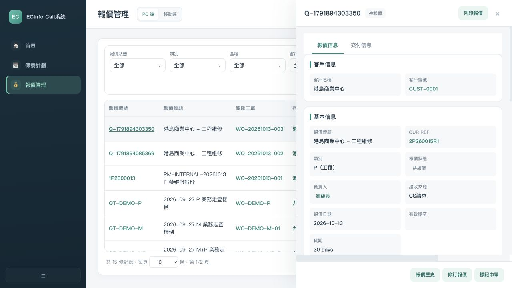

# 首批明确问题整改与内部复测

复核日期：2026-10-13  
当前结论：两组明确问题已修改并完成限定场景复测；完整维修链仍未通过，暂不组织客户定稿。  
范围：TASK-042、TASK-043；对应INT-20261013-01/03/04/08、UPD-006、REQ-005/043/045、CONFIRMED-008/009。用户授权Codex作为项目经理推进，用户确认具体成果；不是客户业务规则批准或业务签收。

## 修改内容与依据

只修改prototype/index.html和prototype/remediation.js。SOURCE-015 P40要求CR读取对应区域；9/27讨论明确CS请求交CR/主管再交报价组、由报价组制作。沿用既有请求对象、状态和处理函数，修复入口与关联；不新增审批策略。

- 普通CR使用所选人员的实际区域，首页、CALL列表、关联报价和分派保持读取范围一致；客户视图按已有地址区域过滤。保护CALL/报价详情入口。其他报表、仓务、移动端及全部操作权限仍需逐项检查，不宣称全权限矩阵完成。
- 修正客户联动对区域控件类型的判断，避免把输入框当下拉框读取options；保留原有地址策略，未新增强制首地址规则。
- CR/TL首页及报价页显示既有待转交请求，来源CALL可直接打开。来电请求从已有workOrderId追溯CALL，取得客户/区域；旧请求只在显示与匹配时追溯，未静默重写历史来源。
- 转交成功且找到关联报价后才记录已转交、责任人和时间；已有报价复用，失败保留待转交。QUO可被选为负责人，旧TL/ADMIN候选和历史负责人保留，角色清理仍待完整权限评审。
- 复测曾发现新请求报价缺少修订初始化，价格修改提示RNaN。仅对本次新创建请求报价初始化为既有R0基线；旧对象不批量改写。用另一个全新CALL重新验证保存为R1。OurRef精确前缀、001版本格式及默认策略仍待C-09，本轮未重设计编号。
- 脚本引用增加版本参数，避免页面更新后仍使用旧缓存脚本。

## 实际复测步骤

环境为独立18814静态服务与正常UI操作，样例只存本地浏览器；没有注入业务状态、启用仓库代理、真实仓库写入或客户接受签字。

| 步骤 | 操作                        | 结果与边界                                                                  | 证据（本目录evidence/）                                                                                   |
| -- | ------------------------- | ---------------------------------------------------------------------- | -------------------------------------------------------------------------------------------------- |
| 1  | 1区CR查看客户及首页               | 对应客户可见；首页按本区CALL计数；局部通过                                                | 23-cr1-customers-dom.txt、35-cr1-home-dom.txt                                                       |
| 2  | CS新增私人CALL选择已有客户          | 联系人、1区、已有地址继续填入，无原options异常；保存WO-20261013-002                          | 24-private-customer.png、DOM                                                                        |
| 3  | CS从全部来电申请报价               | 已申请标记出现，正常按钮撤除；本地通过                                                    | 25-cs-request.png、DOM                                                                              |
| 4  | 1区CR看到待转交并执行              | 状态变已转交，保留陈小姐提出、陈关系转交、时间及Q号                                             | 26-cr-request-pending.png、27-cr-forwarded.png、DOM                                                  |
| 5  | QUO接手002并保存               | 负责人候选有既有QUO；保存发现修订初始化缺陷，随即修正新请求创建；该中间样例不算最终通过                          | 28-quo-source-dom.txt、29-quo-owner-options.png、30-quote-edit-initial-dom.txt                       |
| 6  | 全新003重新申请、CR转交            | WO-20261013-003→Q-1791894303350，来源和记录对应；已转交无重复按钮。刷新后记录保留，队列可直接打开来源CALL | 31-final-new-call-dom.txt、32-final-forward.png、48-queue-source-open-dom.txt、49-final-queue.png及DOM |
| 7  | QUO以邹组长负责003报价、填物料与总价保存   | 来源CS请求与CALL保留，既有修订R1及历史R0/R1可见；本地通过。条款/编号定稿未通过                         | 33-final-quo-saved.png、34-revision-history.png、DOM                                                 |
| 8  | 1区CR读取CALL、报价、分派并筛选2区CALL | 正常记录按关联CALL区域；跨区筛选0条；限定场景通过                                            | 36-cr1-dispatch.png、37-cr1-calls-dom.txt、38-cr1-other-region-dom.txt、39-cr1-quotes-dom.txt         |
| 9  | 2/3区CR查看首页、CALL、报价、分派     | 各页按所选人员实际区域，1区请求不会出现；限定读取场景通过                                          | 40-cr2-*、41-cr3-*、region-post-summary.json                                                         |
| 10 | 主管赵组长转交已存在报价的001旧请求       | 复用1P2600013，完成转交且不创建重复报价；旧请求关联兼容已复测                                    | 44-tl-forward-final-dom.txt；42为修正前记录，不能作通过证据                                                       |
| 11 | 政府新增CALL选择客户，再取消          | 联系人、1区、地址及可编辑JNO可见；无options异常；未提交虚假政府业务                                | 43-government-customer.png、DOM、browser-errors-after.json                                           |
| 12 | 同一001查看材料和正式时间            | MR-1P2600013仍待备货，正式时间禁用，门槛保持。现场/SR/CP/完工/财务未执行                         | 45-material-gate-retained.png、DOM                                                                  |

## 问题和UAT状态

首轮8项记录保留在[初查快照](INTERNAL-REVIEW.md)。INT-01/03/04/08已按上述限定范围整改复测；INT-02材料衔接仍阻塞，INT-05合同/JNO完整案例、INT-06条款与编号、INT-07交付Tab仍待处理。CR其他模块、无关联CALL来电、夜班、全部动作与移动端未验证，不能整体关闭权限或请求业务。

UAT-02仍执行中：正常新请求接手、负责人及既有修订子项通过，其余异常和完整链未全验。UAT-11仍执行中：普通CR三名人员的主要读取场景已复测，其他岗位/动作/夜班未验；选择器候选、客户多区域字段与其他模块的数据范围还需核对，不能据此整体关闭跨区问题。UAT-03仍未通过：材料门槛和下游断点保留。UAT-16仍执行中：双语姓名子项已通过、客户控件局部复测，多合同等未全验。客户签收均保持待确认。

当前Gate 1/Gate 2不放行定稿，冻结批次仍为0。代码修复与内部子项通过不代替客户批准或业务验收。没有提交、推送或发布。

三个入口已同步：同一推进Excel回填任务/局部验收，Hub从本报告读取日期/版本结论并链接底层依据。Hub显示及状态链接检查见46/47号DOM和46号截图；知识主题统计不作为实时任务进度。

## 下一步由项目经理推进

本报告保留首轮整改快照。随后继续完成TASK-045部分报价整改：INT-07重绘后分页面板复测通过，INT-06条款字段部分承接，未决编号/有效期及整链仍未通过。当前增量结果见[报价条款与交付入口局部复测](QUOTATION-REMEDIATION-RESULT.md)；以下为首轮结束时的交接记录。

先准备[C-04材料确认与系统分工候选](MR-DECISION-CANDIDATE.md)，解释已有事实、可选方式及影响；未定分工不默认把SP验收映射为MR完成。并继续TASK-045报价条款/交付入口核对与TASK-040同一链的下半段准备。用户只确认本轮具体成果及成熟候选，技术排查由Codex完成。
