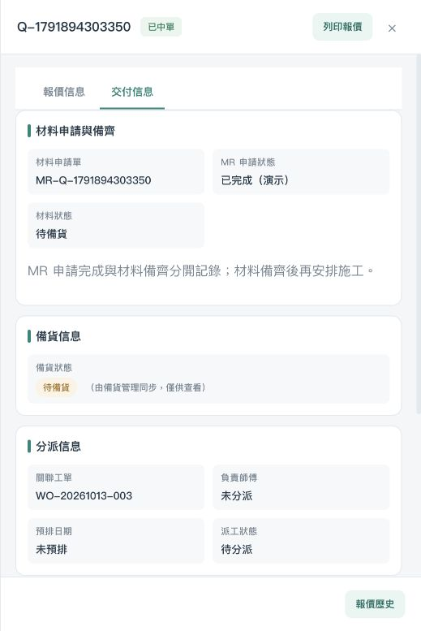
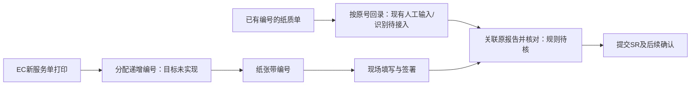

# 材料申请、备齐与首次派工核对及局部整改

复核日期：2026-10-14
当前结论：MR申请结果与材料备齐已分开展示；新MR按用户授权显示“已完成（演示）”，材料仍待备货。师傅误用CALL负责人已修正；PC和移动端首次派工补材料门槛。限定子项已复测，备齐回写、现场前服务单及整条维修链仍未通过，暂不客户定稿。

关联：TASK-040/041/044、C-02/04/08、RP-06～10、REQ-019/020/051/052/054、UPD-028/029。Gate 1/2不放行，客户签收未完成，冻结批次0。

## 本轮范围

- 当前：按用户说明核对仓管/仓库通→EC主管→师傅交接；修复明确的显示/首次派工缺陷，保留依据、正常UI复测和主台账。
- 后续：完整保养、标书、财务和跨流程例外按现有批次推进；真实集成和生产开发本轮不启动。
- 待确认：仓库通具体备齐结果/字段及EC承接方式、部分齐料/取消、出发前Service Report形式与准备人。
- 不做：不以MR审批完成/SP验收代替备齐；不新增EC仓管审批权限，不自动补全旧记录或真实仓库审批，不用种子单或直接改状态冒充完整维修验收。

## 重要事实与技术追溯

| 内容 | 来源/位置 | 证据边界 |
| --- | --- | --- |
| MR是申请；中单报价数据生成MR送仓库通；正常提交审批通过后状态回EC；演示直接MR已完成；之后仍可能采购/到货/出库 | 2026-10-14用户本轮原话，记录于SOURCE-022“用户业务说明：MR申请审批与备齐” | 项目用户直接说明，L3内部业务记录；演示捷径获明确授权，非正式客户批准或仓库真实审批 |
| 仓管仓库通确认备齐，主管EC中单/中标后可见待安排，备齐后施工；师傅带材料和Service Report | SOURCE-022前一轮用户原话；CONFIRMED-004/005工作基线 | 本次采用既有材料门槛并区分任务可见/正式派工，不扩大角色授权 |
| 既有演示仅EC→仓库通创建MR，没有备齐结果回读/回写EC的链路 | `docs/analysis/09-warehouse-tong-sync-demo.md` §2；`prototype/server.py` do_GET/do_POST；`mr-bridge/src/server.js`及mrService.js | GET只有health/materials；POST用于创建MR。server回执status是created/existing，不能当审批通过或材料备齐。未调用真实接口，未读取/改变线上状态 |
| 旧字段映射未定义备齐确认；完成日期、采购入库状态/数量不自动等于本单可施工 | `mr-bridge/src/fieldMap.js` MR_HEADER、PURCHASE_ORDER/ITEM（9/27静态取样） | 已有技术映射L3，非最新线上Schema，不从名称推导新业务规则 |
| 出发前服务单存在依据，但当前管理按钮只登记领取/完工，没有生成服务单 | SOURCE-022用户说明；旧SOP提取§阶段4/5；`prototype/index.html` manageCompletionPaper、renderWorkRecord、renderMobileProcessSheet | 旧SOP提取L3；完整Service Report打印/提前准备入口本轮未验证，未以完工纸“已领取”标志冒充已取得真实服务单 |

现有推送载荷的requestStatus来自旧材料状态字段，代理不消费该字段；不是仓库审批状态回写。本轮未改真实接口协议，后续应按审批/备齐两个维度核对协议。

## 修改与问题编号

| 编号 | 修改/发现 | 当前结果 |
| --- | --- | --- |
| MH-01 | 报价交付页、SR/CP报告摘要和移动CALL详情的师傅显示只读取master，不以CS/主管owner代替 | 代码已改；交付页空师傅及既有周师傅、主管移动详情未分派已复测；SR/CP报告摘要未全面动态验收 |
| MH-02 | 已中单交付页显示MR申请状态与材料状态；新MR本地requestStatus=已完成、requestStatusMode=DEMO，旧status仍承载旧材料状态，未把它改成审批完成 | 新MR“已完成（演示）/待备货”实测；旧MR显示“未记录审批结果/待备货”，不批量回填审批结论 |
| MH-03 | PC/移动首次正式派工检查材料门槛；已成交需物料但缺MR也不默认备齐。正式时间沿用同一材料检查，按钮禁用并说明原因；事件处理再校验 | 001/003已选师傅仍不能派工；预排不是正式派工，未新增备齐确认按钮。材料已就绪成功派工、缺MR异常及改派/定时/标书路径未全面动态验证 |
| MH-04 | 主管移动首页“查看”误跳派工页已分派空列表；待/已分派统计入口也未传正确Tab | 复用既有CALL详情入口修正查看，统计/派工入口传正确Tab；003详情可达、关闭可返回，待分派/已分派入口限定复测通过 |
| MH-05 | 仓库回传链路与出发前SR准备仍缺闭环 | 无真实回传、备齐字段/状态未明确；不启用死代码中的PUR/ADMIN本地就绪操作冒充仓管确认 |

只改prototype/index.html/remediation.js，脚本引用更新；不改server、mr-bridge、仓库Schema、原件和原权限表。没有提交、推送、发布或外发。

## 正常UI检查与证据

环境：18814静态服务。刷新后通过正常快速角色登录/切换人员，无脚本注入业务状态。03样例模拟成交备注明确写“本地内部模拟、非客户接受/签收”。中单动作沿用原自动POST，但静态服务返回501，无代理和真实宜搭写入；501是隔离环境限制，不判定线上接口故障。

| 场景 | 实际结果/边界 | 本目录evidence/ |
| --- | --- | --- |
| 原001交付页 | 改前把陈小姐显示为负责师傅；改后未分派，材料待备货、SP已验收分开可见 | 01-master-before.png/DOM；07-legacy-mr-no-backfill.png/DOM |
| 主管赵组长看001 | 分派中心可见任务；材料未齐，已选同区师傅，确认分派禁用；正式时间仍禁用 | 03-tl-pending-visible-dom.txt；04-tl-material-gate.png/DOM；05-formal-date-still-blocked-dom.txt |
| QUO邹组长对已有003报价模拟中单 | 来源CS请求/WO-20261013-003、R1/HKD1200保留；自动生成MR-Q-1791894303350，申请已完成（演示），材料待备货 | 06-new-mr-separate-status.png/DOM |
| 旧001记录 | 未给旧MR补“已审批”，未改为备齐；CALL仍待分派 | 07-legacy-mr-no-backfill.png/DOM |
| 已派师傅旧报价 | QT-20260621-004继续显示实际周师傅，不丢已有master | 08-assigned-master-retained-dom.txt（种子记录仅验证显示，非新链通过） |
| 新003申请完成后首次派工 | 主管PC确认分派仍禁用，申请完成未越过备齐门槛 | 09-new-mr-first-dispatch-blocked-dom.txt |
| 移动首次派工 | 待分派列表→003→选赵师傅，按钮仍禁用；没有提交派工或通知现场执行 | 10-mobile-material-gate.png/DOM |
| 最终首次派工/正式时间 | 最新共用材料检查下003首次派工仍禁用，正式时间仍禁用；禁用样式已灰显 | 11-final-first-dispatch-gate.png/DOM；12-final-formal-date-dom.txt |
| 主管移动查看/返回/入口Tab | 13为修正前跳空列表；14为修正后003CALL详情，师傅未分派，关闭返回主页；已分派0和待分派3入口对应 | 13-mobile-home-routing.png/DOM；14-mobile-home-detail-after.png/DOM；15-mobile-assigned-tab-dom.txt；16-mobile-pending-entry-after-dom.txt |

## 下一步

TASK-044保持进行中，记录已修改及局部验证，UAT-03仍未通过。先核仓库通真正“材料已备齐”的业务结果及EC对应显示，再形成可验证的状态承接；用户不清楚的部分才登记客户未决。接着核Service Report出发前准备，走同一来源链的派工/现场/SR/完工/交财务。移动查看入口的局部修正不代表整条移动业务已验收。既有范围和客户批准状态保持，技术定位由Codex负责。

## 三个入口同步自检

同一主台账更新30个单元格：TASK-040/041/044、UPD-028、C-02/04及UAT-03证据/执行日期。TASK-044原型修改由未整改改为已修改，任务仍进行中，业务验收仍未完成；UAT-03仍未通过，客户批准/签收不变。6张表、158条需求/参考编号、45个任务编号、表范围、日期/数字格式及13个首页原生链接保留，未发现公式错误。173个原件/决定/原型配套受保护文件哈希不变，允许变更仅prototype/index.html/remediation.js。

后续职责补充：同日用户倾向“仓管应该只负责出库，出库里确认材料是否备齐”，并明确要客户核实。此前仓管备货/最终确认的口述不再作为已确定职责；本轮代码/复测事实保留，原型没有采用出库完成放行逻辑。C-04问句与最新记录见[材料候选](../2026-10-13-b01-b02-internal/MR-DECISION-CANDIDATE.md)，规则为PENDING_CUSTOMER，尚未发送客户。

知识保存用户原话和演示边界，SOURCE-027登记本报告，Hub已显示10/14最新结论和材料整改证据入口，见17-hub-material-review.png及DOM。39项要求/80条历史REQ、原讨论记录及客户批准身份未重新判定。Hub页面检查未捕获error；原型本次新中单的501记录是静态环境限制，未据此宣称接口成功。过程解析/检查保留.codex，正式报告/引用证据在本目录。未提交、推送、发布或对外发送。

## Service Report出发前打印核对（2026-10-14）

这是随后一轮的需求/纸样核对，原型代码本轮没有修改。用户说明“正常希望可以系统打印出来。当然当前客户是纸质的单据”，原话与身份见SOURCE-022。本节补齐打印缺口的依据与验收输入，不把早前材料复测结果改成整链通过。

### 当前做法与目标

当前客户用纸质SR；目标在EC打印后由师傅带到现场。现场填写、签署及提交仍是后续动作，不能因为打印而变成已完成。系统打印是项目用户明确表达的目标，尚无客户正式范围签收。C-04材料放行职责仍待客户，打印准备可独立梳理。

| 核对对象 | 证据与位置 | 本轮结论 |
| --- | --- | --- |
| 原始SR纸样 | [IMG_20260608_185943.jpg](../../../materials/纸质材料图片/IMG_20260608_185943.jpg)，标题、编号、表格及页尾，已直接查看 | 是Service Report样例；右上预印编号为七位，样例内容不推定全量编号规则/必填 |
| 旧打印/领取描述 | `docs/analysis/flow-reference/quotation_flow_readable.md` L113～117、L289～312 | 旧团队SOP提取L3提及打印完工纸/取货，岗位按M/P分支不同，不证明本轮SR打印岗位或SR=CP |
| 同一维修来源主管详情 | `WO-20261013-003`正常UI进入，见[截图19](evidence/19-before-service-call-detail.png)与[DOM](evidence/19-before-service-call-detail-dom.txt) | SR未提交、材料待备货、正式时间禁用；该详情无出发前服务单打印按钮。没有绕过材料门槛或提交SR |
| 领取管理 | `prototype/index.html` 的 `manageCompletionPaper` | 只登记领取人/已完工；不生成/预览/打印文件 |
| 现场SR填写/提交 | `renderWorkRecord`、`handleTicketAction` 的 `submitResult` | 录入纸单编号，当前六位校验；不是出发前打印功能。完整现场路径本轮未执行 |
| 业务对象分歧 | `resolvePaperTypeByMaterial`、移动端强制服务报告、REQ-021/C-08 | 旧代码按材料/报价判CP、移动端目前用SR；适用清单未冻结，不靠代码选一种替客户定规则 |

### 纸样到原型的字段核对

以下是验收前核对输入，不是新的批准字段或预填规则。只登记纸样可见字段，不复抄客户联系方式/签名。

| 纸样项目 | 原型现有数据/字段 | 打印准备需要处理 |
| --- | --- | --- |
| 公司抬头/公司选择 | 人员公司、客户与业务主档可供查找 | 确认适用公司和模板，不从样例默认所有公司通用 |
| 报告编号 | `serviceReportNo`人工录入，六位校验 | 首先问用户编号来源，再核格式与重印一致性；旧七位样例不可被截断 |
| 客户、联系人、电话、地址 | CALL客户/地点/联系人 | 候选自动带入；合同/账号与多合同准确关联尚待验证 |
| 账号、合同/参考编号 | 客户/合同/JNO字段散在不同对象 | 查业务关联与字段含义，不把JNO、CALL号、合同号当同一号码 |
| 接报日期、接报人 | CALL创建时间、受理/历史记录 | 追溯真实受理，不默认当前负责人或打印时间就是接报人/日期 |
| 系统、服务目的 | 现场SR的系统/目的选项 | 出发前预填与现场填写边界待核，样例选项不自动等于必填 |
| 到达/完成时间、工作、跟进 | 现场记录现有字段 | 出发前打印应保留现场填写区；不预写尚未发生的到达/完成结果 |
| 技术员/客户签署、客户不能签署、满意度 | 现场表单/纸样已有对应内容 | 保留书写区域候选；纸样不批准缺签豁免或满意度必填 |
| 公司/会计/客户副本说明 | 纸样页尾三联说明 | 普通打印能否替代复写三联及份数需核实，不默认打印三份已满足原件要求 |

### 后续实现与验证条件

沿用TASK-040/041、REQ-021/027/031、C-08/09，不另建任务总表。编号来源先问用户；打印岗位与单据适用逐项核实后，形成对应权限/入口及字段预填方案。EC的打印入口、模板预览、打印操作、历史重印和旧编号兼容尚未实现/验收；本轮不改字段、编号校验、权限或状态。

后续用同一业务来源验证：正常角色找到出发前服务单→预览客户/合同/来源准确→现场区保留填写→实际打印/保存→再次打印编号不变→历史纸单仍可追溯→打印后工单/SR提交状态保持→现场填写/签署/上传再交下一岗位。材料未齐/未派师傅时能否打印及哪些角色可打印，先核实际规则，不强制推定门槛。当前UAT-03仍未通过，客户签收未变。

### 本次同步检查

主台账回填24个说明/依据单元格，关联TASK-040/041/044、REQ-021/027及C-08；任务/客户确认/UAT状态均未改变。6页、45个任务编号、158个需求/参考编号、表范围/合并/数字格式及13个首页原生链接保留，无公式错误；首页与受影响行已渲染检查。175个原件/决定/原型文件哈希不变，原型本次无代码变化。Hub来源路径检查通过，首页可见当前纸单、目标EC打印及下一问编号来源，见[截图20](evidence/20-hub-sr-print-target.png)与[DOM](evidence/20-hub-sr-print-target-dom.txt)，本次页面检查未捕获error。客户版v1不变，未发送客户、未提交/推送/发布。

## 人工SR编号与图片导入修正（2026-10-14）

本节对应随后用户回复：“正常还是以人工录入为准，当然纸质单据识别编号这个功能是需要的”，SOURCE-022保存原话。关联REQ-027/028、TASK-040/041、C-01/08/09、历史Q-022。编号来源已经回答；用户明确需求与客户一期范围批准分开，真实OCR尚未接入。

本次发现：`importServiceReportData`不读取图片文字，却将CALL数字尾六位作为SR编号，并补入示例系统/目的、完成工作、正常结果和满意度。既有人工值非空时部分字段保留，但空编号/现场字段会被虚构值填充；这不是纸单编号识别，不能继续作为真实上传结果。

修正范围：保持现有上传/示例图片入口及原图存档，去除图片导入对编号和现场字段的自动填充，明示编号人工输入、识别待接入。只改导入与提示，不改六位校验、SR/CP适用、权限、打印、工单提交/完工及历史数据。没有实现OCR，不新增远端识别接口或发送客户单据。

局部验收场景：用现有本地样例SR填写入口分别验证空编号上传后仍空、人工编号/工作记录重新上传后保持、图片预览确实更新且提示已上传，退出重进可保留、工单状态不改变。真实识别准确率/识别确认、同一维修003后续施工/完工均不在这次局部通过范围。正式操作证据将在执行后补入本节。

### 本次真实UI局部复测结果

角色：师傅周师傅。测试对象：既有本地合成样例`WO-DEMO-INSTANT`，不是新维修003，不是客户真实施工记录。正常快速登录→移动CALL→处理中→继续处理。该样例缺签到时间，报告步骤按既有前置不能进入；正常UI点击签到/打卡仅补本地模拟签到，再进入SR，未通过控制台注入数据/绕过前置。

| 场景 | 实际结果 | 证据 |
| --- | --- | --- |
| 空编号/空现场记录，点击示例图片 | 图片出现，编号、完成工作、跟进保持空；系统/目的与满意度不因图片自动选中 | [截图21](evidence/21-sr-empty-number-upload.png)、[DOM21](evidence/21-sr-empty-number-upload-dom.txt) |
| 人工填123456及明确“本地模拟/非真施工”工作和跟进，再走文件选择上传不同编号图片 | 本地虚构SVG图片标999999，上传后仍123456及原工作/跟进；仅更新图片/上传时间，未称识别成功 | [截图22](evidence/22-sr-manual-number-file-upload.png)、[DOM22](evidence/22-sr-manual-number-file-upload-dom.txt) |
| 关闭再继续处理并返回服务报告 | 人工编号和记录保留，原图可见；CALL仍处理中，未点提交/完工 | [截图23](evidence/23-sr-manual-number-reopen.png)、[DOM23](evidence/23-sr-manual-number-reopen-dom.txt) |

限定三组场景通过，页面检查未捕获error。没有上传真实客户纸单到识别服务；测试SVG仅在.codex。没有验证OCR、打印、服务器刷新后的表单回归、六位/七位兼容、SR/CP全部入口、多报告及同一维修003下游。旧记录的模拟填值不批量删除或改写。

### 本轮三个入口与保存检查

主台账更新25个依据/行动/局部结果单元格：REQ-027/028、TASK-040/041、C-08及首页。6页、45个任务编号、158个需求/参考编号、表范围/合并/数字格式和13个首页原生链接保留，无公式错误；首页/需求行已渲染核对。TASK-040/041仍进行中，客户批准及UAT结果不变，UAT-03仍未通过。此次受保护175个原件/决定/原型文件仅`prototype/index.html`按上述范围变化，其余174个哈希不变；脚本语法检查通过。SOURCE-022/027保存本轮依据/验证，Hub同步最新人工编号规则与待接入识别边界；录号时点已向用户提问，尚未回答不自动登记客户问题。客户版v1不变，没有提交/推送/发布、外发客户或接入OCR服务。

## 新打印自动递增与已有纸单回录（2026-10-14）

随后用户进一步说明纸张已有对应编号、以前手动修改也在打印前，现在打印可以自动递增。原话保存在SOURCE-022。本节是当前解释；上一节人工编号的解释与局部上传证据保留为历史，不能继续限制新打印必须手工录号。

| 场景 | 当前依据/目标 | 实现与未决 |
| --- | --- | --- |
| 新服务单由EC打印 | 打印前分配自动递增编号，纸张带号；不需师傅对每张新单编号码 | 打印与递增尚未实现；格式、起点、公司号段/旧纸号衔接、重印/作废与岗位仍待核 |
| 已有纸质服务单上传/回录 | 纸上已有原编号，识别该编号是用户明确需求；原单身份保留 | 当前人工输入可用，OCR未接入；确认/覆盖、失败/重复处理未定，不自动分配新号覆盖旧号 |
| 上传与现场结果 | 上传不是新单打印，不以CALL号生成SR编号/现场结论 | 上轮局部修正保留；打印自动号不撤销该修正，不提前提交/完工 |

新打印正常路径验收需验证不同新单编号递增且不重复、打印页/系统/现场回录一致、取消预览/失败打印不会错配、重印按获确认规则处理、旧纸号保持、历史修改可追溯。这里列的是待准备的验收场景，尚未执行；不自行决定何时消耗号段或重印必须加1。下一小问题先核新打印是否沿用七位数字；客户未决不因用户尚未回复增加。

本轮原型只更新上传提示，区分“已有纸单按原号回录”与“EC新打印目标自动递增”，仍明示打印/识别未接入。没有创建序列、改变六位校验、分配旧记录编号或新权限；完整维修003及客户验收未通过。

本次保存与查看检查：主台账更新21个说明/依据单元格，关联REQ-027/028、TASK-040/041、C-08/09与首页；6页、45任务/158需求参考编号、表范围/合并/数字格式及13原生首页链接保留，无公式错误，首页已渲染检查。任务与客户/UAT状态未改变；受保护175文件仅原型index的一条提示按本轮范围变更，其他174哈希保持。正常师傅入口刷新后进入既有本地WO-DEMO-INSTANT，提示显示两个编号场景，原123456及模拟工作/跟进仍保留、CALL仍处理中，未提交/完工，未捕获页面error；见[截图24](evidence/24-sr-print-increment-explanation.png)及[DOM24](evidence/24-sr-print-increment-explanation-dom.txt)。这只验证提示与已有记录保持，未验证新序列/打印/OCR，也不重算旧上传修正为本轮新增。客户版v1不变，无提交/推送/发布或外发客户。

## 七位编号候选与纸单回录兼容（2026-10-14）

用户选择“先沿用7位数，新单加1”，并明确具体记录后下次问客户，原话见SOURCE-022。候选为ASSUMPTION/PENDING_CUSTOMER，C-09收口编号细则，不再继续问用户同一格式/起点。实际七位纸样仅支持回录完整号，不证明系统起点或自动发号机制。

本轮范围：修复SR输入上限/提交校验仅接受六位的问题，使既有七位纸单编号可完整回录并保留前导零；兼容旧六位样例原号，不批量补零、重写历史或批准新单六位格式。候选提示明确新打印七位/新单加1待客户、起点未定；打印、序列和OCR尚未实现，CP编号与其权限/状态不变。

C-09客户待确认问句：拟沿用七位数字，每张新服务单加1。请确认正式规则、EC从哪个号开始、与仍在使用的纸单号段怎样衔接；重印/打印失败/作废是否产生新号，是否按公司分号段？现有依据为原SR纸样、0702历史编号与用户最新候选，缺少正式客户规则；不内部指定起点或重印策略。此问句仅准备，尚未发出。

局部验收：正常师傅入口回录合成七位`0123456`，上传图片/关闭重进后号码原样保留；六位旧样例仍可保持；空值/非数字不被当有效SR编号。完整提交与自动递增/打印测试另记，不能通过保存输入就标业务验收通过。

本次执行结果：周师傅正常UI进入已有本地WO-DEMO-INSTANT，原六位123456刷新后仍原样显示，输入上限为7、模式为6/7位（见[DOM25](evidence/25-sr-six-digit-legacy-dom.txt)）。暂输12A4567时输入模式不匹配；随后换为合成0123456，上传示例图片再关闭/重进，七位及前导零保持、模式匹配、CALL仍处理中、原模拟工作/跟进保留，见[截图26](evidence/26-sr-seven-digit-reopen.png)及[DOM26](evidence/26-sr-seven-digit-reopen-dom.txt)。未捕获页面error；没有点完成提交，空值提交及完整提交路径未执行，提交编号守卫仅代码/语法检查。没有自动分配号或检验递增成功，旧真实/历史记录不批量修改。

保存自检：主台账更新20个依据/候选/下一步单元格，REQ-027、TASK-040/041、C-08/09及首页；6页、45任务/158需求参考编号、表范围/合并/数字格式及13首页原生链接保留，无公式错误，受影响首页/需求行已渲染核对。原件/决定/原型175受保护文件仅index按本节范围变化，其余174哈希保持；任务/客户批准/UAT状态不变，UAT-03仍未通过。C-09知识状态转PENDING，仍为既有16个主题，不新增客户问题台账；Hub按本节/最新原话同步。客户版v1不变，未发客户、提交/推送/发布或接入真实OCR。

## 师傅公司领单与交付岗位候选（2026-10-14）

用户说明师傅到公司领取对应Service Report再去客户现场，“应该”向CR/主管领取，并要求记录后自行与客户确认。原话/判断保存在SOURCE-022。公司领单先于现场服务是用户实际做法说明；交付岗位CR/主管为ASSUMPTION/PENDING_CUSTOMER，归既有C-08，不默认两岗位都拥有打印/发号/重印权限。原型本轮无变化。

### 三个环节分别核对

| 环节 | 已有依据/当前结果 | 仍需闭环 |
| --- | --- | --- |
| 出发前准备与领单 | 用户说明师傅公司领纸单；现有编号纸单与目标EC打印两路径已整理 | C-08交付/准备/打印责任人；C-09正式格式/起点/重印；原型打印入口不存在，领取登记不能替代真实纸单 |
| 现场填写与签署 | 现有SR表单及原纸样；七位回录/前导零保持局部修复 | 同一维修003尚未到现场；SR/CP适用、照片/签名替代证据及真实交接仍未验收 |
| 回录、提交与资料交下一岗位 | 上传不虚构编号/现场结论局部修正保持；既有师傅提交→CR/主管完工确认→财务资料链 | 纸单/电子记录准确关联、欠件/退回及同源全链未通过；领单不等于提交、完工或已交财务 |

### C-08纸单交接客户待确认子项

- 问题：师傅出发前到公司领对应Service Report，是否通常由CR/主管交给师傅？请说明实际准备/保管/交付岗位，EC上线后的打印岗位，以及服务类型是否影响职责。
- 为什么内部无法定：用户只给出“应该”且明确后续客户确认；旧团队SOP提取按M/P分别提及CR/Project主管，不能替代客户实际岗位或证明SR与完工纸一致。
- 现有证据：SOURCE-022最新原话；原SR纸样185943；旧`quotation_flow_readable.md` L289～312的准备/领取角色（L3）；现有领取管理仅登记，不证明打印权限。
- 候选：CR交付、主管交付或按业务分工，由客户确认实际做法；没有选择正式规则。
- 影响：REQ-021/027、FLOW-P、师傅、CR/主管及打印/资料管理；交接和权限定稿受影响，但不阻止现有资料/技术核对。
- 状态：PENDING_CUSTOMER；问句已准备，未发送、未签批，不重复向用户追问同项。

本轮仅记录/梳理并回填主台账；不新增领单按钮、权限、强制回公司、纸单出库状态或通知。不把既有七位回录/上传修正再算成本轮新增，客户版v1与完整维修003/UAT结论保持。

本次保存检查：主台账18个说明/依据单元格更新，关联TASK-040/041、REQ-021及C-08，任务与客户/UAT状态未改，UAT-03仍未通过；6页、45任务/158需求参考编号、表范围/合并/数字格式及13首页原生链接保留，无公式错误，首页和受影响需求行已渲染检查。原件/决定/原型175受保护文件哈希全部不变，原型本轮无代码变化。C-08知识主题转PENDING，原有16个主题编号保留；准备/现场/回交对照是资料成果，不是业务验收。未提交/推送/发布、外发客户或修改客户版v1。

Hub路径检查通过；C-08详情已实际显示PENDING、师傅公司领单说明、交付CR/主管候选、待核打印岗位及SOURCE-022/027来源链接，页面检查未捕获error，见[截图27](evidence/27-c08-paper-handoff-pending.png)与[DOM27](evidence/27-c08-paper-handoff-pending-dom.txt)。知识更新与项目进度分开，不把问题进入Hub当作客户确认或原型完成。

## 出发前打印继续核对：资料来源与现场空白区（2026-10-14）

当前单据分流按SOURCE-022后续说明：成交维修CP、保养/CALL上门SR；派工备注交接时间/事项，不另强制预约日期。已再次直接查看原SR纸样IMG_20260608_185943.jpg的抬头/编号、客户/合同、接报、系统/目的、到达/完成、工作/跟进、签署和三联说明；仅核字段，不复制真实客户手写内容或签名。

本轮进一步对照当前代码与已完成002：报价交付有CP123459及主管确认记录，按钮“列印報價”生成的是报价，不是出发前CP/SR；manageCompletionPaper仅状态登记，不能当作实际领纸单或打印证据。没有新增打印权限、号码或领取状态。

| 打印项目 | 本轮可追溯数据 | 实现前边界 |
| --- | --- | --- |
| 单据类型/来源 | CALL关联成交报价、保养计划/每期；当前requiresCompletionPaper分支 | 分别准备CP/SR，不能用报价打印替代服务纸单；二次维修保留前期SR，不覆写历史 |
| 客户/现场/联络 | 当前CALL客户、地址、contact/phone及customerId | 预填候选可按本次任务；多合同准确来源未验，不从样例补客户信息 |
| SR账号/Contract Ref | 客户与合同字段、纸样独立两栏 | customerId/JNO/报价号不自动等同纸单账号/合同号；缺少对应值保留未定 |
| CP维修清单 | 最终接受版本acceptedItems，缺快照时已有items仅兼容 | 要保留源报价/版本，不能打印正在修订的新行；真实CP版式仍需选定核实，不能把SR纸样改标题充当CP |
| 接报日期/接报人 | CALL创建/history与createdBy；已有createdBy有角色码/历史CS值 | 需校核真实受理来源，不能用当前师傅/当前时间冒充接报人/日期 |
| 派工事项 | assignNote原文，主管通常电话沟通 | 可作交接说明，不从文本生成已确认日期或“电话已确认” |
| 编号/重印 | 已有SR/CP原号；SR七位+1为用户候选 | C-09起点/号段/失败重印/作废待客户；CP格式不能套SR；当前不从真实号段发号 |
| 到达、完工、工作、跟进及签名 | 原纸样现场区及当前现场记录字段 | 出发前均属尚未发生的内容，应留现场填写，不预写完工结果或签署 |
| 抬头/联数/岗位 | 原SR纸样含多公司选框/三联，旧SOP分支写不同打印岗位 | 公司模板、联数及C-08实际打印/交付岗位仍待核；不默认所有角色全权限或三份普通打印等价原件 |

下一可执行工作：基于已明确数据准备只读样张与对照，再逐项核未定账号/合同、CP模板和既有C-08/09细则；打印本身不改变工单/材料/SR/CP提交或完工状态。当前仅完成来源与边界核对，未实现新打印/递增/OCR/领取闭环，材料003及UAT-03仍未通过。
